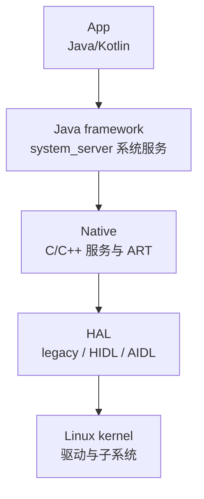
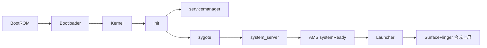
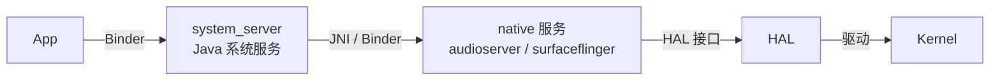
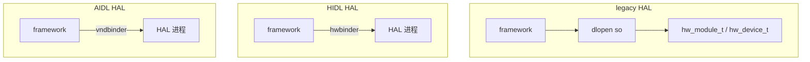
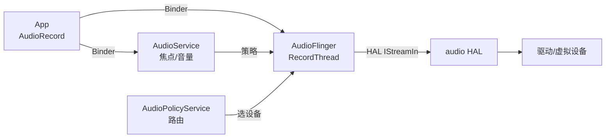

# 写在前面

说明：本文由面试回忆整理，写作过程使用了 AI 辅助（资料核对、结构整理、文字润色），不保证逐字还原面试对话；文中的参考答案仅供复习参考，具体以官方文档与源码为准。

一面里，面试官顺着实习经历问 ROM 侧改动，然后连续追问系统层面的问题：Android 分几层、启动流程是什么、Framework 到底负责什么、HAL 有几种、音频几个服务怎么分工。我答得不利索，中间还改了口。

这篇按“问题、我的回答、参考答案、相关知识点”四段组织，每个问题一章。相关知识点是重点，会把机制、源码位置、调用链和容易混淆的地方展开。公司名与面试官信息不写，回答只保留大意。

内容以 AOSP 官方文档与源码为准，涉及版本差异的地方单独标注。

# Android 分几层

## 问题

“你说说 Android 系统分几层，每层大概做什么。”

## 我的回答

我当时说的是“kernel、aidl/hidl、framework、native、app”，把 HAL 说成了 AIDL/HIDL，又把 framework 和 native 的顺序说反。后面纠正了顺序，但没有纠正 HAL 那一层。

## 参考答案

从下往上五层：

| 层 | 主要内容 | 语言/形态 |
|---|---|---|
| Linux kernel | 驱动、内存、调度、文件系统、Binder 驱动 | C |
| HAL | 硬件抽象接口，legacy、HIDL、AIDL | C/C++，AIDL 接口 |
| Native | native libraries、ART 运行时、native 服务 | C/C++ |
| Java framework | 系统服务（AMS、WMS、PMS、AudioService 等） | Java/Kotlin |
| App | 应用 | Java/Kotlin |

HAL 是层，AIDL 和 HIDL 是这一层用的接口描述工具。把工具当层，就会出现“这一层叫 AIDL”这种说法。

## 相关知识点

### 分层依据

分层不是随便切的，依据是抽象层次与稳定接口：

- Kernel 提供系统调用与驱动接口，向上隐藏硬件差异。
- HAL 提供硬件抽象接口，向上隐藏具体芯片与外设的实现。
- Native 提供 C/C++ 运行时与服务，向上提供性能敏感的能力。
- Framework 提供 Java 系统服务与 API，向上提供应用可用的能力。
- App 提供业务功能。

每一层都假设下一层是稳定的。HAL 的接口稳定，Framework 才能跨设备复用；Framework 的 API 稳定，App 才能跨版本运行。

### HAL 是层，AIDL/HIDL 是工具

AIDL（Android Interface Definition Language）和 HIDL（HAL Interface Definition Language）都是接口描述语言：

- AIDL 最早用于应用与系统服务之间的 Binder 通信，后来扩展到 HAL。
- HIDL 是为 HAL 设计的接口语言，跑在 hwbinder 域，Android 13 起弃用。

HAL 这一层的实现可以是：

- legacy HAL：一个 `.so`，通过 `hw_get_module` 加载，同进程调用。
- HIDL HAL：独立进程或 passthrough 模式，接口用 `.hal` 定义。
- AIDL HAL：独立进程，接口用 `.aidl` 定义，跑在 vndbinder 域。

所以“HAL 有几种形态”和“HAL 是第几层”是两个问题。层只有一个，形态有三种。

### Native 与 Framework 的边界

这两层最容易混，因为都叫“框架”。

- Native 是 C/C++ 的世界：`libc`、`libbinder`、`libaudioflinger`、`surfaceflinger`、ART 运行时，以及 `audioserver` 这类 native 服务。
- Java framework 是 Java 系统服务：AMS、WMS、PMS、AudioService，跑在 `system_server` 里。
- JNI 是两者之间的桥：Java 服务通过 JNI 调 native，native 通过 JNI 回调 Java。

我的实习工作在 `frameworks/av`，是 C++ 代码，属于 native 层的音频子系统。把它说成“framework 层”不算完全错，因为目录名带 frameworks，但它不是 Java framework。面试时我把这两件事混在一起，越解释越乱。

### 进程边界不等于分层

分层是逻辑划分，进程是运行实体。同一个进程可以承载多层：

- `system_server` 是 Java 进程，承载 AMS、WMS、PMS、AudioService 等几十个 Java 服务，里面也有 native 代码。
- `audioserver` 是 native 进程，承载 AudioFlinger 和 AudioPolicyService。
- `surfaceflinger` 是独立 native 进程，负责合成。
- `zygote` 是 Java 进程的模板，本身不是某一层。

所以回答“某功能在哪层”时，最好同时说清“在哪个进程、用什么语言、通过什么接口通信”。

### 源码位置

| 层 | 目录 |
|---|---|
| Kernel | `kernel/`（独立仓库） |
| HAL | `hardware/interfaces/`、`hardware/libhardware/` |
| Native | `frameworks/av/`、`frameworks/native/`、`system/core/`、`art/` |
| Java framework | `frameworks/base/services/`、`frameworks/base/core/java/` |
| App | `packages/apps/`、`vendor/`、`data/app/` |




### ART 运行时在哪一层

ART 是 Android 的运行时，负责执行 dex 字节码。它属于 native 层，不是 framework：

- 应用代码编译成 dex，安装时由 `dex2oat` 提前编译成 oat，运行时由 ART 执行。
- ART 支持 AOT、JIT、解释执行三种模式，按配置组合。
- ART 的 GC、线程、栈管理都在 native 层实现，Java 层通过 JNI 与它交互。

把 ART 放错层，会连带把“Java 代码都跑在 Java 层”这句话说错。Java 代码由 ART 执行，ART 本身是 C++。

### Treble 与 VNDK

Android 8 引入 Treble，把 system 分区与 vendor 分区解耦：

- system 分区放 framework 与系统服务，由 Google 或方案商维护。
- vendor 分区放 HAL 与厂商驱动，由芯片或设备厂商维护。
- 两边通过稳定的 HAL 接口与 VINTF 声明通信。

VNDK（Vendor NDK）是给 vendor 用的 native 库白名单。vendor 代码只能依赖 VNDK 里的库，不能直接用 system 私有库，否则升级 system 时会崩。

对开发者的影响是：改 HAL 要考虑接口稳定性，改 framework 不能随便动 vendor 依赖的 ABI。

### 容易混淆的几组概念

| 说法 | 问题 | 更准确的说法 |
|---|---|---|
| HAL 是驱动 | HAL 是接口层，驱动在内核 | HAL 调用驱动，或直接操作硬件 |
| Binder 是第五层 | Binder 是 IPC 机制 | Binder 驱动在内核，库在 native，接口在 framework |
| Zygote 是系统服务 | Zygote 是进程模板 | Zygote 是 app 与 system_server 的父进程 |
| Framework 就是 UI | Framework 是系统服务层 | UI 只是它对外能力的一部分 |

这些混淆在面试里很常见，纠正的方法不是背定义，而是把“层、进程、机制”三个维度分开说。

### 版本差异

分层本身稳定，但每层的内容随版本变化：

- Android 8：Treble，HAL 开始独立进程。
- Android 10：ATMS 从 AMS 拆出，分区存储。
- Android 12：SplashScreen、更严格的 exported。
- Android 13：HIDL 弃用，AIDL HAL 成为默认。
- Android 14：前台服务类型、更严格的权限。

面试时说“以 Android 14 为基准”比说“Android 都这样”稳。


### Android 与 Linux 的关系

Android 不是一套独立的操作系统内核，它用 Linux 内核，但在用户态另起了一套运行时与框架：

- 内核用 Linux，加上 Android 特有的补丁与驱动（Binder、ashmem、低内存 killer）。
- 用户态不用 GNU 的 glibc，用 bionic；不用传统 init，用 Android init。
- 图形、音频、多媒体都有自己的 native 服务，不依赖 X11、ALSA 的完整栈。
- 应用运行在 ART 上，不是直接跑 C 程序。

所以“Android 是 Linux”只说对了一半：内核是 Linux，用户态是另一套东西。面试时把这两句分开说，能避免很多追问。

### 延伸追问

- “HAL 和驱动有什么区别？”HAL 是用户态的接口层，驱动在内核；HAL 通过系统调用或设备节点访问驱动，也可以直接操作寄存器。
- “Binder 属于哪一层？”Binder 驱动在内核，库在 native，AIDL 接口在 framework 与 app 之间，它不是一个层，是贯穿多层的机制。
- “ART 在哪一层？”native 层，C++ 实现，负责执行 dex。
- “Treble 解决什么问题？”把 system 与 vendor 解耦，让 framework 与 HAL 可以独立升级。


### 分层速查

| 层 | 运行形态 | 语言 | 对外接口 |
|---|---|---|---|
| Kernel | 内核态 | C | 系统调用、设备节点 |
| HAL | 独立进程或同进程 | C/C++ | HAL 接口（AIDL/HIDL） |
| Native | 进程或库 | C/C++ | native 库、Binder 服务 |
| Framework | system_server | Java/Kotlin | 系统服务 API |
| App | 应用进程 | Java/Kotlin | 用户界面 |


### Binder 为什么不算一层

Binder 是 IPC 机制，横跨三层：

- 内核：`/dev/binder` 驱动，负责一次拷贝、路由、线程管理。
- native：`libbinder`，提供 `BpBinder`、`BBinder`、`Parcel`。
- framework/app：AIDL 生成的 Proxy 与 Stub，让远程调用看起来像本地调用。

把 Binder 当层，会漏掉它在三层都有实现这个事实。面试时正确的说法是“Binder 是贯穿内核、native、framework 的通信机制”。


### Android 版本与分层变化

| 版本 | 年份 | 分层相关变化 |
|---|---|---|
| Android 5.0 | 2014 | ART 取代 Dalvik |
| Android 8.0 | 2017 | Treble，HAL 独立进程 |
| Android 10 | 2019 | ATMS 从 AMS 拆出 |
| Android 12 | 2021 | SplashScreen、更严格的组件导出 |
| Android 13 | 2022 | HIDL 弃用，AIDL HAL 默认 |
| Android 14 | 2023 | 前台服务类型、权限收紧 |

版本变化主要影响 HAL 的形态与系统服务的拆分，五层结构本身没变。


### 这题怎么答

先给层数与名称，再给每层一句话职责，最后补一个进程例子。比如“五层：内核、HAL、native、framework、app；内核管硬件，HAL 管接口，native 管运行时与服务，framework 管系统服务，app 管业务；system_server 承载 Java 服务，audioserver 承载音频 native 服务”。这样即使细节记不清，骨架也不会散。

# 启动流程

## 问题

“从按下电源到桌面显示，Android 的启动流程是什么？”

## 我的回答

我当时说的是：

- BootROM 加载硬件 ROM 代码，然后跳转内核。
- 内核启动文件系统、调度，创建 init。
- init 初始化类和资源，加载 rc 文件，按顺序创建服务。
- zygote 是所有 app 的父进程。
- Launcher 由 AMS 的 systemReady 启动，依赖 PMS 绘制 UI，又改口说 WMS。

错在三处：init 不做“初始化类和资源”，那是 zygote；没提 init 启动 zygote，也没提 zygote 的 socket 监听；Launcher 的依赖说成 PMS 或 WMS，实际是 PMS 解析 HOME Intent、WMS 管窗口、SurfaceFlinger 合成。

## 参考答案

1. BootROM：芯片内固化代码，初始化最小硬件，加载 Bootloader。
2. Bootloader：初始化 DDR、存储、显示，校验并加载 kernel 与 DTB，跳转内核入口。
3. Kernel：初始化内存管理、调度、中断、驱动，挂载根文件系统，启动第一个用户态进程 init。
4. init：解析 rc 文件，处理属性与 SELinux，启动 servicemanager、zygote、audioserver 等 native 服务。
5. zygote：创建 ART 运行时，预加载常用类与资源，监听 socket，等待 fork 请求。
6. system_server：由 zygote fork，启动 AMS、PMS、PowerManagerService、WMS、AudioService 等服务。
7. Launcher：AMS 在 systemReady 后解析 HOME Intent，启动桌面应用，SurfaceFlinger 合成上屏。

## 相关知识点

### BootROM 与 Bootloader

BootROM 是 SoC 内部固化的代码，负责最基础的硬件初始化，然后从存储介质加载下一阶段。它通常只认几种固定的启动介质，比如 eMMC、UFS、SD 卡、USB。

Bootloader（U-Boot、LK 或厂商私有的 loader）做这些事：

- 初始化 DDR、存储、显示、串口。
- 读取分区表，加载 `boot.img`、`vendor_boot.img`、`dtbo.img`。
- 校验镜像（AVB），失败时进入 fastboot 或 recovery。
- 把内核、DTB、ramdisk 的地址传给内核，跳转。

启动时间优化经常从这一段开始，因为 Bootloader 的串口打印、USB 探测、显示初始化都很耗时。

### Kernel 初始化

内核入口是 `start_kernel`，依次初始化：

- 内存管理、调度器、中断、定时器。
- 架构相关代码（`setup_arch`）、设备树展开。
- 驱动模型、总线、早期 console。
- 挂载根文件系统，执行 `/init`。

内核初始化完成后，`kernel_init` 会尝试执行 init 程序。如果失败，会进入 panic 或尝试其他路径。

### init 的三个阶段

官方文档把 early init 分成三个阶段：first stage init、SELinux setup、second stage init。

first stage：

- 挂载 `/proc`、`/sys`、`/dev` 等基础文件系统。
- 加载 SELinux policy。
- 设置基础属性，处理内核命令行。
- 准备 second stage 需要的环境。

SELinux setup：

- 根据 policy 设置初始域。
- 决定后续服务的访问控制。

second stage：

- 解析 `/system/etc/init/`、`/vendor/etc/init/` 下的 rc 文件。
- 按触发器（`early-init`、`init`、`boot`、`property`）启动服务。
- 启动属性服务、uevent 处理、子进程回收。
- 启动 `servicemanager`、`zygote`、`audioserver` 等 native 服务。

`servicemanager` 必须早于 zygote，因为 Binder 服务的注册与查询都依赖它。zygote 启动时就要通过 Binder 与系统交互，没有 servicemanager 就会卡住。

### zygote

zygote 的入口是 `app_process`，它启动 ART 运行时，执行 `ZygoteInit.main`：

- 预加载常用类与资源（`preloadClasses`、`preloadResources`）。
- 注册 zygote socket（`/dev/socket/zygote`，由 init 创建）。
- 进入 `runSelectLoop`，等待 fork 请求。

收到请求后，zygote fork 出子进程，子进程执行 `specialize`：

- 设置 uid、gid。
- 设置 SELinux 域。
- 设置 capabilities。
- 关闭不需要的 fd。

用 fork 而不是 exec，是因为 fork 能继承预加载好的 ART、类和资源，省去重复初始化。代价是 zygote 的内存被所有子进程共享（写时复制），zygote 本身不能随便改状态。

### system_server

zygote fork 出 `system_server`，入口是 `SystemServer.main`，然后 `run` 里分三批启动服务：

- `startBootstrapServices`：ActivityManagerService、PackageManagerService、PowerManagerService、ActivityTaskManagerService 等。
- `startCoreServices`：WindowManagerService、BatteryService、InputManagerService 等。
- `startOtherServices`：AudioService、NetworkManagementService、TelephonyRegistry 等。

三批的顺序有依赖关系：PMS 要在 AMS 之前准备好包信息，WMS 依赖 AMS 的窗口令牌，AudioService 依赖 AudioPolicyService 的 native 服务。启动完成后，`AMS.systemReady` 与 `PMS.systemReady` 被调用。

`system_server` 崩溃会被 zygote 发现，zygote 重启，表现为设备软重启。

### Launcher

`AMS.systemReady` 之后，系统解析 `Intent.CATEGORY_HOME`，按 priority、默认设置或 RoleManager 选出桌面应用，然后 `startActivity`。Launcher 的进程同样由 zygote fork，是一个普通 app 进程，只是带了 persistent 属性或默认角色。

窗口创建后由 WMS 管理，SurfaceFlinger 负责合成上屏。PMS 只负责解析 HOME Intent 的目标，不负责绘制。

### 调用链与源码位置

| 阶段 | 源码位置 |
|---|---|
| init | `system/core/init/` |
| zygote 入口 | `frameworks/base/cmds/app_process/app_main.cpp` |
| Zygote 初始化 | `frameworks/base/core/java/com/android/internal/os/ZygoteInit.java` |
| system_server | `frameworks/base/services/java/com/android/server/SystemServer.java` |
| AMS | `frameworks/base/services/core/java/com/android/server/am/ActivityManagerService.java` |
| PMS | `frameworks/base/services/core/java/com/android/server/pm/PackageManagerService.java` |




### 属性系统

属性是 Android 启动期的全局键值存储，由 init 管理：

- `ro.` 开头是只读属性，启动后不能改。
- `persist.` 开头会持久化到 `/data/property`。
- `sys.` 开头是运行时状态，可读写。
- 普通属性放共享内存，读取很快。

rc 文件里可以用 `on property:xxx=yyy` 定义触发器，属性变化时执行对应动作。很多服务不是固定顺序启动，而是等某个属性就绪后再启动。

属性也是排查启动问题的重要线索：`getprop` 能看到当前值，`dmesg` 里能看到属性设置的失败。

### init.rc 的基本语法

rc 文件由几类语句组成：

```text
# 定义一个服务
service audioserver /system/bin/audioserver
    class main
    user audioserver
    group audio camera
    ioprio rt 4
    socket audioserver 0660 audioserver audio

# 定义一个触发器
on boot
    start audioserver
    write /proc/sys/kernel/panic 10
```

- `service` 定义可执行文件、用户、组、socket、权限。
- `on` 定义触发器，常见的有 `early-init`、`init`、`boot`、`property`。
- `class_start main` 启动某一类服务。
- `import` 引入其他 rc 文件。

服务崩溃后是否重启，由 `oneshot`、`disabled`、`restart` 等选项决定。`audioserver` 这类关键服务通常会在崩溃后被 init 拉起。

### 启动优化

启动时间是产品指标，优化要分段测量：

- Bootloader 阶段：串口打印、USB 探测、显示初始化。
- Kernel 阶段：驱动 probe、deferred probe、文件系统挂载。
- init 阶段：rc 解析、服务启动、属性设置。
- zygote 阶段：预加载类与资源、GC。
- system_server 阶段：服务启动顺序、同步 Binder 调用。
- Launcher 阶段：布局、资源加载、首帧。

测量工具包括 `boot_progress` 事件（logcat 里的时间戳）、bootchart、perfetto。优化手段包括并行启动、延迟非关键服务、裁剪预加载、异步初始化。

16 秒开机的目标通常靠硬件、Bootloader、内核、系统四段共同压缩，单靠某一层很难做到。

### 常见启动问题

| 现象 | 可能原因 | 排查入口 |
|---|---|---|
| 卡在 logo | kernel 没起来、rootfs 挂载失败、init 崩溃 | 串口日志、`dmesg`、init 日志 |
| 反复重启 | system_server 崩溃、zygote 崩溃、watchdog | logcat、tombstone、`pstore` |
| 服务起不来 | rc 写错、依赖缺失、SELinux 拒绝 | `dmesg` 的 avc denied、`getprop` |
| 校验失败 | AVB/vbmeta 不匹配、分区被改 | bootloader 日志、`avbtool` |
| 卡在开机动画 | Launcher 没启动、SurfaceFlinger 异常 | `dumpsys activity`、`dumpsys SurfaceFlinger` |

启动问题的排查原则是“从下往上”：先确认内核起来了，再确认 init 起来了，再确认 zygote 与 system_server，最后看 Launcher。

### A/B 与启动

A/B 设备有两个 slot，bootloader 根据 `misc` 分区里的 `bootloader_control` 选择从哪个 slot 启动。更新时写入非活动 slot，重启切换。首次启动成功后，framework 调 `markBootSuccessful`，失败则按重试次数回滚。

这套机制让 OTA 失败不至于变砖，但也让启动链路多了一层 slot 选择，排查时要先确认当前 slot 与启动成功标记。


### 启动日志怎么读

启动阶段的日志分散在几个地方：

- Bootloader 日志走串口，内核起来之前只能看这个。
- 内核日志进 `dmesg`，驱动 probe、挂载、init 启动都在里面。
- init 日志带 `init` 标签，rc 解析、服务启动、属性设置都在 logcat。
- zygote 与 system_server 的日志带 `Zygote`、`SystemServer` 标签。
- Launcher 的日志带应用包名。

排查启动问题时，按时间顺序把这几段日志拼起来，能看出卡在哪一步。`boot_progress` 事件会打出 `boot_progress_start`、`boot_progress_system_run`、`boot_progress_enable_screen` 等时间戳，适合量化。

### 启动阶段的 SELinux

SELinux 在 init 的 first stage 加载 policy，之后每个服务在对应的域里运行。启动期常见的问题是策略缺失：

- 服务的可执行文件没有正确的标签，init 拒绝启动。
- 服务访问设备节点被拒绝，`avc: denied` 出现在 `dmesg`。
- 属性设置被拒绝，服务拿不到配置。

排查时先看 `dmesg` 的 avc 记录，再用 `ls -Z` 确认文件标签，最后补 `file_contexts` 或域策略。

### 延伸追问

- “init 和 zygote 谁先启动？”init 先，zygote 是 init 根据 rc 启动的服务。
- “为什么 servicemanager 要最早？”Binder 服务的注册与查询都依赖它，zygote 启动时就要用。
- “system_server 崩溃会怎样？”zygote 发现后重启，整机软重启。
- “A/B 设备启动失败怎么回滚？”bootloader 按重试次数切回旧 slot。


### 启动时间线速查

| 阶段 | 关键动作 | 主要日志 |
|---|---|---|
| BootROM | 加载 Bootloader | 串口 |
| Bootloader | 初始化硬件、校验、加载内核 | 串口、fastboot |
| Kernel | 初始化子系统、挂载 rootfs、启动 init | `dmesg` |
| init | 解析 rc、启动服务 | logcat 的 init 标签 |
| zygote | 预加载、监听 socket | logcat 的 Zygote 标签 |
| system_server | 启动系统服务 | logcat 的 SystemServer 标签 |
| Launcher | 解析 HOME、首帧 | 应用日志、`dumpsys activity` |


### 16 秒开机的分段

产品页写 16 秒开机，实际是各段压出来的。一个示意拆分：

| 阶段 | 目标耗时 | 主要优化 |
|---|---|---|
| Bootloader | 2 秒 | 减少串口打印、跳过无用探测 |
| Kernel | 3 秒 | 裁剪驱动、异步 probe、压缩内核 |
| init | 2 秒 | 并行启动、延迟非关键服务 |
| zygote | 3 秒 | 裁剪预加载、ART 预编译 |
| system_server | 4 秒 | 服务懒加载、减少同步 Binder |
| Launcher | 2 秒 | 布局精简、资源预加载 |

这只是示意，实际数字取决于硬件与配置。优化的前提是分段测量，否则容易在某一层反复改却看不到整机收益。


### 启动分析工具

除了看日志，启动优化常用两个工具：

- bootchart：记录启动期各进程的 CPU、IO、唤醒，生成时间线图。内核命令行加 `androidboot.bootchart` 开启，输出在 `/data/bootchart`。
- perfetto：系统级跟踪，能同时抓 CPU 调度、Binder、SurfaceFlinger、应用事件。启动阶段抓一段 trace，能看到各线程的耗时与阻塞。

两者结合使用：bootchart 看整体资源，perfetto 看具体阻塞点。


### 这题怎么答

按时间顺序说七步，每步一句职责，最后补 Launcher 的依赖关系。重点是 init、zygote、system_server 三者的边界：init 起服务，zygote 预加载并 fork，system_server 起系统服务。答完这三句，再展开细节。

# Framework 到底负责什么

## 问题

“你真的了解 Framework 在 Android 系统开发里的角色吗？它桥接了什么？”

## 我的回答

我说“Framework 是系统服务所在的层，起桥梁作用”，但没有说清桥接的是哪两端，也没有区分 Java 服务与 native 服务。面试官没有继续追问，但这个问题显然没有答到点上。

## 参考答案

Framework 是 Java 系统服务层。它向上通过 Binder 给 App 提供 API，向下通过 JNI、Binder、HAL 访问 native 与硬件。桥接可以拆成三段：

- App 与系统服务之间：Binder。App 通过 `getSystemService` 拿到系统服务代理，调用跨进程。
- 系统服务与 native/HAL 之间：JNI 或 Binder。Java 服务通过 JNI 调 native，或者通过 Binder 调 native 服务；native 服务再通过 HAL 接口访问硬件。
- native 与内核之间：系统调用与驱动。native 服务读写设备节点、调用 `ioctl`、`mmap`。

Framework 的价值是把这三段包起来，给 App 一个稳定的 API。App 不需要知道下面是 Binder 还是 JNI，也不需要知道 HAL 是哪个厂商实现的。

## 相关知识点

### 系统服务清单

`system_server` 里跑着几十个服务，入门先记几个：

| 服务 | 职责 |
|---|---|
| ActivityManagerService（AMS） | 进程管理、四大组件调度、ANR、权限 |
| ActivityTaskManagerService（ATMS） | Activity 与任务栈、多窗口 |
| WindowManagerService（WMS） | 窗口层级、布局、焦点、动画、输入分发协作 |
| PackageManagerService（PMS） | APK 解析、安装、权限、签名、组件查询 |
| PowerManagerService | 电源状态、WakeLock、休眠 |
| AudioService | 音频焦点、音量曲线、ringer mode |
| InputManagerService | 输入设备管理、事件分发入口 |

Android 10 之后，AMS 拆出 ATMS，Activity 与任务栈归 ATMS，进程与内存归 AMS。面试时把这两者说反，会显得没跟上版本变化。

### 三种通信方式

Framework 向下对接，常用三种方式：

- Binder：跨进程方法调用。Java 服务与 native 服务之间、App 与系统服务之间都用。
- JNI：同一进程内 Java 与 C/C++ 的桥。Java 服务调 native 库，或者 native 回调 Java。
- 系统调用：native 直接访问内核。读写 `/dev` 节点、`ioctl`、`mmap`、`epoll`。

三者的边界可以这样记：跨进程用 Binder，同进程跨语言用 JNI，访问内核用系统调用。

### App 怎么拿到系统服务

```java
// App 侧：通过 Context 拿系统服务代理
WindowManager wm = (WindowManager) context.getSystemService(Context.WINDOW_SERVICE);
```

`getSystemService` 最终走 `SystemServiceRegistry` 或 `ServiceManager.getService`，拿到 Binder 代理。代理的方法调用经 Binder 驱动到 `system_server`，由对应服务的 Stub 处理。

系统服务的注册发生在 `system_server` 启动时，通过 `ServiceManager.addService` 把 Binder 对象挂到 servicemanager。App 查询时按名字取。

### Framework 与 native 服务的边界

有些能力不在 `system_server` 里，而是独立的 native 服务：

| 能力 | 进程 | 语言 |
|---|---|---|
| 音频流与混音 | audioserver | C++ |
| 显示合成 | surfaceflinger | C++ |
| 媒体编解码 | mediaserver 或应用进程 | C++ |
| 相机 | cameraserver | C++ |

Java framework 通过 Binder 调这些 native 服务，native 服务再通过 HAL 访问硬件。所以“音频是 Framework 做的”这句话不准确，准确说法是“Java 层有 AudioService 管策略，native 层有 AudioFlinger 管流”。

### 源码位置

| 内容 | 路径 |
|---|---|
| Java 系统服务 | `frameworks/base/services/core/java/com/android/server/` |
| App API | `frameworks/base/core/java/android/` |
| JNI | `frameworks/base/core/jni/` |
| native 服务 | `frameworks/av/services/`、`frameworks/native/services/` |




### SystemServiceManager 与启动阶段

系统服务不是一次性全部启动。`SystemServiceManager` 负责：

- `startService`：实例化服务、调用 `onStart`。
- `startBootPhase`：按阶段回调 `onBootPhase`，服务可以在不同阶段做不同的事。
- 阶段包括 `PHASE_WAIT_FOR_DEFAULT_DISPLAY`、`PHASE_LOCKED_BOOT_COMPLETED`、`PHASE_BOOT_COMPLETED` 等。

这个机制让服务能表达依赖：需要用户解锁的服务等到 `PHASE_BOOT_COMPLETED`，需要显示的服务等到屏幕就绪。排查“服务启动早了或晚了”的问题，先看它注册在哪个阶段。

### AIDL 生成的代码

系统服务对外暴露接口，通常用 AIDL：

- `.aidl` 文件定义接口与方法。
- 编译时 `aidl` 工具生成 Java/C++ 的 Proxy 与 Stub。
- Proxy 在客户端，负责把参数写入 Parcel、调用 `transact`。
- Stub 在服务端，负责解包、分发到具体实现、写回结果。

`oneway` 方法不等待返回，适合通知类调用。带返回值的同步方法会阻塞客户端线程，调用方要避免在持锁时调用。

### getSystemService 的路径

App 调用 `getSystemService` 时，并不是每次都走 Binder：

- `SystemServiceRegistry` 里注册了服务的构造器与缓存。
- 第一次取时创建代理并缓存，后续直接返回。
- 代理的实际调用才走 Binder。

所以“getSystemService 很慢”这个说法要分情况：取代理可能很快，慢的是后续的跨进程调用。

### 为什么 system_server 崩溃会影响整机

`system_server` 承载 AMS、WMS、PMS 等核心服务，所有应用都依赖它。它崩溃后：

- zygote 发现子进程退出，触发重启。
- 已经运行的应用进程失去系统服务，界面无响应。
- 系统回到开机流程，表现为软重启。

这也是为什么系统服务的稳定性要求高：一个空指针、一次死锁，可能让整机重启。Watchdog 会监控关键线程，超时后主动重启 system_server 并记录日志。


### 权限模型

Android 的权限分几层：

- 应用权限：manifest 声明，运行时申请，由 PMS 授予。
- 系统权限：signature 或 privileged，只有系统签名的应用或 priv-app 能拿。
- SELinux：强制访问控制，决定进程能访问哪些文件、属性、Binder 接口。
- capability：细粒度的内核能力，比如 `CAP_NET_ADMIN`。

Framework 服务在中间做校验：检查调用者的 uid、pid、permission，再决定是否放行。很多“接口返回失败”的问题，根因是权限或 SELinux，而不是代码逻辑。

### 服务的稳定性

系统服务的稳定性靠几层保障：

- Watchdog：监控关键线程，超时后重启 system_server 并记录。
- ANR：主线程阻塞超时，系统记录 trace 并提示。
- Binder 死亡通知：客户端监听服务端进程死亡，做清理或重连。
- 异常隔离：单个服务崩溃尽量不影响其他服务，但 system_server 内的崩溃会波及整机。

写系统服务时，耗时操作要放子线程，Binder 调用要设超时，锁的持有范围要小。这些规则和写普通并发程序一样，只是后果更大。

### 延伸追问

- “getSystemService 慢吗？”取代理有缓存，慢的是后续跨进程调用。
- “system_server 为什么容易崩？”服务多、依赖多、Binder 调用多，一处死锁或空指针会波及全局。
- “AMS 和 ATMS 什么关系？”Android 10 拆分，ATMS 管 Activity 与任务栈，AMS 管进程与内存。
- “系统服务怎么做权限校验？”检查 uid/pid/permission，配合 SELinux。


### 系统服务速查

| 服务 | 关键方法 | 常见问题 |
|---|---|---|
| AMS | `startProcessLocked`、`systemReady` | 进程起不来、ANR |
| ATMS | `startActivity`、任务栈管理 | 任务栈错乱、多窗口 |
| WMS | `addWindow`、`relayout` | 窗口不显示、层级错 |
| PMS | `installPackage`、`resolveIntent` | 安装失败、解析不到 |
| AudioService | `adjustStreamVolume`、焦点 | 无声、焦点被抢 |


### 系统服务怎么注册

系统服务注册分两步：

- `ServiceManager.addService(name, binder)`：把 Binder 对象挂到 servicemanager，name 是字符串键。
- 客户端 `ServiceManager.getService(name)`：拿到 Binder 代理，再转成具体接口。

`system_server` 里的服务通常在构造或 `onStart` 时注册。注册太早，依赖还没就绪；注册太晚，客户端拿不到。启动顺序的坑大多出在这里。

服务端进程死亡后，客户端的 Binder 代理会收到死亡通知，可以清理或重连。系统服务通常不需要重连，因为 system_server 崩溃意味着整机重启。


### Binder 调用的简要流程

一次同步调用大致是：

1. 客户端调用 Proxy 的方法，参数写入 `Parcel`。
2. `BpBinder` 通过 `ioctl` 发 `BC_TRANSACTION` 给驱动。
3. 驱动把事务挂到服务端线程，服务端收到 `BR_TRANSACTION`。
4. `BBinder` 调用 `onTransact`，按 code 分发到具体方法。
5. 结果写入回复 `Parcel`，发 `BC_REPLY`，客户端收到 `BR_REPLY`。

这个过程里，驱动只做一次数据拷贝（发送方到内核缓冲区），接收方通过 mmap 直接读。


### 这题怎么答

先说“Java 系统服务层”，再给三段桥接（App 与系统服务、系统服务与 native/HAL、native 与内核），最后举一两个服务例子。不要只说“桥梁”，要说清桥接的两端与通信方式。

# HAL 有几种形态

## 问题

“你说说 HAL 是什么，有几种写法。”

## 我的回答

我说 HAL 是硬件抽象层，完整的实现方案是 AIDL 或 HIDL。这个回答不准确：AIDL 和 HIDL 只是接口描述方式，完整方案还包括服务进程、启动配置、权限、版本声明。

## 参考答案

HAL 是硬件抽象层，向上提供统一接口，向下对接具体硬件。常见三种形态：

| 形态 | 通信方式 | 特点 | 现状 |
|---|---|---|---|
| legacy | 同进程 `dlopen` | `hw_get_module` 加载 so，直接调函数 | 逐步淘汰 |
| HIDL | hwbinder | 独立进程或 passthrough，版本化接口 | Android 13 起弃用 |
| AIDL HAL | binder（vndbinder） | 与 Android 其他 AIDL 接口统一，支持稳定版本 | 新平台默认 |

## 相关知识点

### legacy HAL 的加载

legacy HAL 是一个 `.so`，通过 `hw_get_module` 加载：

```c
// hardware/libhardware/hardware.c（简化）
int hw_get_module(const char *id, const struct hw_module_t **module)
{
    // 按 id 和 variant 拼路径，依次尝试 /odm/lib/hw、/vendor/lib/hw、/system/lib/hw
    // dlopen 后取 HAL_MODULE_INFO_SYM，得到 hw_module_t
}
```

`hw_module_t` 描述模块，`hw_device_t` 描述设备。模块的 `open` 方法返回设备结构：

```c
// hardware/libhardware/include/hardware/hardware.h（简化）
struct hw_module_t {
    uint32_t tag;
    uint16_t module_api_version;
    const char *id;
    const char *name;
    const struct hw_module_methods_t *methods;
    void *dso;
};

struct hw_device_t {
    uint32_t tag;
    uint32_t version;
    struct hw_module_t *module;
    int (*close)(struct hw_device_t *device);
};
```

变体机制允许多个实现共存：同一个 HAL id，按 `ro.hardware`、`ro.board.platform` 等属性选择不同的 so。

### HIDL 的两种模式

HIDL 用 `.hal` 文件定义接口，`hidl-gen` 生成 Proxy/Stub 与序列化代码。运行方式有两种：

- binderized：HAL 跑在独立进程，通过 hwbinder 与 framework 通信。服务在 rc 里用 `interface` 声明，向 `hwservicemanager` 注册。
- passthrough：同进程 `dlopen` 加载 legacy HAL 的 so，框架直接调用。用于迁移期或性能敏感场景，不符合 Treble 的进程隔离。

HIDL 支持版本化，接口用 `@1.0`、`@2.0` 这样的版本号，框架按版本选择实现。Android 13 起 HIDL 弃用，新接口走 AIDL。

### AIDL HAL

AIDL HAL 用 `.aidl` 定义接口，跑在 vndbinder 域，通过 servicemanager 注册。服务在 rc 里的写法：

```text
# vendor 侧的 rc 片段（示意）
service vendor.audio-default /vendor/bin/hw/android.hardware.audio.service
    class hal
    user system
    group system
    interface aidl android.hardware.audio.core.IModule/default
```

`interface aidl` 这一行让 init 在启动服务后把 Binder 对象注册到 servicemanager。客户端用 `AServiceManager_waitForService` 或生成的 Stub 获取代理。

AIDL HAL 的接口需要标 `@VintfStability`，才能进入稳定 ABI 集合。

### VINTF

VINTF（Vendor Interface）解决“framework 与 vendor 版本是否匹配”的问题。两个文件：

- `manifest.xml`：由 vendor 提供，声明设备提供了哪些 HAL、版本、实例。
- `compatibility_matrix.xml`：由 framework 提供，声明 framework 需要哪些 HAL、版本范围。

开机时 `libvintf` 校验两者是否匹配，不匹配会拒绝启动或报错。OTA 升级时，framework 与 vendor 分区的版本可能不同，VINTF 是保证兼容性的手段。

### SELinux

新增一个 HAL 不只是写接口，还要配 SELinux：

- 设备节点在 `file_contexts` 里打标签。
- HAL 服务进程有独立的域，比如 `hal_audio`。
- 用 `hal_attribute`、`hal_server_domain` 声明服务端与客户端的访问关系。
- 缺少策略时，`avc: denied` 会出现在 `dmesg` 与 logcat 里。

### 进程内 HAL 的取舍

进程内 HAL 把实现直接放进调用方进程，不走独立服务。好处是：

- 少一个进程，少一次跨进程通信。
- 数据在同一个地址空间，延迟低。
- 改动集中在调用方模块，不用新增 rc、VINTF、SELinux。

代价是：

- 不符合 Treble 的进程隔离，HAL 崩溃会带崩调用方。
- 不能给其他产品复用。
- Android 大版本升级时迁移成本高。

作为内部定制方案可以接受，但不能说成通用做法。

### 源码位置

| 内容 | 路径 |
|---|---|
| legacy HAL 头文件 | `hardware/libhardware/include/hardware/` |
| HAL 接口定义 | `hardware/interfaces/` |
| audio AIDL HAL | `hardware/interfaces/audio/aidl/` |
| VINTF 校验 | `system/libvintf/` |




### hw_get_module 的变体搜索

legacy HAL 的变体机制允许同一 HAL 有多个实现。`hw_get_module` 会按顺序尝试：

- `ro.hardware` 的值，比如 `qcom`、`rockchip`。
- `ro.product.board`。
- `ro.board.platform`。
- `ro.arch`。
- 最后尝试 `default`。

拼出的文件名形如 `audio.primary.rk3568.so`。如果变体文件不存在，回落到 `audio.primary.default.so`。这个机制让同一套 framework 适配不同芯片。

### HIDL 的生成与运行

HIDL 的接口用 `.hal` 定义，构建时 `hidl-gen` 生成：

- C++/Java 的 Proxy 与 Stub。
- 序列化与反序列化代码。
- 注册用的宏与 `Android.bp` 规则。

HIDL 跑在 hwbinder 域，与普通 Binder 分开，避免与 framework 的 Binder 流量互相影响。服务向 `hwservicemanager` 注册，客户端按接口名与版本查询。

passthrough 模式不启动独立进程，而是把 legacy HAL 的 so 加载进调用方，通过 `getService` 的 passthrough 变体拿到实现。它适合迁移期，减少了进程间通信，但不符合 Treble 的隔离要求。

### AIDL HAL 的稳定版本

AIDL HAL 要进入 vendor 与 framework 的稳定接口集合，需要：

- 接口标 `@VintfStability`。
- 在 VINTF manifest 里声明实例与版本。
- 遵循 frozen API 规则，已发布的接口不能随意改。

好处是 framework 与 vendor 可以独立升级。代价是接口演进要按版本走，不能直接改方法签名。

### 常见 HAL 问题

| 现象 | 可能原因 | 排查入口 |
|---|---|---|
| 服务起不来 | rc 写错、二进制缺失、依赖库找不到 | `dmesg`、`logcat`、`ls -l /vendor/bin/hw` |
| 客户端拿不到服务 | 未注册、VINTF 未声明、servicemanager 未就绪 | `service list`、`dumpsys`、`logcat` |
| 权限拒绝 | SELinux 策略缺失、设备节点标签错误 | `dmesg` 的 avc denied、`ls -Z` |
| 版本不匹配 | manifest 与 matrix 不一致 | `dumpsys` 的 VINTF 信息、`libvintf` 日志 |
| 数据异常 | HAL 实现错误、缓冲区对齐、时序问题 | HAL 日志、抓包、逻辑分析仪 |

### 进程内 HAL 与 passthrough 的区别

两者都是“不启独立进程”，但来源不同：

- passthrough 是 HIDL 的一种模式，加载的是 legacy HAL 的 so，接口仍是 HIDL。
- 进程内 HAL 是自定义实现，直接把设备类放进调用方进程，接口可以是自定义的，也可以是框架的 HAL 接口。

共同点是省掉跨进程通信，共同缺点是不符合 Treble 隔离、复用性差。


### Treble 的分区与接口

Treble 之后，Android 的分区职责更清楚：

- `system`：framework、系统服务、系统应用。
- `vendor`：HAL、驱动、厂商应用。
- `product`：产品定制。
- `odm`：ODM 定制。

分区之间通过 HAL 接口与 VINTF 通信，不能随便跨分区依赖私有库。这样 Google 可以单独升级 system，厂商可以单独升级 vendor。

代价是接口设计要更谨慎：一旦发布，方法签名不能随便改，只能加版本。

### HAL 与驱动的边界

HAL 不等于驱动。以触摸为例：

- 驱动在内核，负责 I2C 通信、中断、上报 input 事件。
- HAL 在用户态，负责把设备能力抽象成接口，处理校准、参数、电源。
- Framework 通过 HAL 接口配置设备，通过 input 子系统拿事件。

有些简单外设没有独立 HAL，framework 直接读 input 或 sysfs。复杂外设（相机、音频、传感器）通常有 HAL。

### 延伸追问

- “HAL 为什么要独立进程？”隔离崩溃、方便厂商独立升级、符合 Treble。
- “passthrough 和进程内 HAL 有什么区别？”passthrough 是 HIDL 模式，加载 legacy so；进程内 HAL 是自定义实现，直接把设备类放进调用方。
- “VINTF 校验失败会怎样？”开机时 framework 拒绝启动或报错，OTA 后可能出现。
- “HAL 接口能改吗？”已发布的稳定接口不能改签名，只能加版本。


### HAL 形态速查

| 形态 | 加载方式 | 通信 | 注册 | 隔离 |
|---|---|---|---|---|
| legacy | `hw_get_module` + dlopen | 函数调用 | 无 | 同进程 |
| HIDL binderized | init 启动服务 | hwbinder | hwservicemanager | 独立进程 |
| HIDL passthrough | dlopen legacy so | 函数调用 | 无 | 同进程 |
| AIDL HAL | init 启动服务 | vndbinder | servicemanager | 独立进程 |


### HAL 调试命令

```bash
service list                      # 看已注册的服务
dumpsys                           # 看系统服务列表
dumpsys media.audio_flinger       # 看音频 HAL 与线程状态
logcat -b all | grep -i hal       # 看 HAL 日志
dmesg | grep avc                  # 看 SELinux 拒绝
ls -Z /dev/xxx                    # 看设备节点标签
getprop | grep -i hal             # 看 HAL 相关属性
```

这些命令覆盖了“服务有没有起来、注册有没有成功、权限有没有放行”三类问题。


### SELinux 策略的最小例子

新增一个 HAL 服务，策略通常包含：

```text
# 声明 HAL 属性
hal_attribute(audio);

# 服务端域
type hal_audio_default, domain;
hal_server_domain(hal_audio_default, hal_audio);
```

再在 `file_contexts` 里给可执行文件与设备节点打标签。客户端要访问这个 HAL，需要对应的 `hal_client_domain`。缺少任何一项，都会出现 `avc: denied`。

策略的写法随 Android 版本变化，但“域、属性、标签、允许规则”这四件事不变。


### 这题怎么答

先给三种形态的名称与通信方式，再给一个加载或注册流程，最后补进程内 HAL 的取舍。重点是区分“层”与“接口工具”，以及“独立进程”与“同进程”的差别。

# 音频三个服务怎么分工

## 问题

“你实习做音频，说说 AudioService、AudioFlinger、AudioPolicyService 分别负责什么。”

## 我的回答

我把三个服务混着说：有时说 AudioService 管路由，有时说 AudioFlinger 管策略，中间还改口。复盘时看，问题在于没有按“进程、语言、职责”三个维度把三者分开。

## 参考答案

| 服务 | 进程 | 语言 | 职责 |
|---|---|---|---|
| AudioService | system_server | Java | 音频焦点、音量曲线、ringer mode、设备回调 |
| AudioFlinger | audioserver | C++ | 音频流、混音、音量执行、送 HAL |
| AudioPolicyService | audioserver | C++ | 策略、设备路由、选 HAL |

三者的关系可以概括为：AudioService 做用户可见的策略，AudioPolicyService 做设备与路由策略，AudioFlinger 做实际的流与数据搬运。

## 相关知识点

### AudioService

AudioService 是 Java framework 服务，跑在 `system_server`。它管理：

- 音频焦点：哪个应用能出声、多个应用同时请求时谁让谁。焦点栈由 `MediaFocusControl` 维护。
- 音量：音量曲线、各 stream 的音量索引、绝对音量。
- ringer mode：静音、振动、响铃。
- 设备回调：耳机插拔、蓝牙连接等事件的上层通知。

应用调用 `AudioManager` 的方法，最终落到 AudioService。AudioService 不直接操作硬件，它把决策交给 native 层执行。

### AudioFlinger

AudioFlinger 是 native 服务，跑在 `audioserver`。它管理：

- 音频流：每个 `AudioTrack`、`AudioRecord` 对应一个 stream。
- 线程：MixerThread 负责混音与播放，RecordThread 负责录音。
- 混音：把多个 track 混合成一路输出。
- 音量执行：把 AudioService 下发的音量应用到流上。
- 送 HAL：通过 audio HAL 把数据写到设备。

AudioFlinger 的核心数据结构与线程模型在 `Threads.cpp`，流的创建与路由在 `AudioFlinger.cpp`。

### AudioPolicyService

AudioPolicyService 也是 native 服务，同样在 `audioserver`。它管理：

- 设备路由：当前该用扬声器、耳机、蓝牙还是 USB。
- 输入源选择：录音时用哪个麦克风。
- 策略：通话、媒体、通知等场景的优先级。
- HAL 选择：用哪个 audio HAL 模块。

AudioPolicyService 是 AudioFlinger 的“决策者”，AudioFlinger 是“执行者”。策略的具体实现常在 `AudioPolicyManager` 里。

### 一条录音链路

应用调用 `AudioRecord.startRecording()` 后，数据大致这样流动：

1. `AudioRecord`（Java）通过 JNI 调 native 的 `AudioRecord`。
2. native 侧通过 Binder 调 AudioFlinger，创建 record track 与 RecordThread。
3. RecordThread 通过 audio HAL 的 `IStreamIn::read` 读 PCM。
4. HAL 从驱动或虚拟设备取数据。
5. 数据经共享缓冲区回到应用。

这条链路里，AudioService 管权限与焦点，AudioPolicyService 决定用哪个输入设备，AudioFlinger 负责把数据搬上来。

### 音量、路由、焦点的归属

| 行为 | 决策 | 执行 |
|---|---|---|
| 调音量 | AudioService 算索引 | AudioFlinger 应用到流 |
| 切设备 | AudioPolicyService 选设备 | AudioFlinger 切换输出/输入 |
| 焦点变化 | AudioService 维护焦点栈 | 应用响应回调 |

面试时把这三列说清，比笼统说“音频服务”更有说服力。

### 源码位置

| 内容 | 路径 |
|---|---|
| AudioService | `frameworks/base/services/core/java/com/android/server/audio/AudioService.java` |
| AudioFlinger | `frameworks/av/services/audioflinger/AudioFlinger.cpp` |
| 录音/播放线程 | `frameworks/av/services/audioflinger/Threads.cpp` |
| AudioPolicyService | `frameworks/av/services/audiopolicy/service/AudioPolicyService.cpp` |
| AudioPolicyManager | `frameworks/av/services/audiopolicy/managerdefault/AudioPolicyManager.cpp` |
| AudioRecord native | `frameworks/av/media/libaudioclient/AudioRecord.cpp` |




### 音频焦点

音频焦点解决“多个应用同时想出声”的问题。AudioService 维护一个焦点栈：

- 应用请求焦点时说明用途（媒体、通话、通知等）。
- 新请求可能让旧持有者暂停、降低音量（ducking）或完全停止。
- 焦点丢失与恢复通过回调通知应用。

焦点策略与路由策略是两件事：焦点决定“谁该出声”，路由决定“从哪个设备出声”。

### 音量曲线

音量不是线性的。AudioService 为每种 stream 维护一条曲线，把用户看到的音量索引映射到实际增益：

- 曲线可以是分段线性的，也可以是自定义的。
- 绝对音量（absolute volume）用于蓝牙设备，音量由手机侧控制。
- 不同设备、不同 stream 可以有不同曲线。

调试音量问题时，先确认索引到增益的映射，再看 HAL 是否按增益执行。

### AudioTrack 与低延迟

播放侧的核心是 AudioTrack。数据从应用写入共享缓冲区，AudioFlinger 的 MixerThread 周期性地取数据、混音、送 HAL。

低延迟路径包括：

- fast track：绕过部分混音逻辑，直接送 HAL。
- MMAP：应用与 HAL 共享内存，减少拷贝。
- 更小的 period size：降低延迟，但增加欠载风险。

低延迟不是单一开关，是缓冲区、线程优先级、HAL 能力共同决定的。

### AudioRecord 的缓冲与 period

录音侧的核心是 AudioRecord。应用申请缓冲区后，AudioFlinger 的 RecordThread 按 period 从 HAL 读数据，写入共享缓冲区，应用按需读取。

几个参数影响体验：

- buffer size：总缓冲，太小容易欠载，太大增加延迟。
- period size：一次读写的粒度，影响唤醒频率。
- 采样率与声道：要与 HAL 和上层协商一致。

虚拟麦克风这类设备，HAL 侧还要处理生产速率与消费速率的匹配，否则会出现 overrun 或 underrun。

### 音频 HAL 的版本

音频 HAL 也经历了 legacy、HIDL、AIDL 三代：

- legacy：`audio.primary.<board>.so`，通过 `hw_get_module` 加载。
- HIDL：`android.hardware.audio@x.x`，独立服务或 passthrough。
- AIDL：`android.hardware.audio.core`，新平台默认。

AudioFlinger 通过 `loadHwModule` 加载模块，再打开输入/输出流。不同代 HAL 的接口不同，但“打开设备、读写流、设置参数”的基本模型一致。

### 常见音频问题

| 现象 | 可能原因 | 排查入口 |
|---|---|---|
| 无声 | 路由选错、焦点被抢、音量为 0、流未启动 | `dumpsys audio`、`dumpsys media.audio_policy` |
| 卡顿 | underrun/overrun、缓冲不足、线程优先级低 | `dumpsys media.audio_flinger`、`perf` |
| 爆音 | 削波、重采样过冲、缓冲区边界 | 抓 PCM、看峰值、HAL 日志 |
| 路由错 | policy 配置错、设备未注册、策略优先级 | `dumpsys media.audio_policy`、`logcat` |
| 延迟大 | 缓冲过深、重采样、HAL 周期长 | 分段打点、`dumpsys` 缓冲水位 |

音频问题的排查原则是分层对账：应用、AudioService、AudioFlinger、HAL、驱动，每一层都有自己的状态与日志。


### 音频策略配置

音频路由不是写死在代码里，很多规则来自 XML 配置：

- `audio_policy_configuration.xml` 定义 module、devicePort、profile、route。
- 每个 module 对应一个 HAL，声明支持的输入/输出设备与采样率。
- route 把 source 与 sink 连起来，决定默认走哪条路径。

修改路由时，先看配置里有没有对应设备与 profile，再看 `AudioPolicyManager` 的选择逻辑，最后看 HAL 是否真的打开成功。三层都对了，声音才会出来。

### 音频时间戳

音频是实时流，时间戳很重要：

- 每帧数据带时间戳，表示它在时间轴上的位置。
- 播放侧用它做同步，录音侧用它做拼接。
- 时间戳错乱会导致变速、变调、容器时长错误。

跨进程传输时，时间戳要从发送端时间轴映射到本地时间轴，映射关系要稳定，不能频繁重锚。重锚要有冷却，否则时间轴会抖。

### 延伸追问

- “焦点和路由有什么区别？”焦点决定谁出声，路由决定从哪个设备出声。
- “低延迟怎么做？”fast track、MMAP、更小的 period、提高线程优先级。
- “underrun 怎么查？”看 `dumpsys media.audio_flinger` 的线程状态、缓冲水位、HAL 读速率。
- “音频 HAL 有几种？”legacy、HIDL、AIDL 三代，新平台用 AIDL。


### 音频对象速查

| 对象 | 进程 | 职责 | 关键类 |
|---|---|---|---|
| AudioService | system_server | 焦点、音量、ringer | `AudioService` |
| AudioFlinger | audioserver | 流、混音、送 HAL | `AudioFlinger`、`MixerThread` |
| AudioPolicyService | audioserver | 策略、路由 | `AudioPolicyService` |
| AudioTrack | 应用进程 | 播放缓冲 | `AudioTrack` |
| AudioRecord | 应用进程 | 录音缓冲 | `AudioRecord` |


### 音频调试命令

```bash
dumpsys audio                     # AudioService：焦点、音量、设备
dumpsys media.audio_policy        # 路由、设备、策略
dumpsys media.audio_flinger       # 流、线程、缓冲、underrun
logcat -b all | grep -i audio     # 音频相关日志
```

三个 dumpsys 分别对应 Java 策略、路由策略、native 执行。出声问题先看 `audio` 与 `audio_policy`，卡顿与爆音看 `audio_flinger`。


### 焦点策略

音频焦点的行为取决于请求类型与当前持有者：

| 新请求 | 当前持有者 | 典型行为 |
|---|---|---|
| 通话 | 媒体 | 媒体暂停 |
| 通知 | 媒体 | 媒体 ducking（降低音量） |
| 媒体 | 通话 | 拒绝或延后 |
| 助手 | 媒体 | 短暂 ducking 或暂停 |

这些规则由 AudioService 的焦点栈与策略表决定，不是固定的。调试焦点问题时，先看请求类型与栈里谁在持有，再看回调有没有正确发出。


### 这题怎么答

先给三个服务的进程与职责表，再给一条录音链路，最后说清音量、路由、焦点的归属。回答时把“决策”与“执行”分开，比笼统说“音频服务”清楚。

# 参考

- [Android platform architecture](https://developer.android.com/guide/platform)
- [Android init README](https://android.googlesource.com/platform/system/core/+/master/init/README.md)
- [Zygote](https://source.android.com/docs/core/runtime/zygote)
- [HAL overview](https://source.android.com/docs/core/architecture/hal)
