# DeepSeek Harness 简析

- 平时用 Claude Code、Cursor 这类编码工具，也在用 dsh，一直好奇"模型外面那一层"到底做了什么：同一个模型，怎么进了工具里就能读文件、跑命令、循环干活。这篇把 DeepSeek Harness（dsh）从概念到架构拆开讲一遍，由浅入深，最后落到动手用
- 文章内容以官方仓库 deepseek-ai/deepseek-harness 的文档和源码为准，凡是讲到的机制都有官方依据，引用处带链接
- 先给一个时效提醒：dsh 目前是 developer preview，官方 README 明说在快速迭代、会有破坏性兼容变更。本文按 0.2.2-rc.1（2026 年 11 月）核对，引用处尽量固定到版本 tag；你读到文章时版本可能又前进了，细节对不上就以官方最新文档为准

## 概念与定位

### 前置概念：Agent

- Agent（智能体）在这里指的不是聊天框。聊天框是"你问一句，模型答一句"，答完就结束；Agent 是让模型进入一个"能干活"的循环，直到把任务做完
- 一次 Agent 工作的最小形态：
  - 观察：接收任务，看看当前环境（读文件、看目录、查状态）
  - 决策：根据观察决定下一步做什么，可能是直接回答，也可能是调用某个工具
  - 行动：执行决策，写文件、跑命令、请求接口
  - 反馈：看到行动结果，回到决策，继续循环
- 这个循环叫 Agent Loop（智能体循环）。模型本身只会"预测下一个词"，是 harness 把这个循环搭起来，模型才从"能对话"变成"能干活"

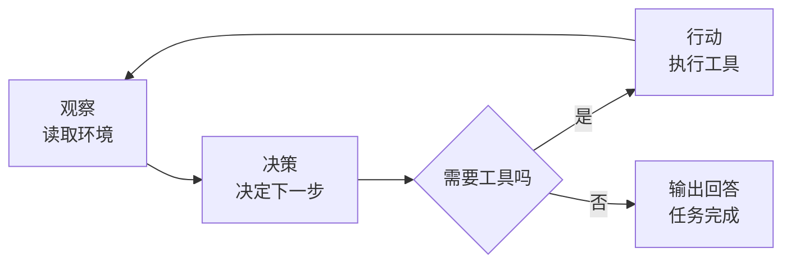

- 有两个容易混的点：
  - Agent 可以指"这套会干活的程序"，也可以指"模型本身"。平时说的"Agent 能力"，一般指前者，也就是模型加上外面那层循环和工具之后的能力
  - 没有循环的裸模型调用不叫 Agent。你调一次 API 问个问题，那是问答；Agent 是模型自己决定下一步做什么，反复做直到完成

### 前置概念：Harness

- harness 直译是"马具、挽具"，在 AI 领域指"模型外面的工程"。模型是内核，harness 是外壳；模型决定上限，harness 决定实际用得好不好
- 发动机与整车的类比：模型是发动机，提供动力；harness 是整车，变速箱、底盘、方向盘、仪表盘都在 harness 里。光有发动机开不了车，光有模型干不了活
- 裸 API 调用和有 harness 的调用，差别很大：

| 维度 | 裸 API 调用 | 有 harness 的调用 |
| --- | --- | --- |
| 会话 | 一次问答，无上下文积累 | 持续会话，记忆上下文 |
| 工具 | 无，只能生成文本 | 可调工具、读写文件 |
| 循环 | 一次生成完事 | agent 循环，反复做事直到完成 |
| 环境 | 无感知 | 能读文件、看系统、操作 |
| 编排 | 用户手动编排每一步 | harness 自动编排 |

- harness 组装的东西，大致有这么几块：
  - 上下文：把该给模型看的信息组织成每一轮的输入
  - 检索：模型知识有限、过时、私有，harness 负责找资料喂给模型
  - 记忆：跨会话保存可复用的信息
  - 工具：把读文件、跑命令、请求接口暴露给模型
  - 循环：让"决策、行动、看结果、再决策"转起来
  - 反馈：工具结果、用户确认、错误处理回传给模型
  - 运行环境与沙箱：限制模型能碰到的资源，权限边界落在执行环境里

### dsh 是什么

- DeepSeek Harness，简称 dsh，是 DeepSeek AI 开发的开源 agent harness。官方 README 第一句：an open-source agent harness developed by DeepSeek AI
- README 紧接着交代架构取向：built on an everything-is-a-plugin architecture，底层是 Cordis，设计思想在论文《[A Programming Paradigm for Spatiotemporal Composability](https://arxiv.org/abs/2608.25512)》里
- 旧版官网有一句更直白的概括：Agent = Model + Harness。模型负责会思考，harness 负责让它在真实环境里干活。这一版页面已经改版，公式和当时的九项能力列举都撤掉了，原文可以从 [Wayback 2026-09-01 快照](https://web.archive.org/web/20260901171645/https://deepseek.com/harness/en/) 看到
- 官方主页（[deepseek.com/harness](https://www.deepseek.com/harness/en/)）现在是产品入口，桌面端下载、插件、调度、轨迹四块。页面上讲的是能力可替换、可重组，具体可替换的范围从模型、工具、技能，一直覆盖到会话、沙箱、存储、循环、调度和界面
- 可追溯这条要落到仓库文档才准。官方架构文档的原话是 Model-visible means logged：模型请求里出现的每一样东西，都必须能从 append-only 的会话日志重建出来，resume、fork、搜索都基于同一份事件流
- dsh 有双重身份：
  - 它是一个能直接用的 agent 产品：装好后 `dsh web` 打开界面就能用，官方还发布了 Electron 桌面版
  - 它是一个插件化的 harness 平台（agent runtime）：所有能力都做成插件，通过配置组合，开发者可以按需求替换模型、工具、界面，甚至 Agent Loop 本身
- 支撑这双重身份的核心思想是 everything-is-a-plugin（一切皆为插件），底层由 Cordis 这个插件运行框架驱动。Cordis 负责把插件组织成一套可运行的系统，dsh 的每项能力都是挂在它上面的插件
- 版本与时效，再强调一次：
  - dsh 是 developer preview，官方 README 原文：THERE WILL BE COMPATIBILITY-BREAKING CHANGES（会有破坏性兼容变更）
  - 本文按 0.2.2-rc.1 核对。这个版本自 2026 年 11 月起发布，包含桌面端、插件管理器、PTC 执行器等一批新东西，也改了几处旧版本的行为，正文里遇到会单独点出来
- 官方来源：
  - 官方仓库：[deepseek-ai/deepseek-harness](https://github.com/deepseek-ai/deepseek-harness)
  - 官方文档站：[DeepSeek Harness 文档](https://deepseek-harness.github.io/deepseek-harness/)
  - npm 包：[@deepseek-ai/dsh](https://www.npmjs.com/package/@deepseek-ai/dsh)

### dsh 与 Claude Code / Codex / Hermes Agent 的定位对比

- 把 dsh 和 Claude Code、OpenAI Codex、Hermes Agent 放在一起比，不是比谁强，而是比定位和开放程度，方便看出 dsh 处在什么位置
- 四者的官方定位：
  - Claude Code 是 Anthropic 的 agentic coding tool，在终端和 IDE 里用，官方定位是"理解你的代码库、编辑文件、运行命令，帮你更快交付"
  - Codex 是 OpenAI 的 coding agent，在 IDE 里与代码并列使用，也可以把更大任务委托到云端执行
  - Hermes Agent 是 Nous Research 的自我改进 AI agent，内置学习循环，能从使用经验里创建和打磨 skills，还能在 Telegram、Discord 这类消息平台上常驻运行
  - dsh 是 DeepSeek 的开源 agent harness，有 CLI、Web UI 和桌面应用三种入口，核心设计是一切皆插件

| 维度 | dsh | Claude Code | Codex | Hermes Agent |
| --- | --- | --- | --- | --- |
| 开发者 | DeepSeek AI | Anthropic | OpenAI | Nous Research |
| 开源 | 是（MIT） | 否 | 是，CLI 部分（Apache-2.0） | 是（MIT） |
| 运行形态 | CLI + Web UI + Electron 桌面版，另有 headless / SDK / ACP profile | 终端 CLI + IDE 扩展 | CLI + IDE 扩展 + 云端委托 | CLI（完整 TUI）+ 消息网关 + Desktop |
| 插件机制 | 一切皆插件（Cordis），模型、工具、Loop、UI 都可替换；另有图形化插件管理器与按会话选的 agent preset | 插件目录，含 skills、agents、hooks、MCP 组件 | 角色化插件（role-specific plugins） | skills（agentskills 开放标准）+ MCP + 内置工具 |
| 模型 | 默认 DeepSeek 模型，适配器插件可换；官方账号登录或 API Key 两种凭据 | 官方以 Claude 为主，`/model` 可切，可经 `ANTHROPIC_BASE_URL` 接第三方 | 官方以 OpenAI 为主，`config.toml` 可配自定义 provider | 任意模型，`hermes model` 切换，无锁定 |
| 特色 | 插件化到内核，能力可重组 | 背靠 Anthropic | 背靠 OpenAI，云端委托 | 内置学习循环，自我改进，消息平台常驻 |

- 这张表里，dsh 的差异在"插件机制"这一行：可替换做到了系统级，连 Agent Loop 本身都是插件；Claude Code 和 Codex 的插件是在固定核心外面加东西；Hermes 的扩展靠 skills 和 MCP，同样不到系统级
- Hermes 的差异在别处：它是四者里唯一主打"自我改进"的，内置学习循环，会从使用经验里创建和打磨 skills，还能在消息平台上常驻干活，而不是只待在终端或 IDE 里
- 参考来源：
  - Claude Code 官方页：[claude.com/product/claude-code](https://claude.com/product/claude-code)
  - Claude Code 插件文档：[Plugins reference](https://code.claude.com/docs/en/plugins-reference)
  - Claude Code 模型配置：[Model configuration](https://code.claude.com/docs/en/model-config)
  - Codex IDE 扩展：[Codex IDE extension](https://learn.chatgpt.com/docs/codex/ide)
  - Codex 插件：[Codex for every role, tool, and workflow](https://openai.com/index/codex-for-every-role-tool-workflow/)
  - Codex 自定义模型 provider：[Advanced Configuration](https://learn.chatgpt.com/docs/config-file/config-advanced)
  - Codex 仓库与许可证：[openai/codex](https://github.com/openai/codex)
  - Hermes Agent 仓库：[nousresearch/hermes-agent](https://github.com/nousresearch/hermes-agent)
  - Hermes Agent 文档：[Hermes Agent 文档](https://hermes-agent.nousresearch.com/docs/)

### 实践：怎么判断一个 harness 适不适合自己

- 概念节讲了 harness 是什么，这一节讲怎么选。列几个判断维度：
  - 模型自由度：能不能换模型？dsh 的模型适配器是插件，改配置就能换，官方还给 DeepSeek 账号登录和 API Key 两条凭据路径；Hermes Agent 用 `hermes model` 也能随便切；Claude Code 和 Codex 官方以自家模型为主，但也留了口子：Claude Code 可经 `ANTHROPIC_BASE_URL` 或 LLM gateway 接第三方模型（社区工具 [cc-switch](https://github.com/farion1231/cc-switch) 就是这么做的），Codex 可在 `config.toml` 里配 `[model_providers]` 自定义 provider
  - 可扩展性：能不能加工具、改行为？dsh 一切皆插件，能改到 Loop 层；Hermes 靠 skills 和 MCP 扩展；别的产品多数在固定核心外面加插件
  - 现成资源：有没有可用的插件、技能、MCP server？Claude Code、Codex 背靠大厂社区，dsh 是开源社区加官方仓库
  - 稳定性：是不是成熟产品？dsh 还在 developer preview，破坏性变更多；Claude Code、Codex 相对稳定
  - 使用成本：安装配置的复杂度、日常运行的开销（token、额度）
- 没有绝对的对错，看你要什么：
  - 要"开箱即用、稳定"，大厂产品合适
  - 要"能改到内核、模型自由、参与开源"，dsh 这类插件化 harness 合适
  - 两个都要，可以拿 dsh 当研究对象，同时日常用顺手的产品

## 设计哲学

### 一切皆为插件

- dsh 最核心的设计思想是 everything-is-a-plugin（一切皆为插件）。这不是说"dsh 是一个固定核心，外面可以加插件"，而是组成 Agent 的主要能力、乃至传统意义上的核心部分，全部放进同一套插件体系
- 官方架构文档（[architecture.md](https://github.com/deepseek-ai/deepseek-harness/blob/dsh-v0.2.2-rc.1/docs/architecture.md)）有一句原话：
  - "Every part of the product is a plugin, including the model adapter, the tool registry, the session log, and the agent loop itself, so each is replaceable from configuration."
  - 翻译：产品的每一部分都是插件，包括模型适配器、工具注册表、会话日志、以及 Agent Loop 本身，所以每一块都能通过配置替换
- 这句话落到仓库里就是真实存在的包结构：
  - 模型适配器：`packages/llm/llm-deepseek`（DeepSeek 模型适配器）
  - Agent Loop：`packages/core/agent-loop`
  - 会话日志：`packages/session/session-log-deepseek`
  - 工具注册表：`packages/core/tools`
  - 它们都是和其他插件平级的 npm 包，没有谁天生是"内核"
- 官方架构文档还有一句更直接的话：
  - "There is no privileged core to patch: you extend dsh by mounting a plugin beside the others, and registrations are effects that unwind when their plugin unloads."
  - 翻译：不存在一个特权核心需要你去 patch。扩展 dsh 的方式，是在其他插件旁边再挂一个插件；所有注册都是可回卷的副作用，插件卸载时自动撤销
- 与"普通系统加插件"的区别，用一个表格说清：

| 对比点 | 普通系统加插件 | dsh 的一切皆为插件 |
| --- | --- | --- |
| 核心 | 固定核心，改不了 | 连 Agent Loop、模型适配器、会话日志都是插件 |
| 扩展方式 | 往核心外面挂载 | 在旁边挂载，可替换任意部分 |
| 替换粒度 | 换工具、换界面 | 换模型、换循环、换日志、换界面 |
| 卸载 | 通常要重启 | 插件可动态加载、卸载、热更新 |

- "一切"有边界：不是任意代码都能不受限制地塞进系统。dsh 会预先定义服务接口、Registry、事件、UI Slot 等扩展位置，插件必须遵守相应约定。强调的是"主要系统能力都采用统一的插件方式实现"，而不是"系统不存在任何结构"

### 什么是插件、哪些能当插件

- 在 Cordis 的世界里，插件就是"实现了一个功能入口的对象"。官方 primer 的定义：
  - "A plugin is a object that implements Service. It can be a function with optional inject and apply(ctx) fields, or a Service subclass whose lifecycle Cordis mounts into the current context."
  - 翻译：插件是一个实现了服务的对象，可以是一个带可选 inject 和 apply(ctx) 字段的函数，也可以是一个生命周期由 Cordis 挂载进当前上下文的服务子类
- 官方注册表文档（registry.md）把插件的形态写得更具体：

```ts
// vendor/cordis/src/registry.ts —— 插件入口形态
type Plugin<T = any> =
  | Plugin.Function<T>      // 函数插件：直接以 (ctx, config) 调用
  | Plugin.Constructor<T>   // 类插件：以 new (ctx, config) 构造
  | Plugin.Object<T>        // 对象插件：含 apply(ctx, config) 方法
```

- 插件还可以声明一些元数据，让 Cordis 知道怎么用它：
  - `name`：显示名，用于诊断和日志
  - `Config`：配置校验器，插件启动前校验配置
  - `inject`：这个插件需要哪些服务，服务齐了才会加载
  - `provide`：这个插件提供哪些服务
  - `intercept`：声明它消费哪些服务的拦截配置，用于需要包一层语义的领域
- 从 dsh 的整体结构看，插件大致覆盖六类能力：

| 能力类别 | 包含的插件 |
| --- | --- |
| 模型与推理 | 模型适配器（DeepSeek 或其他）、Agent Loop、上下文压缩（basic、工具结果裁剪、图片外移） |
| 工具与执行 | 工具注册表与可换执行器（native / PTC）、文件系统、文件编辑器、Shell、持久终端、LSP、Web Search、Web Fetch、MCP、Skill、子 Agent |
| 会话与状态 | Session Event Log、JSONL 持久化、会话查询（SQLite 全文索引）、轨迹视图、标题、统计、Storage |
| 权限与运行环境 | 用户审批、权限预设、文件访问策略、进程 Sandbox（Linux / macOS / Windows ACL）、凭据管理 |
| 任务编排与后台 | Goal、Todo、Workflow、后台 Job、调度、各种 Subagent Provider |
| 交互入口与界面 | Web Server、Headless Runner、ACP、API、桌面端载体、浏览器侧边栏、会话界面、工具结果视图 |

- 这六类不是官方分类，是看包结构归纳出来的。界面那一类尤其碎：Web 前端本身由六十多个 `dsh-client-ui-*` 插件拼成，侧边栏、工具卡片、审批弹窗各自是插件

### 插件化程度对比

- 概念节讲了 dsh 的一切皆为插件，这一节把它和其他产品比一比插件化的程度。对比对象还是 Claude Code、Codex、Hermes Agent

| 维度 | dsh | Claude Code | Codex | Hermes Agent |
| --- | --- | --- | --- | --- |
| 扩展哲学 | 一切皆插件，核心也可换 | 固定核心 + 插件目录 | 固定核心 + 角色化插件 | 固定核心 + skills / MCP |
| 核心（Agent Loop）可替换 | 是 | 否 | 否 | 否 |
| 扩展单位 | Cordis 插件（函数/类/对象） | 插件目录（skills/agents/hooks/MCP） | 角色化插件 | skills + MCP server |
| 扩展深度 | 服务、事件、副作用、UI 都能动 | 在核心外挂载 | 在核心外挂载 | 在核心外挂载 |
| 按会话换组合 | 有，agent preset 给同一进程里的每个会话配一套工具、提示段和技能 | 无 | 无 | 无（会话间共用同一套工具） |
| 模型可换 | 配置换 | `/model` 切换，可经 `ANTHROPIC_BASE_URL` 接第三方 | `config.toml` 可配自定义 provider | hermes model 换 |

- 结论很直接：dsh 把"可替换"做到了系统级，其余三家的插件都是在固定核心外面加东西。这不是说 dsh 更高级，而是它选择了"可组合性优先"这条路，代价是你要理解 Cordis 这套插件机制才能改到内核

### Web UI 也是插件

- 不只是 Agent 的"脑、手、记忆"可以替换，用户看到的界面同样是可组合模块
- dsh 的界面相关能力分布在这些包里：
  - `packages/web/web`：Web 能力本身
  - `packages/bundle/web-app`：浏览器应用，作为 `web` profile 的一层
  - `packages/bundle/headless`：无界面的单次运行器
  - `packages/bundle/acp-app`：自动化用的 ACP server
- 界面本身也是插件拼出来的，日常用的 Web 前端由六十多个 `dsh-client-ui-*` 包组成，侧边栏、会话列表、工具卡片、审批弹窗、设置页各自是一个插件
- 更强的证据是桌面端：0.2.x 发布的 Electron 桌面版不是另写一个 harness，而是给同一个 Web 应用套了个壳，并独占 `desktop` 这个 profile 名，命令行启动器明确拒绝 boot 和 dump 它
- Web Server、Headless Runner、ACP、API 都是插件，由 profile 组合出来。把 web-app 换成 headless 就得到单次运行模式：跑一个任务、打印最终答案、退出，不是可交互的终端会话
- 顺序反过来说也成立：dsh 不是"先写好一个固定网页，再给你几个按钮"，而是先有插件，界面是这些插件被组合出来的样子

### 实践：识别 dsh 里的插件

- 概念节讲了插件有哪些形态和类别，这一节讲怎么把"一切皆插件"落到实际操作
- 最直接的办法是让 dsh 把自己装了哪些插件打印出来。装好 dsh 之后，运行：
  - `dsh --profile web --dump-config`
  - 这个命令打印本机 `web` profile 启动时的完整插件树，格式是 YAML 条目列表，一个条目包含 id、包名，以及可选的 `disabled` 与 `config`
  - 条目按来源分层，每层前面有一行注释标明是哪个 bundle、被谁改过，比如 `# == @deepseek-ai/dsh-base`。行数取决于你装了多少第三方组合包，默认比这个少得多，不要拿它当固定值
  - 每行的 id 就是 patch 要定位的目标，任何一行都能被你的 patch 替换
- 另外两个 dump 选项：`--dump-default-config` 打印不含用户层和 `--patch` 覆盖的默认树，`--dump-config-schema` 打印这些条目和 patch 的 JSON Schema，用来查某个字段怎么填
- 识别思路：看到任何"能力"，就问它是不是一个插件
  - 换模型，是换 `llm-deepseek` 这个插件
  - 加一个自定义工具，是挂一个工具插件
  - 想改会话存储格式，是换 `session-persistence-jsonl` 这个插件
  - 想改权限规则，是调 `permission-presets` 或 `user-approval` 插件
  - 想换工具呈现方式，是换工具执行器（`tool-executor-native` 或 `tool-executor-ptc`）
- 插件化思维对使用者的影响：在 dsh 里，"改行为"通常不是改源码，而是"选插件、配配置、写 patch"。不理解这套机制时，改起来像黑盒；理解了，就变成拼积木
- 想自己写插件，从官方教程开始：[Cordis 教程](https://github.com/deepseek-ai/deepseek-harness/blob/dsh-v0.2.2-rc.1/docs/cordis-tutorial/index.md)
  - 教程 01 讲第一个插件怎么写
  - 教程 02 讲生命周期和 effect
  - 教程 06 讲组合与 HMR（热更新）
  - 教程 07 讲怎么把插件接进 harness

## 整体架构


### 架构总览

- 官方架构文档（[architecture.md](https://github.com/deepseek-ai/deepseek-harness/blob/dsh-v0.2.2-rc.1/docs/architecture.md)）的第一句，就是看 dsh 运行时的总纲：
  - "A running dsh is a plugin tree composed at boot from ordered layers."
  - 翻译：一个运行中的 dsh，是启动时由有序层组合成的插件树
- 这句话有两个重点：
  - "插件树"：运行中的 dsh 不是一个大程序，而是很多插件挂在一起组成的结构
  - "启动时由有序层组合"：这棵树的组成是启动阶段就定好的，依据是配置（profile、bundle、patch）
- 从请求处理的角度看，dsh 有一条主线：
  1. 入口接收请求（Web 界面、ACP、SDK、命令行四种）
  2. 请求交给 ctx.agents（Agent 注册表），找到或创建对应的 Agent
  3. Agent 由 Agent Loop 驱动，在模型（LLM 适配器）和工具之间循环
  4. 循环的每一步都记录进 Session Event Log（会话事件日志）
  5. 输出适配器把结果送回入口
- 其中几个核心包的职责，官方架构文档有一张表：

| 包 | 职责 | ctx key |
| --- | --- | --- |
| core/session | append-only 会话事件日志与内存存储 | ctx.sessions |
| core/system-prompt | 提示段与工具 schema 组装 | ctx.systemPrompt |
| core/tools | 带作用域的工具注册表、可换执行器与守卫执行管线 | ctx.tools |
| core/agent | Agent 接口、活注册表、agent 事件 | ctx.agents |
| core/agent-loop | 默认的 Agent Loop 实现 | ctx.agentLoop |
| core/scope | 按 Agent 的作用域注册原语（没有自己的 ctx key） | 无 |
| llm/llm | 消息与流式词汇、模型适配器 seam | ctx.llm |

- 一个关键认知：Cordis Runtime 是全局底座（控制平面），不是请求流里的某一步。请求确实会经过 Agent Loop，但 Cordis 是所有插件挂载、服务互相调用、事件广播的载体，它在你启动 dsh 的那一刻就在运行，负责把这棵插件树组织好

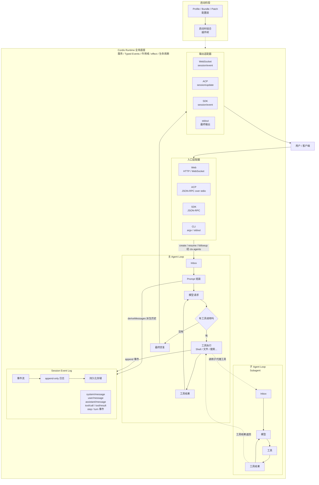

- 这张图是全文的总纲：启动阶段组合出插件树，之后整个运行时都活在 Cordis 底座里。底座内部是五块：入口适配器、主 Agent Loop、子 Agent Loop、Session Event Log、输出适配器。主循环里的工具可以再开子循环（Subagent），循环产生的每一步事件都进会话日志，历史从日志派生，结果从输出适配器送回

### 入口层：Web / ACP / SDK / CLI


- dsh 有四种命令行入口，对应官方预置的 profile（一种 profile 就是一套命名好的插件组合），另有一个由桌面版独占的 desktop 载体

| 入口 | profile | 形态与协议 |
| --- | --- | --- |
| Web UI | web | HTTP + WebSocket，浏览器界面，支持热更新 |
| Headless | headless | 跑一个任务、打印最终答案、退出；加 `--json` 输出按行 JSON 事件流，加 `--session-id` 可在同一会话上继续 |
| SDK | sdk | JSON-RPC 协议，TypeScript / Python 的 client/server |
| ACP | acp | Agent Client Protocol（JSON-RPC over stdio），自动化专用 |
| 桌面应用 | desktop | Electron 外壳，由桌面版独占，命令行启动器拒绝启动或 dump 这个名字 |

- 还有一个 sdk-minimal profile，是刻意维护的一个更小、独立的 SDK 组合，不套用 dsh-base
- 启动器没有默认 profile：裸跑 `dsh` 只打印用法，要跑谁就明确写 `dsh web` 或 `dsh --profile <name>`
- 这些入口共享第一层 dsh-base（模型适配器、工具、持久化、沙箱与审批策略、设置、凭据、遥测），在此基础上每个入口再叠加自己的部分：
  - web 加浏览器应用
  - headless 加一个没有服务端的一次性运行器
  - sdk 加 SDK 的 JSON-RPC server
  - acp 加一个只做自动化的 ACP server
- 各入口的请求最终都汇到同一个地方：ctx.agents。Web 界面、SDK 客户端、ACP 客户端、命令行，它们驱动 Agent 的方式是一样的，只是协议不同
- 协议细节上有个差异值得注意：
  - web 是浏览器应用，走 HTTP 和 WebSocket，人直接对着界面操作
  - sdk 是程序化的 JSON-RPC，TypeScript 或 Python 代码里调用
  - acp 走标准的 Agent Client Protocol（[agentclientprotocol.com](https://agentclientprotocol.com)），设计给自动化用：外部子代理、测试运行器、脚本控制器。它只发标准 ACP 消息，不发 dsh 私有数据
- 驱动一个 Agent 有三种基本操作：
  - create：新建一个 session 和 Agent
  - resume：先加载持久化的 session，再继续
  - followup：在现有 Agent 上追加一条普通后续消息，并唤醒驱动器
- 投递消息其实有统一的一个 `send(message, target, wakeup)`，三种操作是它的固定别名：followup 排队到下一轮并唤醒，steer 提交到下一步并唤醒，inject 只加上下文不唤醒
- web profile 是"活"的（配置改了会热更新重载），headless、sdk、sdk-minimal、acp 是启动时一次性应用全部层，因为对一个一次性运行或 stdio 应用来说，任务开始后再换依赖会破坏生命周期

### 主循环：turn 与 step

- Agent Loop 是让模型"能干活"的那层循环，dsh 里它有两个基本单位：
  - step：一次模型请求，加上这次请求调用的所有工具
  - turn：零个或多个 step，从第一个输入被认领开始，到不再欠任何请求时结束
- turn 是"完成用户一次输入的全过程"，step 是其中的"模型想一次、干一次活"的单元。一个 turn 里模型可能来回思考并调用工具很多次，那就是多个 step
- 官方架构文档给了 turn 的完整事件流程，这里是它的简化版：

```text
turn/start 回合开始
  claim 认领输入（next-step 输入 + 一个排队消息）
  assemble 组装 prompt 段与工具 schema
  agent/pre-step 拦截点：可改写消息或整体拒绝
  step/start 一个 step 开始
    把进入的消息追加为 user/message
    系统提示作为 system/message 表面节点对齐
    从会话日志派生模型历史
    request/header 记录请求信封，request/context 记录路由与容量
    经 llm/stream 发起流式请求
    实时分片走 agent/assistant-stream，完整回复落成 assistant/message
    tool/call 工具调用，经工具执行管线，回填 tool/result
  step/end 一个 step 结束
  如果工具还欠着另一个请求，或又有新输入到达，就再 claim 开下一个 step
  agent/turn-stopping 拦截点
turn/end 回合结束
```

- 官方把事件按域分开：
  - 持久会话事件（durable session events）：写进会话日志、长期保存。上面流程里的 turn、step、user/message、assistant/message、tool/call、tool/result 是骨架，不是全集。新版完整词汇表有六十多种，插件还能用声明合并往里加自己的事件
  - 实时扩展点（live extension points）：运行中的拦截点，供插件观察或插手，不写日志。它按 agent、llm、tools 三个域划分，比如 agent/pre-step、agent/assistant-stream、llm/stream、tools/pre-execute
  - agent/request 这个老拦截点还在，但已标记弃用，只为现有监听器保留，新代码不该再挂它
- 输入通过一个 inbox（收件箱）到达 Agent，inbox 内部是两个有序的待处理消息列表：
  - next-turn：排着下一个回合要处理的消息
  - next-step：当前回合内、下一步要处理的输入
  - Agent 认领（claim）时，把全部 next-step 输入取走，同时在回合边界再取一个 next-turn 消息

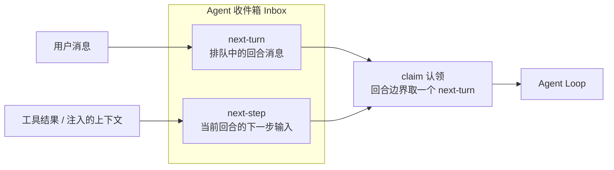
- 模型历史的来源值得提前点出：模型每次请求看到的上下文，不是聊天软件里那种把最近几条消息拼起来，而是从一条 append-only 的会话事件日志里派生出来的。这条日志就是模型的记忆本体，会话系统的各个机制都围绕它展开
- agent/pre-step 是决定"模型看到什么"的拦截点，它可能改写要进入的消息，也可能整体拒绝；如果第一个认领被拒绝，回合仍然会以"没有花费任何 step"的方式关闭，日志照样记录这次尝试
- 现在用 mermaid 把 turn 和 step 的关系画出来：

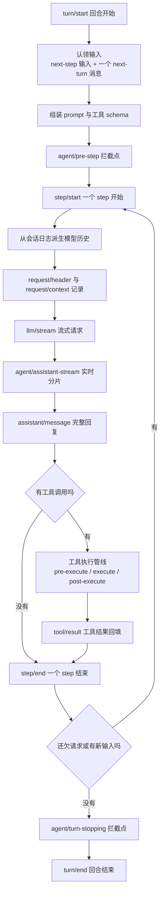

- 这张图里最容易被忽视的是那条从 step/end 回到 step/start 的边：模型调完一个工具，拿到结果，如果它还打算再调一个工具，循环不会结束，而是开新的 step 继续，直到它认为任务完成。这就是"模型自己决定下一步做什么"在 dsh 里的落地形态
- Agent Loop 不是唯一的实现：core/agent 定义 Agent 接口，core/agent-loop 是默认实现。想换循环，提供一个实现同样接口的插件即可

### 工具层：ctx.tools 与 guard 执行管线

- Agent Loop 决定"要不要调工具"，工具怎么被找到、怎么被允许、怎么执行、结果怎么回填，是工具层的事
- ctx.tools 是一个带作用域的工具注册表，外面还有一层守卫执行管线。官方架构文档把工具层定位为 scoped tool registry and guarded execution pipeline
- 0.2.x 起它还要多一层：每个步骤先解析出一个步骤级工具集，这一批调用交给该作用域的**工具执行器**结算。内置两个执行器，native 直接把工具暴露给模型，PTC 通过 `run_code` 把工具包装成生成式 SDK；也可以自己实现执行器，自定义执行器不强制走共享管线
- 工具的执行管线有完整的官方流程图（[tool-execution-pipeline.md](https://github.com/deepseek-ai/deepseek-harness/blob/dsh-v0.2.2-rc.1/docs/tool-execution-pipeline.md)），这里按顺序讲它的关键环节：

```text
tool/call 会话事件（执行前先记录）
UI 挂起卡片（模型端还在等）
tools/pre-execute 瀑布（allow / deny / ask：权限、沙箱、hooks 在这里裁决）
ctx.approval 审批（只在 ask 分支触发，没有可答的审批者就拒绝）
注册的单调守卫（deny 拒绝或 abstain 弃权，只能在审批之后收紧，不能翻案）
tools/execute 瀑布（超时、重试、指标，包在派发外面）
工具本体 execute() 执行
fs/write-intent 或 fs/edit-intent（文件系统写入守卫，只对 tool-fs 生效）
工具自身产生的事件（todo/write、fs/observed、hook/invoked 等）
projectContent（这次执行准备好的图文内容）
tools/post-execute 瀑布（接受 / 阻断 / 替换 / 附加上下文）
外层规范化（异常变成 isError）
ToolDefinition.finalizeContent（最后的内容不变量）
tools/result 同步通知（冻结的权威结果）
tool/result 会话事件（模型看到的唯一结果）
```

- 这条管线想解决几件事：
  - 拦截要发生在执行之前：pre-execute 瀑布里，权限、沙箱、审计插件都能拦下这个工具调用，拦住就不执行
  - 审批要有兜底：approval 是一次性询问，如果系统里没有能回答的审批者，默认拒绝，不会放行
  - 执行要能被包装：超时、重试、指标这类"围绕派发"的关心点放在 execute 瀑布里，不写进工具本体
  - 结果要唯一且权威：最终以 tool/result 事件为准，UI 展示、模型回填、统计都用它，避免各看各的
  - 拒绝不能被翻案：单调守卫只能收紧，一个守卫拒绝之后，后面的监听者不能把它改回放行
- 文件和子进程相关工具还有个特殊性：tool-fs 的写入会触发 fs/write-intent、fs/edit-intent 事件，0.2.x 还多了 fs/delete-intent；读写前的检查在 tool-fs 下层做，属于文件系统能力自己的守卫
- 工具注册的连带效果：一个工具注册进 ctx.tools，它的 schema 就会加入 prompt assembly，模型在下一轮就能看到并调用它。所以"给模型加一个能力"，落到操作上就是"注册一个工具插件"
- 下面这张图把整条管线串起来，重点看权限、审批、守卫是如何一层层裁决的：

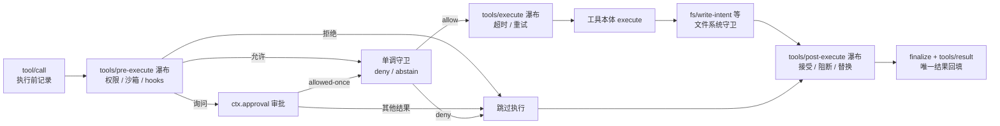

### Subagent 子代理机制

- 子代理（subagent）是 Agent 把一部分工作委托给另一个 Agent 的能力。dsh 默认组合是 Main Agent 加 Subagent，不是 worker 加 orchestrator：主 Agent 调一个"子代理工具"，得到一个子 Agent，子 Agent 有自己的会话和模型循环，结果经完成通知回来。仓库里另有显式启用的实验性 Agent Team（Lead 加具名 teammate 加持久任务板），形态更接近 orchestrator，但不进默认 profile
- 架构要点：
  - ctx.subagents 是"命名 provider 注册表"，和 bash 那种"单一执行器"不同，多个 provider 可以同时注册、按名字选用
  - provider 按后端分两类：本地后端（spawn、fork）在进程内建子 Agent、有持久子会话；外部后端（acp、codex、claude-code、dsh-sdk）是一次执行的传输适配器，各自保留自己的权限体系
  - 随 npm 安装交付的是 spawn 和 fork。外部后端要另外装，文章里提到它们时说的是"文档列出的 provider"，不是"开箱可用"
  - 模型侧入口是 tool-subagent（按 provider 委托），控制面是 tool-subagent-control（send_message、interrupt_agent、list_agents）
- 委托调用不前台等结果：工具立刻返回 `started subagent <childId>`，子代理跑完再发一条完成通知。通知默认投给父 Agent，也可以只回调用者（`delivery: 'caller'`），让 workflow 这类调用方自己等结果
- 两个后端是两套契约：

| 维度 | 本地后端（spawn / fork） | 外部后端（acp / codex / claude-code / dsh-sdk） |
| --- | --- | --- |
| 生命周期 | 持久子会话，可跨多轮 | 一次执行，结束即终 |
| 创建方式 | provider 只提供 prepareContinuable()，由 continuation manager 建子 Agent | provider 提供 start()，起一次执行 |
| 取结果 | 完成通知加 activation 结果 | 完成通知加执行句柄 |
| 后续消息 | send_message 可以继续，支持冷恢复 | 不接受后续输入 |
| 能力校验 | 创建前校验，不支持就以类型化错误拒绝 | 同左 |

### Subagent：本地后端

- spawn 起一个全新子 Agent，fork 把父会话日志里从 seq 0 开始的已完结 turn 前缀作为种子
- 同一时刻最多一个进程内 Activation（"重建出来的子 Agent 在内存里的那段时期"）
- 子 Agent 的收件箱是唯一的 FIFO 队列：父发消息、子回复、再发、再回，可以多轮
- 父给子发消息用 send_message，只允许直接父子之间，也就是 direct parent 与直接可继续的子代理
- 子结束时，continuation manager 给它的 direct parent 发一个 settle notice，说明这一期怎么结束，并带上最后的 assistant 内容
- 冷恢复靠日志里的子代理描述符重建：spawn 可以带自己的 agent preset，fork 与外部后端都不接受 preset 选项
- fork 是"带记忆的子代理"，因为它用父历史做种；spawn 的种子是空的，从零开始

### Subagent：外部后端

- 外部后端把子任务交给另一个运行时，比如 Claude Code、Codex，或者另一台机器上的 dsh（走 ACP 或 SDK）
- 这类后端只执行一次，不接受后续消息；要重试就重新委托
- 能力校验仍在创建前做：provider 声明支持哪些能力，请求了不支持的能力会以同一组类型化错误拒绝，不会"接受了又不做"
- 权限上，外部后端各自管自己的一套，dsh 侧只负责发起和收结果

- 嵌套深度与并发有两条约束：
  - 深度：子代理持久化自己的 delegationDepth，Host 设置 `subagent.maxDepth` 默认 1；工具也可以写 `provider-managed`，把深度交给外部后端自己管
  - 并发：同时活跃的子代理有配额，默认 8，超出报 `ACTIVATION_LIMIT_REACHED`
- 子代理与主循环的关系：从主 Agent 的视角，调用子代理就是调用一个工具，走的就是工具执行管线；子 Agent 内部又跑一套自己的 Agent Loop
- 下面这张图表示派发、执行、返回的链路：

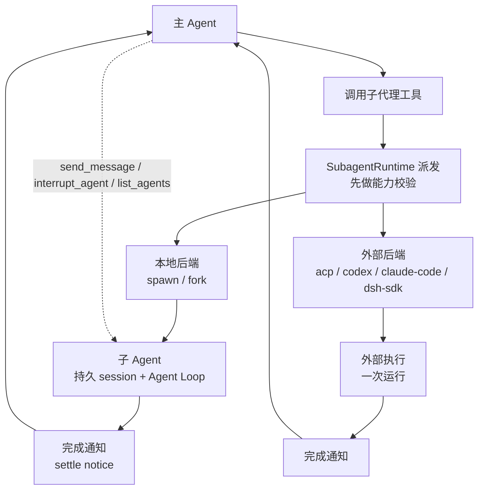

### 会话系统：Session Event Log

- 会话系统是 dsh 里"模型的记忆本体"。它不像聊天软件那样把对话历史存在一个单独数组里，而是维护一条 append-only 的会话事件日志（Session Event Log），模型上下文、界面展示、恢复、分支、轨迹查看全都从这条日志派生
- 官方原则只有一句话：**Model-visible means logged**（模型能看到的，必然已记录）。任何进入模型请求的东西，都必须能从日志里重建出来；新加一种模型能看到的输入，就得新增一种会话事件，再从日志渲染。这条靠 `Session.append` 对每条事件的载荷校验来守，不是靠一个运行时总闸
- 日志承载的核心事件类型，官方列在 [session.md](https://github.com/deepseek-ai/deepseek-harness/blob/dsh-v0.2.2-rc.1/docs/subsystems/session.md)，目前是 14 种：

| 事件类型 | 载荷要点 | 说明 |
| --- | --- | --- |
| turn/start | turn 编号 | 一个回合开始 |
| turn/end | turn 编号、结束原因 | 一个回合结束 |
| step/start | turn、step 编号 | 一个 step 开始 |
| step/end | turn、step 编号 | 一个 step 结束 |
| system/message | turn、step、渲染后的系统提示 | 系统提示作为表面节点 0 |
| developer/message | turn、step、增量消息、可选 headerSeq | 步骤内的增量变更，工具增减走它 |
| user/message | 用户消息 | 用户输入 |
| assistant/message | turn、step、完整回复、内嵌的紧凑 timed stream | 模型完整回复 |
| assistant/attempt | turn、step、失败的尝试 | 未产生表面消息的模型尝试，重试、取消、流式错误都记这里 |
| tool/call | turn、step、工具名、参数 | 工具调用开始 |
| tool/result | turn、step、结果 | 工具调用结果 |
| request/header | 请求信封 | 本轮请求的配置与工具 schema 快照，非表面事件 |
| request/context | 路由上下文 | 请求走到的模型/上下文容量，非表面事件 |
| session/end-seed | 无 | fork 种子结束标记 |

- 表面事件只有 5 种：system/message、developer/message、user/message、assistant/message、tool/result。只有这几种会产生模型消息、也只有它们带 surfaceOp（追加或替换）。turn 与 step 边界、assistant/attempt、request/* 都不进对话表面
- 模型每次请求的历史，由 `deriveMessages()` 从日志投影出来：它把这 5 种表面事件转成消息序列，tool/call 不产生消息、只与 tool/result 配对，系统提示则直接从 system/message 节点取，不再走 request/header
- 流式片段不是单独的事件：assistant/message 里内嵌这一轮的紧凑 timed stream，未结算的尝试另有 assistant/attempt 记录。所以 UI 仍能还原逐字输出，但日志里没有成千上万条 chunk
- 从这条日志派生的东西不止模型上下文：
  - resume：恢复一个会话，读日志重建状态
  - fork：在某个 turn 边界分支出新会话
  - 轨迹视图：把日志按回合摊开，看这一轮发生了什么
  - 标题生成、遥测、持久化：也都读这条日志
- 下面这张图是日志的核心循环：

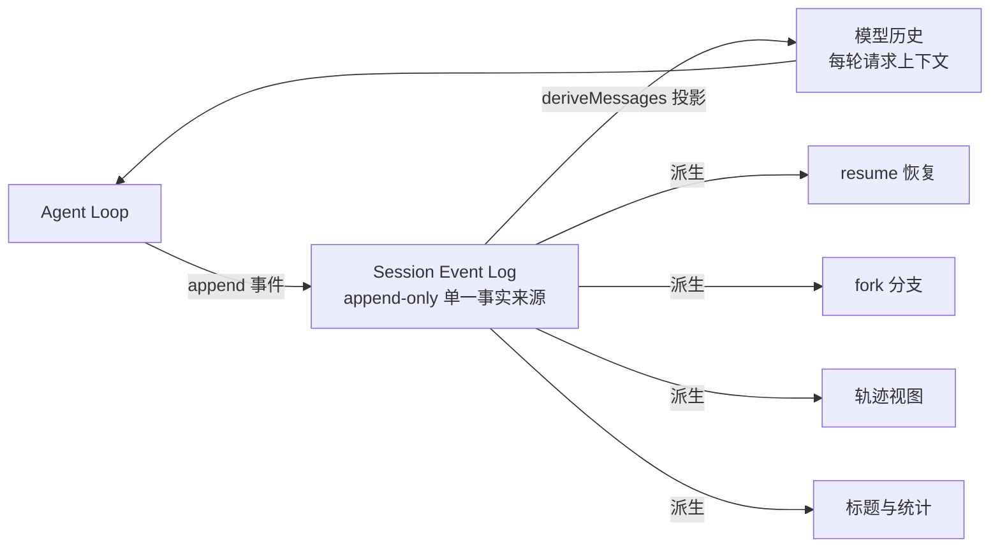

- 理解这条日志，就理解了 dsh 的会话：它不维护"一份模型历史 + 一份界面记录 + 一份持久化"，而是只维护一份日志，其余都是投影。这是"单一事实来源"在会话层的落地

### 会话记录的落盘：JSONL 与版本

- 内存里的日志要持久化，靠的是持久化 seam（SessionPersistence）。它定义 create/open/stat/list 四个操作，返回一个每会话的句柄（read/append/flush/close），句柄拿着日志的所有读写权和"单写者"所有权
- 官方默认的 provider 是 JSONL 后端：每个会话一个 append-only 的 JSONL 日志文件
- 磁盘布局是这样的：

```text
<root>/
  --<normalized-cwd>--/        # 可读的项目目录（无 cwd 时是 _no-cwd/）
    <session-id>/              # 会话 id 安全转义成路径段
      session.v4.jsonl.zstd    # 默认：校验和 header 帧 + 追加帧，文件名带格式版本
      session.lock             # 跨进程单写者的文件锁
```

- 文件名带版本号是从 v1 开始的约定：v0 那代仍叫 `session.jsonl`，之后是 `session.v<N>.jsonl`，压缩后缀照旧。所以 0.2.2 写出来的日志叫 `session.v4.jsonl.zstd`
- 单写者有两层：进程内是句柄所有权，跨进程靠 `session.lock` 上的非阻塞 flock（Windows 上是命名内核信号量）。拿不到锁就打不开写句柄
- 配置项：
  - root：根目录，唯一必填
  - compression：物理编码，'zstd'（默认，校验和 Zstandard 帧）或 'none'（纯文本行）
  - listConcurrency：批量列会话时的并发度，默认 3
  - packChunks 已经删了。旧版本会把连续的流式片段打包成一行，现在每个持久事件一行；v0 与 v1 的旧 reader 仍能解那些历史打包行
- 选 zstd 还是纯文本是存储内部细节：对 Agent Loop、模型、轨迹来说，逻辑事件流完全一样，换后端不改变任何行为
- 版本机制是开发者预览的"安全带"，规则在 0.2.x 变了：
  - 每个日志文件头带一个 SESSION_FORMAT_VERSION，目前是 4
  - 超前的版本（比当前 harness 新）会被拒绝，报错文案会明说"这是更新的 harness 写的，升级 harness 才能打开"
  - 落后的版本（v0 到 v3）不再拒绝，而是经静态迁移链打开：只读打开是单遍解码加迁移、不落新文件；写打开才在 Worker 线程校验并以不覆盖的方式发布 v4 文件，源文件逐字节不变
  - 迁移链拆成六个包（格式本体、迁移目录，以及 v0 升 v1 到 v3 升 v4 四条），目录在模块初始化时校验链完整、没有缺口
  - 日志里出现本版本不认识的必需事件，仍然拒绝打开；带 `ignorable` 标记的插件事件是例外，会被保留并跳过
- 崩溃恢复有一套明确的做法，官方文档讲得很清楚：
  - 一个日志在回合中途崩溃，会留下没有 turn/end 的 turn/start。持久化不去截断或修补它，因为长任务里一个 turn 可能巨大，那些事件在崩溃前已经安全落盘
  - 只有"撕裂的物理尾"（一次没落盘的 append 留下的残缺帧）会被丢弃；撕裂帧里能完整解码出来的记录会被重写，其余截掉
  - 恢复是读取方的职责：resume 时 Agent Loop 读日志，算出缺失的 closers（缺失的工具错误、打开的 step/end、合成的一条 turn/end，reason 标记为 interrupted），当作普通批次补写进去
  - 恢复语义上有两条保守规则：一条 assistant 请求没有配对的工具调用，记 TOOL_NOT_STARTED；一条工具调用没有结果，记 TOOL_OUTCOME_UNKNOWN，模型只能重试只读或幂等的工作
- 日志之外还有一圈只读投影，让"用会话记录"这件事变得可用：
  - session-query：把日志索引进独立的 SQLite 数据库，支持 FTS5 全文搜索
  - session-title：给会话生成标题（LLM 生成或用户指定）
  - session-stats：会话统计
  - 这些投影都不改日志本身，日志始终是权威

### 上下文压缩 compact

- 长任务里，会话日志越积越长，模型的上下文窗口装不下。dsh 的答案是 compaction（上下文压缩），把"旧的一部分上下文压成摘要，替换掉原文"，让窗口腾出空间
- compact 在 dsh 里是一个能力 seam（capability seam），和 bash 一样拆成三份：
  - 服务定义：ctx.compaction（CompactionEngine）
  - 服务提供者：dsh-compaction-basic（默认后端），另有 dsh-compaction-tool-result-pruner（裁工具结果）和 dsh-compaction-image-offload（把图片移出上下文）
  - 人类侧消费者：/compact 命令
- 它有一套自己的会话事件，构成"压缩锁"：
  - compaction/start 先记录（带回合号，null 表示手动独立一次）
  - 然后做摘要、记录 compaction/summary（含摘要、被遮罩的范围、预估 token 数等）
  - 裁剪工具结果时另记 compaction/prune，图片外移记 image/offload
  - 最后 compaction/end 释放锁
  - 锁最后释放的意义：如果中途崩溃，日志里会留下一个没有配对的 compaction/start，能被识别成"孤儿锁"，而不是假装压缩成功了

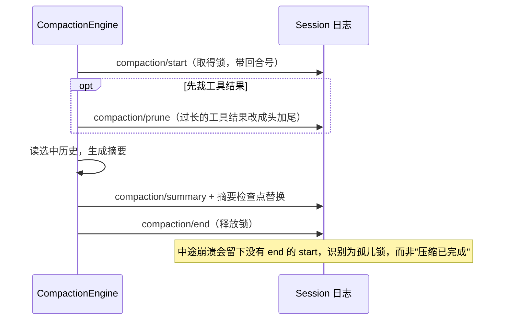
- CompactionEngine 暴露三种压缩入口：
  - compactIfNeeded(agent, trigger)：按触发条件自动压，条件是 pressure（压力）或 context-overflow（溢出）
  - compactNow(agent)：即使没到压力也压一次有用的，作为回合间的维护
  - compactRegion：对一段明确的范围做压缩
- 三个触发时机：
  - 压力压缩：在 agent/pre-step 瀑布里、请求派生之前跑。压力达标或溢出后，会先调用可选的 ctx.toolResultPruner 裁剪工具结果，再量测、选范围
  - 失败恢复：在 agent/request-error 里跑，前提是表面替换生成有推进
  - 模型切换：换路由时先对目标模型的窗口做一次压力检查，压不下来就以 MODEL_SWITCH_COMPACTION_FAILED 拒绝这次切换
- ToolResultPruner 是可选的服务，负责把过长的工具结果裁掉：默认按 thresholdChars（阈值）、headChars（保留开头）、tailChars（保留结尾）三个参数，把工具结果改成"开头加结尾"，中间省略
- 回答一个最实际的问题：不配任何参数时，compact 到底保留什么、去掉什么。默认参数是：

| 参数 | 默认值 | 含义 |
| --- | --- | --- |
| thresholdRatio | 0.8 | 触发线，实际触发点取 `min(W × 0.8, W − O − headroomTokens)` |
| retainRatio | 0.16 | 最近对话逐字保留的比例，基数是 `W − O`（窗口减输出预留） |
| retainTokens | 无 | 保留量的绝对字节形式，与 retainRatio 二选一 |
| headroomTokens | 65536 | 给摘要请求留的头部空间 |
| maxTokens | 跟随 headroomTokens | 摘要请求的输出上限，也可以按模型单独覆盖 |

- 表里 W 是路由模型的上下文窗口，O 是这次请求的输出预留。0.2.x 把"保留多少"和"留多少给摘要"拆成了两个可配的量，还支持按 provider/model 覆盖（`modelPolicies`），小窗口部署要自己算 headroom，否则启动时就报配置不合法

- 按这个默认跑一次压缩，实际发生的事：
  1. 达到 80% 阈值后，如果挂了 ToolResultPruner，先把过大的工具结果裁掉（裁剪不发模型请求，可能就此低于阈值，连摘要都不需要做）
  2. 裁完仍超阈值，才做摘要：把最早的"平衡跨度"（一段开头和结尾都完整的对话区域）选出来
  3. 用一次额外的模型请求重放这段历史，写出一份结构化摘要（按固定模板分节：主要意图、关键技术点、文件与代码、错误与修复、未完成工作、当前工作、下一步、关键上下文）
  4. 用这条摘要替换掉被选中的老区域，最近的 16% 原文保持不动，对话从摘要继续
  5. 报告压掉了多少条历史项、释放了多少 token
- 有两条边界是压缩动不了的：
  - 选中的范围从第一个不是 system/message 的节点开始，所以系统提示（表面节点 0）永远不在被遮蔽的范围里；但历史内追加的后续 system/message 属于普通历史，会被压掉
  - 一个不可分割的单元（比如一次超大的工具调用）不能拆分。如果整段对话就是一个不可分割单元，压缩会什么都不做、什么都不写
- 摘要检查点用 <compacted-summary> 标签包起来写进日志，后面紧跟保留的最近单元。模型下一次请求看到的是"自动生成的检查点说明 + 摘要 + 保留的原文"
- 压缩的成本是一次额外的模型请求（读历史、写摘要）；只有摘要文本被保留，被压掉的原文字节不再进模型上下文，但仍在 append-only 日志里
- 一个容易误会的点：compact 不是模型可见的工具。模型没有"压缩自己"的工具可调，压缩由后端按条件自动触发，或者由人通过 /compact 命令发起

### 沙箱与权限控制

- 模型能跑命令、读写文件，就得有人回答"哪些能碰、哪些不能碰"。dsh 把这件事拆成两层：沙箱管文件系统效果，审批管"这个动作要不要问人"
- SandboxMode 只管文件系统效果，有三种模式：

| 模式 | 效果 |
| --- | --- |
| read-only | 拒绝写入（POSIX 运行器额外给 shell 一个 /dev/null 出口） |
| workspace-write | 允许在工作区根目录和后端承诺的临时区里写 |
| danger-full-access | 不设防，绕过限制 |

- 只有前两种能发给沙箱 provider；danger-full-access 的消费者直接以原始 argv 启动，不经过 ctx.sandbox
- 0.2.x 加了一条升档路径：一次调用被拒之后，模型可以请求一个"严格更宽"的模式，由人审批。阶梯是闭合的，read-only 能升到 workspace-write 或 danger-full-access，workspace-write 只能升到 danger-full-access，反向不允许
- 这个升档在工具参数上表现为一对字段：`sandbox_permissions` 加 `justification`。模式只在校验时用，不写进工具 schema 的枚举里，所以模型看不到全部选项，只能用当前档位
- 如果宿主根本没法执行所选模式（既没装 bubblewrap，也没有可用的 Landlock 内核），调用会以 SANDBOX_UNAVAILABLE 失败，而不是悄悄不设防地跑
- 具体某个执行用哪个模式，由 ctx.sandboxPolicy 决定。它按优先级解析：
  - 显式批准的模式覆盖 > 会话里最后一条 sandbox/mode 事件 > 部署默认模式
  - 工作区根目录是 workspace-write 的写入边界，随会话 cwd 一起落到每个强制执行的环节
- "执行世界共享"是这个设计里很关键的一点：文件系统和子进程共享同一个执行世界，指向一个远程沙箱时，Bash、PTY、LSP 会一起跟着搬过去，不需要为每个工具单独配沙箱
- 权限预设（permission presets）把"沙箱模式 + 审批策略"捆成一个可选的组合：
  - 插件 schema 里的默认表是两项：workspace-write 配 ask，danger-full-access 配 never
  - 随产品装配的 base 组合实际下发三项，多一项 read-only 配 ask，所以界面上数出来是三个
  - 另有两个保留名不能出现在预设表里：custom 表示"当前值不匹配任何预设"，auto 交给实验性的 auto review
  - 用户用 `/permission` 命令切换，切换会记一条 permission/preset 事件，之后的设置变更只影响新建会话
- 审批（approval）回答"这个具体动作能不能继续"：
  - ApprovalPolicy 只有两个值：ask（默认，交给审批者链）和 never（直接拒绝，不打扰任何人）
  - 结果类型是封闭且 fail-closed 的：只有 allowed-once 放行，rejected、cancelled、unavailable 全部拒绝
  - 系统里没有能回答的审批者，结果就是 unavailable，等于拒绝，不会偷偷放行
- 权限判断落在工具执行管线的哪一步？在 tools/pre-execute 瀑布里：权限、沙箱、审计插件在这里拦，拦住就不执行；需要人确认的动作在这里触发审批弹窗
- 这样组合出来的完整控制链是：工具调用进入管线，在 pre-execute 里按沙箱策略和审批策略裁决；拒绝就跳过执行，允许才进 execute

### 输出返回：Output Adapters

- 请求怎么进来、Agent 怎么循环、结果怎么记录已经拆开，最后一个环节是结果怎么送回去
- 输出和入口一一对应，靠输出适配器（output adapter）完成：

| 入口 | 输出适配器 | 结果形态 |
| --- | --- | --- |
| Web UI | 认证 WebSocket 上的 RPC 复用流（`/api/remote.mux`），事件流是其中一条 | 浏览器渲染事件流 |
| ACP | ACP 协议消息 | 标准 ACP 事件、thought、工具生命周期 |
| SDK | JSON-RPC 响应 | 客户端可编程处理的事件 |
| Headless | stdout 文本，加 `--json` 时改为按行 JSON 事件流 | 命令行或监督进程直接读 |

- 共同点是：输出的不是"一段最终文本"，而是一路事件流。Web 界面从 session/event 渲染卡片、流式文字、工具执行状态；ACP 发标准 ACP 消息；SDK 客户端订阅事件
- 所以"输出"这个环节本身也是一个插件可以换的部分：你想接新的客户端形态，就实现对应的输出适配器，Agent 循环本身不用改

### 架构异同对比

- 到这里，dsh 的运行架构已经完整，把它和 Claude Code、Codex、Hermes Agent 的架构比一比，能看清各自的取舍。下表只列各产品公开文档能支撑的维度，不替它们下结论

| 维度 | dsh | Claude Code | Codex | Hermes Agent |
| --- | --- | --- | --- | --- |
| 循环 | 插件化的 agent-loop，可替换 | 固定闭源 CLI 循环 | CLI + IDE + 云端，固定 | 本地 CLI + 消息网关，固定 |
| 工具系统 | ctx.tools + guard 管线 + MCP | 内置工具 + MCP + 插件 | 内置工具 + MCP + 插件 | 内置工具 + MCP |
| 会话与记忆 | append-only 事件日志，JSONL 落盘，可搜索、可看轨迹 | 本地会话历史文件 | 本地 JSONL 会话，云端委托在云端 | FTS5 会话搜索 + 持久记忆 |
| 权限控制 | 沙箱模式 + 权限预设 + 审批 | permission modes（default、acceptEdits、plan、auto 等） | `sandbox_mode` 与 `approval_policy` 可配 | 审批 + 可换终端后端（本地 / Docker / SSH / 云沙箱） |
| 插件化程度 | 一切皆插件，核心可换 | 插件目录，核心固定 | 角色化插件，核心固定 | skills + MCP，核心固定 |

- 差异的核心可以浓缩成一句话：dsh 把"可替换"做到了系统级，从循环到日志到输出都能换；其余三家在固定核心外面提供扩展，而它们各自的长处不在"可换"，在别的方向
- 参考来源：
  - Claude Code 权限模式：[Permission modes](https://code.claude.com/docs/en/permission-modes)
  - Codex 沙箱与配置：[Sandboxing](https://learn.chatgpt.com/docs/sandboxing)
  - Hermes Agent 仓库：[nousresearch/hermes-agent](https://github.com/nousresearch/hermes-agent)

### 实践：读一次会话的事件日志

- 概念节讲了会话日志是什么，这一节讲怎么把它读出来验证上面说的机制
- 最直观的做法是跑一个真实任务，然后看日志。dsh 的日志默认落在持久化根目录下，路径形如：

```text
<root>/--<normalized-cwd>--/<session-id>/session.v4.jsonl.zstd
```

- 想看明文，有三条路：把会话的持久化后端配成 compression: 'none'；用 `/export` 把会话导出成 ZIP，或直接复制为 Markdown；挂载 `dsh-tool-session-query` 之后用 `session_search` 之类的工具搜。注意最后这条是可选包，默认组合里没有，界面上也不会天然出现搜索框
- 读的时候对照着找这些事件：
  - turn/start 到 turn/end：看一个回合从哪开始、在哪结束，结束原因是什么
  - step/start 到 step/end：数一个回合里模型来回了几次（开了几个 step）
  - tool/call 和 tool/result：看每次工具调用是不是成对出现、结果有没有被 ToolResultPruner 裁剪
  - system/message：看这次请求的系统提示，它是表面节点 0
  - user/message 和 assistant/message：对照模型实际看到的上下文
  - request/header：看这次请求的配置与工具 schema，注意它不再承载系统提示
- 一次任务跑完，你会在日志里看到"回合数、每回合 step 数、工具调用序列、最终回复"，正好对应主循环那节的流程图。读熟之后，"模型的记忆是什么"就从抽象概念变成一份看得见的文件
- 想更细，官方文档还有会话（[session.md](https://github.com/deepseek-ai/deepseek-harness/blob/dsh-v0.2.2-rc.1/docs/subsystems/session.md)）和持久化（[persistence.md](https://github.com/deepseek-ai/deepseek-harness/blob/dsh-v0.2.2-rc.1/docs/subsystems/persistence.md)）的完整说明，里面有每条事件和恢复语义的权威定义

## Cordis 插件运行时


### Cordis 是什么

- Cordis 是 dsh 底层的插件运行框架。它不是 DeepSeek 为 dsh 发明的，而是一个通用的 TypeScript 插件框架，被 vendor 进 dsh 的代码库，dsh 和它各自独立演进
- 两者的关系一句话能说清：
  - Cordis 是"组织插件的运行时"：负责把插件加载起来、让它们互相找到服务、管理生命周期、清理资源、支持热更新
  - dsh 是"由 Cordis 组合的插件搭建的 agent 运行时"：模型适配器、Agent Loop、会话日志、Web UI 都是挂在 Cordis 上的插件
- 官方 primer 用五个想法概括 Cordis，记住这五条，后面所有机制都是它们的展开：
  1. 插件是一个实现了 Service 的对象，可以是带 inject 和 apply(ctx) 的函数，也可以是 Service 子类
  2. Context 是服务的仓库，一个服务认领一个 ctx.<key>（如 ctx.tools、ctx.llm），别的插件按 key 找服务，而不是 import 具体实现
  3. 用 inject 声明服务依赖，插件会等依赖的服务出现才加载，加载顺序由服务需求表达，而不是手动排启动顺序
  4. 服务之间用 Typed Events 通信，按 emit、waterfall、parallel、serial、bail 五种方式派发
  5. 所有注册都是可回卷的 effect，重载和卸载时按可预期的方式撤销
- 与传统"一个 main() 写死程序"的对比：传统程序把模块在代码里 import 死，谁依赖谁写死在源码里；Cordis 让插件在运行时按需加载、按服务需求互相衔接，换个实现不用改调用方
- 官方 primer：[cordis-primer.md](https://github.com/deepseek-ai/deepseek-harness/blob/dsh-v0.2.2-rc.1/docs/cordis-primer.md)，对应的上手教程在 [Cordis 教程](https://github.com/deepseek-ai/deepseek-harness/blob/dsh-v0.2.2-rc.1/docs/cordis-tutorial/index.md)
- 把这一章的地图先画出来，后面各节按这张图展开。它覆盖四件事：启动组装、Fiber 生命周期、Context/Registry、HMR：

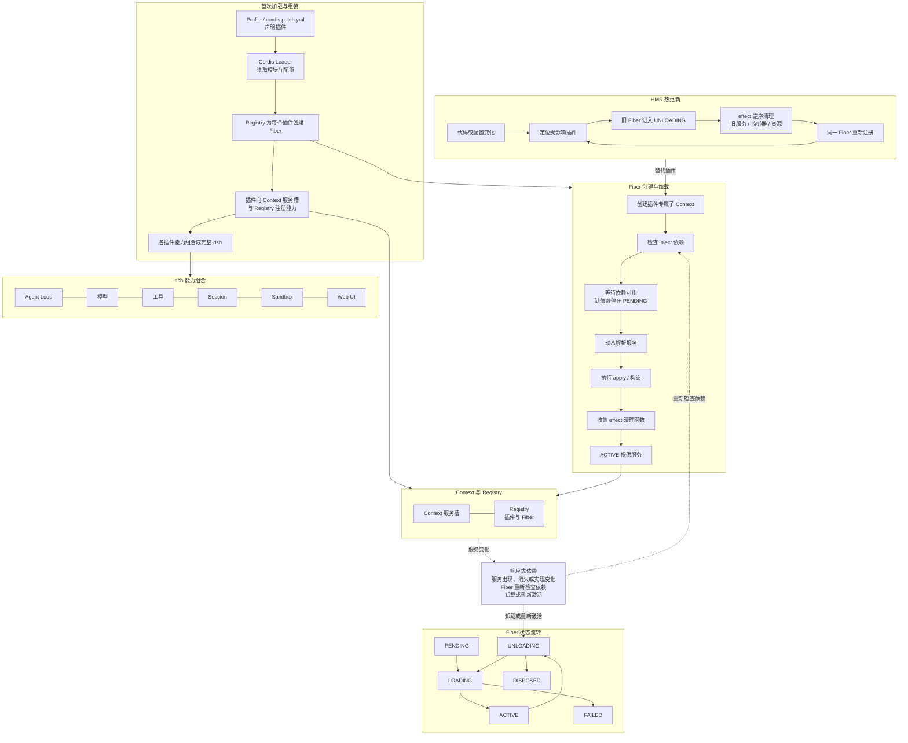

### 静态组装：从配置到插件树

- 运行中的 dsh 是"启动时由有序层组合成的插件树"。这棵树的组合发生在启动阶段，依据是三层概念：

| 概念 | 是什么 | 谁写的 |
| --- | --- | --- |
| profile | 一个命名的组合，列出堆哪些 bundle、装哪些插件、放用户的 patch | 预置模板或用户 |
| bundle | 一组 Cordis 配置行加它们挂载的代码，打包分发的单位 | 各 bundle 包 |
| patch | 覆盖配置，按 id 定位一行并整体替换，或插入新行 | 用户 |

- 每个 bundle 和 profile 在自己的 package.json 里用 dsh 字段声明自己：dsh.profile 列出 profile 的 bundles，dsh.bundle 指向 bundle 的补丁文件。补丁文件可以是一个，也可以是一个有序列表，`dsh-web-app` 就是五个：主 patch 加四个 preset
- 层叠顺序是固定的：profile 里每个 bundle 按列出顺序一层层叠，然后是 profile 自己的 cordis.patch.yml，再是 home 级的 cordis.patch.yml，最后是命令行 --patch 覆盖。后面的层能改前面的层
- profile 根上的 cordis.yml 不是"默认插件清单"，它只是一个空根（`[]`），给 Loader 一个锚点。所有默认行都写在各自的 cordis.patch.yml 里，整棵树由 patch 层叠出来
- patch 的合成不在 Loader 里，而在 app-boot 的合成步骤：它把各层 patch 按顺序拼起来，按 id 定位行、整行替换配置，或者用 `insert` 插入新行。所谓"删行"不是 patch 语法，是下一代组合不再列出这一行时由重合成自然移除
- Loader（加载器）负责另一半：解析配置行、按名字读插件模块、处理 `!!js` 插值（`config` 在插件自己的上下文里算，`disabled` 在每次挂载决定时算）
- HMR 由 YAML 控制：base 打开只监听配置的 dsh-hmr，headless、sdk、acp 关掉，sdk-minimal 干脆不挂。profile patch 可以覆盖这些默认值
- 插件不是随便装：安装和启动会对照插件声明的 `engines.dsh` 范围（没声明就按 DSH peer 范围）检查运行时版本，不兼容的插件要用户显式确认一个精确版本的豁免才能装
- 想看你机器上实际启动的插件树，运行：
  - `dsh --profile web --dump-config`
  - 打印出来的每个条目都对应一次实际挂载，条目带 `# ==` 开头的层注释，标明它来自哪个 bundle、被谁改过，任何一行都可以被你的 patch 替换
- 用 mermaid 表示组合过程：

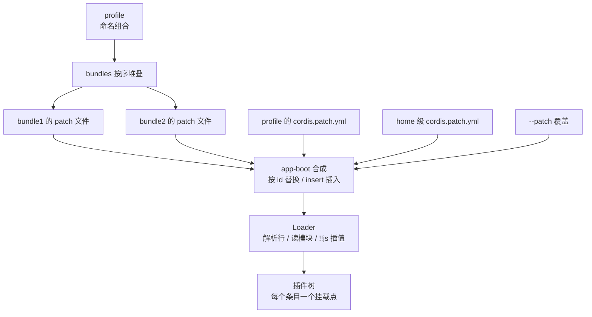

### agent preset：会话级组合（四种模式）

- profile、bundle、patch 属于"进程级组合"：决定整个 dsh 进程启动时挂哪些插件。dsh 还有第二层组合，"会话级组合"：每个 agent 会话从哪个 preset 组合出自己的工具集、提示段和 skills
- preset 的写法在 0.2.x 换了。旧版是"一个目录，里面放一份 agent.cordis.yml"；现在是一条普通的 Cordis 插件行：`@deepseek-ai/dsh-agent-preset`，`config.plugins` 直接列子插件。登记由 `@deepseek-ai/dsh-agent-preset-registry` 负责，它不扫目录、也不接受 preset 路径
- 四个内置 preset 以 patch 文件的形式随 web bundle 分发，`config.id` 分别是 standard、ptc、minimal、cordis，可以按 `preset-standard` 这类 id 被 profile patch 覆盖：

| 模式 | preset 名 | 组成 | 定位 |
| --- | --- | --- | --- |
| 标准模式 | standard | 完整编码 agent：文件编辑、Shell、文件与网页检索、skills、计划模式组、目标、子代理、工作流、插件管理 | 日常全能 |
| PTC 模式 | ptc | 与标准模式基本相同，但关掉 workflow、插件管理与插件市场工具，改挂 PTC 执行器 | 编程式工具调用 |
| 极简模式 | minimal | 持久终端（bash 或 pwsh）加读图工具，带上下文压缩 | benchmark、最小环境 |
| 创造模式 | cordis | 标准模式全部能力，加运行时检查工具和写插件、写 patch 的技能包 | 造新 preset |


- 系统级组合和会话级组合的关系：进程启动时按 profile 挂好基础（注册表、沙箱、审批、持久化、模型路由），每个会话再从 preset 组合自己的那层。Host 共用同一个 Agent Loop，preset 换的是这个会话的工具、提示段和技能
- 四种模式不是四个不同程序，是同一套插件机制下的四种不同插件组合，这正是"不同模式 = 不同插件配置"的体现
- PTC 模式单独说。PTC 全称 Programmatic Tool Calling（编程式工具调用），做法是给模型两种呈现方式：
  - native：模型直接调用工具，传统 function calling
  - ptc：模型写一段程序（当前是 TypeScript），程序通过生成的 SDK 绑定调工具，把多步操作放进一个程序里
  - 0.2.x 起这不再是 `tools.mode` 开关，而是"挂哪个执行器"：`tool-executor-native` 或 `tool-executor-ptc`，按作用域选，最近的作用域决定提供者。旧的 `tools.mode` 与 `presentAs` 字段被显式删除了，写在新配置里会直接报错
- 创造模式的工具能力收窄了：它带的是 `tool-cordis`，现在只做运行时检查（列条目、查条目），不再"在内存里定义并运行插件"。装持久插件的活归插件管理器；写插件的规范放进了 `dsh-agent-preset` 自带的技能包里
- 会话可以在"还没产生任何输出"之前换 preset，一旦有产出就锁定了；换的时候发 `tools/change`，让界面和工具集同步刷新

### Registry 与 Fiber：插件与运行实例

- 这一节开始进入 Cordis 的机制层。先分清两个概念：
  - Plugin（插件定义）：一份可执行的入口（函数、类、或 apply 对象），它描述"这个插件是什么"
  - Fiber（运行实例）：同一个插件被 ctx.plugin() 加载一次，就产生一个 fiber，它是"这次加载的运行实例"
- 类比：Plugin 是程序，Fiber 是进程。同一个程序可以启动多个进程，同一个插件也可以被加载多次、产生多个 fiber，各自有自己的配置和状态
- 一个 fiber 的生命周期由状态机管理，官方源码里的枚举是（vendor/cordis/src/fiber.ts）：

```ts
// vendor/cordis/src/fiber.ts —— 一个插件 fiber 的生命周期状态
export const enum FiberState {
  PENDING,    // 等待所需的服务出现
  LOADING,    // 插件回调正在执行
  ACTIVE,     // 已加载、正在提供服务
  FAILED,     // 回调或配置抛了错
  DISPOSED,   // 已移除，无法重启
  UNLOADING,  // 正在回卷资源（跑 disposer）
}
```

- 官方对每个状态的注释：PENDING 是等所需服务；LOADING 是回调在跑；ACTIVE 是加载完、提供服务；FAILED 是回调或配置抛错；UNLOADING 是 disposer 在跑；DISPOSED 是已移除、不能重启
- fiber 的启动路径大致是：
  1. ctx.plugin(plugin, ...args) 创建 fiber，状态 PENDING
  2. 发布 internal/plugin 事件（加载器可能在这里补充依赖声明）
  3. 逐个检查 inject 声明的服务依赖，缺任何一个就停在 PENDING 等
  4. 依赖齐了，状态变 LOADING，执行插件回调（函数就直接调，类是 new 出来）
  5. 回调里注册的所有 effect 被收集起来，无错则状态变 ACTIVE
- 一个容易被忽略的点：依赖缺失不是报错，而是"等着"。fiber 停在 PENDING，等服务出现的那刻再继续。这就是"加载顺序由服务需求表达"的落地
- 失败也有一条明确的路：回调或配置抛错，状态变 FAILED，日志记录错误。但 FAILED 不会因为依赖恢复就自己重来，`_setEpoch` 里有一句 `if (this._error) return` 把这条路封住；只有调用 `fiber.update()` 清掉 `_error` 之后，它才会重新加载
- 用 mermaid 画状态机：

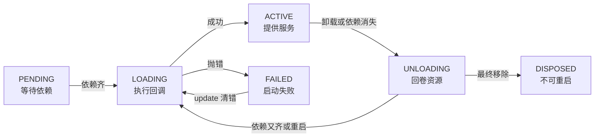

- DISPOSED 是终态：fiber 的 id 被清空，任何再往它上面注册 effect 的尝试都会抛 INACTIVE_EFFECT。这就是"卸载了就是卸载了"，不残留半死不活的实例

### Context 服务槽与专用 Registry

- fiber 跑起来之后，插件怎么互相发现？靠 Context。Context 是一个服务仓库，插件往里面"放服务"和"取服务"
- 两个核心操作：
  - provide：一个插件声明"我提供某服务"，注册进对应的服务槽
  - inject：一个插件声明"我需要某服务"，按 key 依赖
- 关键点是按 key 而不是按实现：依赖方写 ctx.tools、ctx.llm、ctx.sessions，不写"import 某个具体类"。这样换实现时，调用方一行都不用改
- 服务缺失时 fiber 停在 PENDING 等，这是"响应式依赖"的入口。机制上由 fiber 的 _refresh 实现：它把每个依赖服务的实例 uid 拼进自己的"纪元"（epoch），只要有一个依赖缺失，纪元就变成非活动值，fiber 退回到等待态

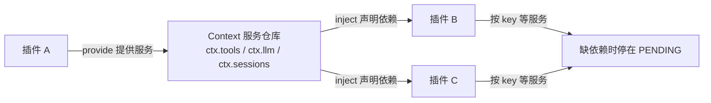
- 和专用 Registry 的分工要分清：

| 维度 | Context 服务槽 | 专用 Registry |
| --- | --- | --- |
| 管什么 | 全局的 ctx.<key> 服务仓库 | 特定领域的注册表，如 ctx.tools、ctx.sessions |
| 职责 | 服务存在、依赖解析、作用域隔离 | 该领域的注册、查询、守卫逻辑 |
| 例子 | ctx.llm、ctx.agents | ctx.tools 的工具执行管线、ctx.sessions 的日志管理 |

- Context 回答"这个服务在不在、谁提供"，专用 Registry 回答"这个领域里注册了什么、怎么用"。工具、会话这些领域有自己的专用注册表和丰富逻辑，Context 是它们下面那层通用的服务总线
- inject 还能带拦截配置（intercept），声明"我消费某服务的拦截配置"，这是给那些需要包一层语义的领域用的，一般的依赖用不到

### Effect：可回卷的副作用

- 插件在加载时要"做事"：注册服务、挂事件监听、起一个 server、开一个文件监视器。这些事在 Cordis 里统一叫 effect（副作用），它们有一个共同要求：随时能被撤销
- 用 ctx.effect 注册一个 effect，写法是：

```ts
ctx.effect(() => {
  // 立即执行：注册服务、监听事件、启动资源
  const server = startServer()
  // 返回一个 disposer（撤销函数）
  return () => {
    server.close()
  }
})
```

- 语义是两条：
  - 立即执行：effect 的函数体在注册时就跑，不等以后
  - 返回 disposer：函数返回一个撤销函数，用来撤掉刚才做的事
- 撤销的时机有两个，谁先到用谁：
  - 你手动调用返回的 disposer
  - fiber 卸载时，把收集到的所有 disposer 一起跑掉
- 关键的设计是"逆序回卷"：卸载时按注册的逆序运行 disposer。源码就在 fiber.ts 里：

```ts
// vendor/cordis/src/fiber.ts —— 卸载：清理 fiber 收集的所有 disposer
private async _unload() {
  // Dependents are notified when this fiber leaves ACTIVE, but may still
  // access its services during their own teardown, so the effects of this
  // fiber are only disposed after every dependent has unloaded.
  while ([...this.provisions].some(impl => impl.dependents.size)) {
    await new Promise<void>((resolve) => this._release = resolve)
  }
  this._release = undefined
  await Promise.all(this._disposables.clear().map(async (dispose) => {
    try {
      await composeError(async (info) => {
        await Promise.resolve()
        info.error = new Error()
        await runDisposable(dispose)
      }, this._runner.getOuterStack)
    } catch (reason) {
      this.ctx.logger.error(reason)
    }
  }))
  // release the providers waiting for this fiber to unload
  for (const impl of Object.values(this.committed ?? {})) {
    if (!impl.dependents.delete(this) || impl.dependents.size) continue
    impl.release?.()
    impl.ctx.fiber._release?.()
  }
  this.committed = undefined
  this._updateState(() => {
    if (this._runner.epoch === INACTIVE) {
      this.inertia = undefined
    } else {
      this.inertia = this._reload()
      return FiberState.LOADING
    }
  })
}
```

- 这段比"逆序跑 disposer"多两件事：卸载前先等所有依赖方退场（`dependents` 清空），卸载后通知等它的提供方。所以 Cordis 的卸载有顺序保证，不是一把 `Promise.all` 撒出去

- 每个 effect 产生的 disposer 被收集进 fiber 的 _disposables 列表；effect 返回的 disposer 内部也是这样逆序跑：

```ts
// vendor/cordis/src/fiber.ts —— 一个 effect 内部按注册逆序撤销
const dispose = () => {
  if (disposing) return disposalTask
  disposing = true
  let task!: void | Promise<void>
  for (const disposable of disposables.splice(0).reverse()) {
    if (task) {
      task = task.then(() => runDisposable(disposable))
    } else {
      const result = runDisposable(disposable)
      if (isObject(result) && 'then' in result) {
        task = result as any
      }
    }
  }
  return disposalTask = task
}
```

- 逆序不是一句 for 循环就完了：每个 disposer 可能返回 Promise，这里用一条串行链把它们接起来，保证后一个等前一个跑完，顺序不会被异步打乱

- 逆序的意义：资源有依赖关系。你先注册了 A，再注册 B，B 可能用到了 A 的东西；卸载时先撤 B、再撤 A，才不会出现"A 已经没了，B 撤销时找不到它"的问题
- 这就是 dsh 能"卸载干净"的根本原因：没有哪一行注册是漏网的，每个注册都必须配一个 disposer（官方实践规则明确要求：Every registration should have a disposer）
- 这同时解释了为什么插件能热更新、为什么说"没有特权核心需要 patch"：一切注册都可回卷，卸载旧插件不会留下僵尸资源

### 事件系统：Typed Events

- 插件之间除了"按服务 key 找实现"，还需要"广播通知"和"拦截请求"。这靠事件系统，而且事件是强类型的
- 事件名通过 TypeScript 的声明合并（declaration merging）声明：各个包往同一个事件映射里加自己的事件类型，编译期就能检查事件名和载荷对不对，插件扩展的事件也能被类型系统覆盖
- 事件的派发方式有五种，官方 primer 有一张表：

| 模式 | 是否等待 | 派发顺序 | 有返回值吗 |
| --- | --- | --- | --- |
| emit | 否 | 监听者按注册顺序观察 | 无 |
| waterfall | 否 | 监听者按注册顺序观察 | 有 |
| parallel | 是 | 所有监听者并行 | 无 |
| serial | 是 | 监听者按注册顺序观察 | 有 |
| bail | 否 | 按注册顺序，直到一个触发 bail | 有 |

- 这五种对应五类语义：
  - emit：纯广播，谁听到了谁处理，互不干扰（比如会话事件广播给 UI）
  - waterfall：围绕中间件的链，一个监听者可以决定要不要传给下一个（比如工具执行的 pre-execute）
  - parallel：并行 fan-out，等全部完成（比如多个消费者都要处理的初始化）
  - serial：按顺序执行，前一个结果可以传给下一个
  - bail：按顺序，直到某个监听者给出决定性答案就停（比如"谁处理这个请求"）
- waterfall 是 dsh 里最常见的拦截方式，它的语义要单独讲清（官方 primer 原文）：
  - 监听者收到 (...args, next)，调用 next() 把（可能被包装过的）结果委托给下一个监听者
  - 不调用 next() 就短路：链条在这里停住
  - 值通过 next() 的返回值向后传播
- 举个例子：工具执行管线的 tools/pre-execute 就是 waterfall。一个权限插件监听它，决定"允许"就调用 next() 放行，决定"拒绝"就不调用 next() 短路，工具本体就不会执行

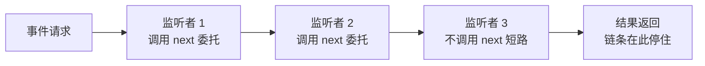
- 派发模式是事件的公开契约的一部分：官方要求新事件用 @mode 标注，生成目录会检查声明和派发处是否一致

### 响应式依赖与 HMR

- Cordis 最亮眼的能力是响应式依赖：服务一变化，依赖方自动跟着变
- 响应式依赖的机制在 fiber 的 _refresh 里：

```ts
// vendor/cordis/src/fiber.ts —— 依赖变化时重算"纪元"
_refresh() {
  let epoch = `${this._revision}`
  for (const name of Object.keys(this.inject)) {
    const impl = this._store[name]
    if (!impl) {
      epoch = INACTIVE      // 缺一个依赖，纪元变成非活动值
      break
    }
    epoch += ':' + impl.uid // 依赖实例的 uid 拼进纪元
  }
  this._setEpoch(epoch)     // 纪元变了，就重新加载或卸载
}
```

- 纪元（epoch）由配置修订号打头，后面拼上每个依赖服务的实例 uid。任何依赖的实例变了（出现、消失、换实现），依赖方的纪元就变，fiber 重新加载或退回等待态。这个级联会沿着依赖链往下传：A 依赖 B，B 依赖 C，C 换实现，B 和 A 依次跟着重载

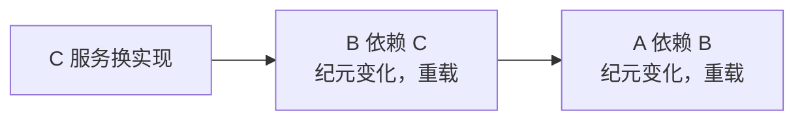

- 这是"服务缺失时停在 PENDING"的完整机制：纪元缺依赖就变成非活动值，fiber 卸载（_unload），等服务出现纪元变回活动值，fiber 再重新加载（_reload）。注意 `_setEpoch` 里有一句 `if (this._error) return`，所以失败过的 fiber 不参与这条自动恢复
- HMR 是站在响应式依赖上做的"主动版本"：调用 `fiber.update(config)` 要求某个插件用新配置或新代码重来。默认行为是 restart，也就是先回卷再重载
- 源码里 restart 与 update 长这样：

```ts
// vendor/cordis/src/fiber.ts —— 重启与热更新
async restart() {
  const fiber = this.ctx.fiber
  fiber.assertActive()
  fiber._revision++   // 修订号自增，纪元随之改变
  fiber._refresh()
  await fiber.await() // 等重载稳定
}

update(config: any, noSave = false): Awaitable<void> {
  const fiber = this.ctx.fiber
  fiber.assertActive()
  const loaded = fiber._runner.epoch !== INACTIVE
  const resolved = loaded ? fiber.resolveConfig(config) : undefined
  if (!noSave) fiber.context.emit('internal/commit', fiber, config)
  fiber.config = config
  fiber._error = undefined          // 清掉错误，FAILED 才能重来
  const configRevision = ++fiber._configRevision
  const epoch = fiber._runner.epoch
  const committed = fiber.committed
  let restarted = false
  const restart = () => {
    restarted = true
    return fiber.restart()
  }
  const publish = () => {
    // 只有没被否决、且状态没再变过，才把新配置登记为生效配置
    if (!restarted && fiber.uid !== null && fiber._configRevision === configRevision
      && fiber._runner.epoch === epoch && fiber.committed === committed) {
      fiber._effectiveConfig = resolved
    }
  }
  const result = loaded
    ? fiber.context.waterfall(fiber, 'internal/update', resolved, restart)
    : restart()
  // a listener may veto the restart, in which case there is nothing to await
  if (result === undefined) {
    publish()
    return
  }
  const task = Promise.resolve(result).then(publish)
  // the failure is already reported by the fiber, so mark it handled here:
  // a caller that drops the result cannot turn it into an unhandled
  // rejection, while `await update()` still observes it
  task.catch(() => {})
  return task
}
```

- `internal/update` 是 waterfall，监听者不调用 `next`（也就是不调 `restart`）就等于否决这次重启；`update` 看到 `result === undefined` 就只发布配置、不重启。这才是"可否决"的实现方式
- 需要说清的一点：dsh 侧的 HMR 实现换过。旧版挂 `@deepseek-ai/cordis-plugin-hmr`，0.2.x 换成 `@deepseek-ai/dsh-hmr`，`hmr` 服务键与事件保留，但重载路径改成"Loader 的 entry 更新加 app-boot 的 `recomposeProfile()`"，所以改 profile 或 home 级 patch 文件也能触发对应的重合成。`internal/update` 的现役监听者是 Loader，不是 HMR 插件
- 为什么重载之后不残留旧资源？因为重启走的是同一套 _unload：先等所有依赖方退场，再逐个跑掉这个 fiber 收集的 disposer。旧插件注册的服务、监听、server 全部撤销，再在同一 fiber 上重新注册
- 同一个 fiber 从头到尾只有一个：`_reload()` 是在这个 fiber 上重跑，`uid` 不变；只有 dispose 才会把 `uid` 置空、进入 DISPOSED。所以"热更新等于换了一个新 fiber"这个说法不对，换的是同一次加载的内容
- 用 mermaid 画 HMR 的流程：

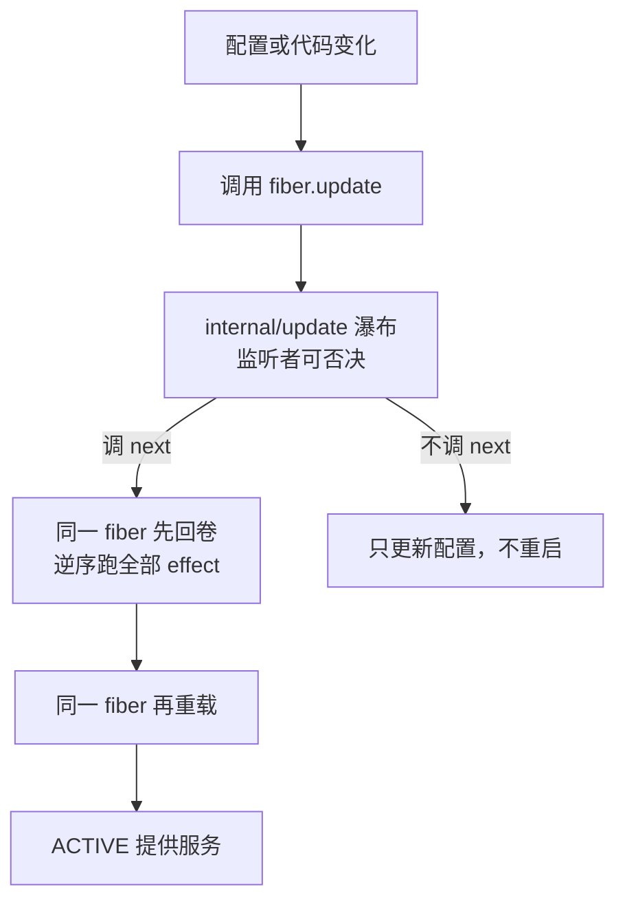

- 响应式依赖和 HMR 的分工：响应式依赖管"依赖变化时被动跟着变"，HMR 管"主动要求某插件重启"。两者共用同一套 fiber 生命周期。所以 web profile 能热更新，headless、sdk、acp 这类一次性或 stdio 的应用刻意关掉，任务开始后换依赖会破坏生命周期

### 小结：Cordis 模型

- Cordis 的机制拆开讲完了，这里收拢成一张职责表：

| 部件 | 解决什么问题 |
| --- | --- |
| app-boot 合成 | 把各层 patch 按 id 拼成最终条目列表 |
| Loader | 解析条目、读插件模块、维护运行中的插件图 |
| Registry | 管理插件定义与 fiber 的关系 |
| Fiber | 一个插件的运行实例，管状态和生命周期 |
| Context | 服务仓库，按 key 提供/获取服务 |
| Effect | 可回卷的副作用，保证卸载干净 |
| Inject | 声明依赖，让加载顺序由需求决定 |
| Typed Events | 插件间广播与拦截，强类型 |
| HMR | 响应式依赖 + 主动重启，支持热更新 |

- app-boot 先把各层 patch 合成成条目列表，Loader 再按条目把插件装进来，每个插件变成一个 Fiber，Fiber 通过 Context 声明依赖（Inject）并贡献服务，服务之间用 Typed Events 通信，Fiber 里做的一切注册都是 Effect，随卸载逆序回卷；依赖一变，靠响应式依赖沿链级联，HMR 让改动即时生效
- 分层图：

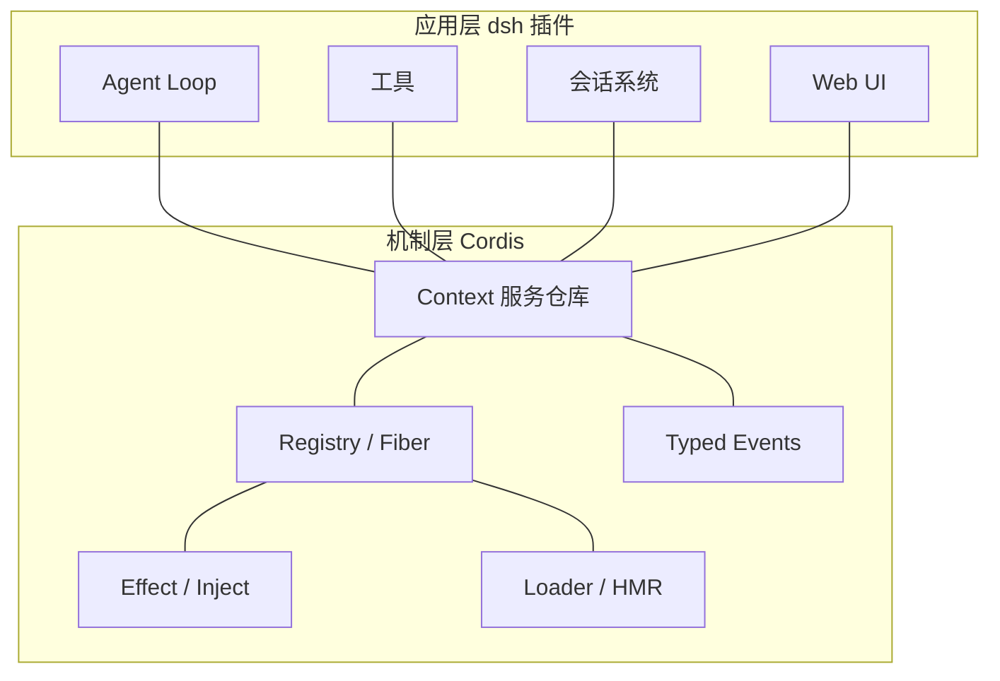

- 最后回答一个贯穿全文的问题：为什么 Agent Loop 本身也是插件、还能替换？因为 Agent Loop 在 Cordis 视角里就是一个"提供 ctx.agentLoop 服务的插件"。它依赖模型、会话、工具这些服务，通过 inject 声明；它要做的注册同样走 effect。别的插件提供一个实现了同样服务的插件，就能替换它，机制上没有任何特殊之处
- 这就是"一切皆为插件"在机制层的完整答案：不是宣传口号，而是 Cordis 这套生命周期、依赖、副作用模型把每个组件都变得可替换

### 实践：写第一个 Cordis 插件

- 概念节讲了 Cordis 的机制，这一节动手写一个最小插件，把 Fiber、Context、Effect、HMR 都过一遍
- 一个最简单的插件（官方教程 01 的形态）：

```ts
// my-plugin.ts —— 第一个 Cordis 插件
export const name = 'my-plugin'

export function apply(ctx) {
  // apply 是插件的入口，ctx 是这个插件的上下文
  ctx.effect(() => {
    console.log('插件已加载')
    return () => console.log('插件已卸载')
  })
}
```

- 把它接进配置。这里有个关键区别：patch 文件里的裸行（只写 `- id:`）是"覆盖已存在的那一行"，要**新增**插件必须放在 `- insert:` 下面，否则 Loader 会报 `patch: entry "my-plugin" not found`

```yaml
# <DSH_HOME>/profiles/web/cordis.patch.yml
- insert:
    - id: my-plugin
      name: './my-plugin'
```

- `name` 是模块标识，解析规则跟 profile 目录一致。手写文件时插件模块要能被 Node 解析到；正式分发走插件管理器（`dsh plugin` 或界面里的安装按钮），由它写进 profile 的依赖

- 跑 `dsh --profile web` 或 `pnpm dsh --profile headless "随便一句话"`，你会看到：
  - 启动时打印"插件已加载"
  - 如果 profile 支持热更新（web），改一下插件代码保存，会看到先打印"插件已卸载"再打印"插件已加载"，这是同一个 fiber 先回卷再重载，不是换了个新 fiber
  - 退出时打印"插件已卸载"
- 进阶一步，加上依赖声明和提供服务：

```ts
// my-plugin.ts —— 声明依赖 + 提供服务
export const name = 'my-plugin'

export const inject = ['tools']  // 等 ctx.tools 出现才加载

export function apply(ctx) {
  ctx.effect(() => {
    // 往工具注册表里挂一个工具
    return () => { /* 卸载时撤销 */ }
  })
}
```

- 观察点：
  - 把 inject 改成 ['不存在的服务']，插件会一直停在 PENDING，不报错也不加载，等那个服务出现
  - 把 effect 里的注册写清楚 disposer，卸载时它一定被跑
- 官方教程一步步来：[Cordis 教程 01](https://github.com/deepseek-ai/deepseek-harness/blob/dsh-v0.2.2-rc.1/docs/cordis-tutorial/index.md)，02 讲生命周期和 effect，06 讲组合与 HMR，07 讲怎么把插件接进 harness
- 这一节做下来，你亲手看到了"加载、依赖等待、卸载回卷、热更新"四个动作在日志里的样子

## 产品形态

- 0.2.x 把同一套机制长成了一个产品。这一节看它现在长成什么样，判断标准只有一个：这件事能不能反过来证明"一切皆插件"，或者解释清"插件从哪来"。

### 桌面应用

- 官方发布了 Electron 桌面版。它不是另写一套 harness，而是给完整的 Web 应用套了一个壳：`apps/desktop` 的说明写着 "an Electron shell around the complete dsh Web application"
- 壳本身承担两件平台相关的事：独占 `$DSH_HOME/profiles/desktop` 这个 profile，以及在应用菜单里注册 `dsh` 命令（自带 pnpm 运行时）
- 对命令行这边的影响是硬的：`desktop` 成了保留名，CLI 拒绝启动它、也拒绝对它做配置 dump。所以你在终端里敲 `dsh --profile desktop` 是走不通的，桌面端只能由桌面应用自己启
- 这条正好反证界面是插件：同一个 Web 前端，换一个宿主（浏览器或 Electron）就能跑，harness 一行没改

### 插件管理器与插件市场

- 插件管理器是 0.2.x 新增的能力：从 Web 侧栏安装、移除、启停插件，也可以让 agent 通过工具代劳。它和 `dsh plugin` 命令共用同一套包操作与 profile 写锁，更新依赖时会保留你已经关掉的组合包选择
- 插件市场是另一层：它读用户自己配置的插件索引，列出可装的东西、兼容性和安装状态，并提供一个只读的 `plugin_market` 工具给模型查。要点在于**默认没有配置索引源**，随附的 profile 也不装启用它的组合包，所以"dsh 自带应用商店"这个说法不成立
- 这两件事加起来回答了"插件从哪来"：以前是自己写 patch、自己改文件，现在是先看清单、再点安装，装完还是落在 profile 的 patch 层里。插件化没变，只是入口图形化了

### 遥测与可观测

- "每次运行可追溯"在 0.2.x 落地成两条通道：本地是 append-only 的会话日志，远端是可选的 OTLP 上报
- 上报默认是关到最小的：会话上传默认 `FEEDBACK_ONLY`，另有默认开启的会话日志上传插件（`session-log-deepseek`）。字段、开关都在 `dsh-otel`、`session-telemetry-otel`、`host-product-telemetry-otel` 这三个包里，部署侧可以整体关掉
- 对使用者的意义是：轨迹和统计数据来自同一份事件流，不是另存一份；对隐私敏感的场景，要主动去看这三个包的配置，而不是假设"没联网就没有数据"

### 调度与后台

- `schedule` 从实验组合包转成了内置工具（`tool-schedule`），标准 preset 里直接就有。它和 `jobs`（后台任务）、`workflow`（多步子代理编排）一起，构成"把活丢出去、过后再收"的那一层
- 这三样都不是新机制，是既有插件体系里的新工具：调度本身还是个插件，能换能关

### 组合包矩阵

- 官方维护一份组合包清单（`dsh-official-bundles`），按用途分四类，插件管理器就是照这份清单展示的：

| 类别 | 含义 | 例子 |
| --- | --- | --- |
| 模板 | 首次使用时自动初始化 | web、headless、sdk、sdk-minimal、acp |
| 可选 | 在插件管理器里可装可卸，默认不装 | session-search、agent-team、liveshare、inspector、forge、plugin-market、worktree、voice-input、auto-review |
| 按需 | 装的时候才拉，能装进任何 profile | subagent-claude-code、subagent-codex、cua |
| 已退役 | 安装器会从旧 profile 里移除 | 旧的 experimental-schedule-bundle |

- 这张表也解释了文章里反复出现的"默认不装"：可选和按需这两类不在基础组合里，读者在 `--dump-config` 里看不到它们，不代表不存在

### 实验包

- 仓库里有一批 `dsh-experimental-*`，都在可选清单里，装的时候插件页会打 Experimental 徽标。它们各自解决一个具体问题，不是同一套东西的变体：

| 包 | 做什么 |
| --- | --- |
| agent-team | 一个会话里多出 Lead、具名 teammate 和共享任务板，九个协调工具 |
| forge | 注册代码托管提供方，轮询变更请求状态 |
| liveshare | 把会话共享出去，带所有者登录校验和查看者控制 |
| inspector | 用 Chrome DevTools 检查 Host 与浏览器的 Cordis 运行时 |
| ralph | 显式请求的重复工作，每次用全新的 agent 跑 |
| worktree | 在会话的文件策略下建一个保留的 Git worktree |
| translator | 机器翻译，匿名端点或可选的原生 Flash |
| auto-review | 每次调用前加一道自动审查 |

- 这些包的共同点是都可装可卸、不进默认 profile。写进文章只是为了说明"插件化到什么程度"：连"多个 agent 开会"这种事都能作为一个可选组合包存在，而不是内核里的一个模式

### 其余方向

- 还有几条产品线没有展开：Office 能力（`skill-office`、`office-to-pdf`、libreoffice 工具包）、语音（`speech-to-text`、`voice-input`）、远端访问（`api-remote-access`）。它们的共同点是都在插件层，不在 harness 的机制层
- 写到这里可以下一个判断：0.2.x 没有改"一切皆插件"这条主线，而是把这条主线的产品化做完了。桌面端、插件市场、遥测、实验包，每一个都是"再挂一个插件"，没有一个走进内核

## 实践与落地

### 安装与运行 dsh

- 动手用 dsh，第一步是装。前置是 Node.js，0.2.x 要求 `>=24.9.0`（0.1.x 时代还是 `^22.19.0` 或 `>=24.0.0`，升级时容易漏），然后一行命令启动 Web UI：

```bash
npx @deepseek-ai/dsh web
```

- npx 会拉取并运行官方 npm 包（[@deepseek-ai/dsh](https://www.npmjs.com/package/@deepseek-ai/dsh)）。默认在 `127.0.0.1:3080` 起服务，本地启动会自动开浏览器；通过 SSH 启动时只打印带 token 的地址，因为转发地址由 SSH 客户端或编辑器掌握。加 `--no-open` 就只起服务不开浏览器（快速开始见[官方文档](https://deepseek-harness.github.io/deepseek-harness/)）
- 想从源码跑，就 clone 官方仓库，装依赖后用 pnpm 起：

```bash
git clone https://github.com/deepseek-ai/deepseek-harness
cd deepseek-harness
pnpm install
pnpm run build
pnpm dsh web
```

- `pnpm run build` 不能省。它准备仓库产物（含前端静态文件），`pnpm dsh web` 直接复用这些产物、不再构建；少了这一步，启动会停在"前端未构建"的提示上

- 五个随附 profile 的差别：
  - web：浏览器界面，支持热更新
  - headless：无界面，给一句话跑完打印结果；`--json` 输出行事件流，`--session-id` 可续跑
  - sdk / sdk-minimal：给 SDK 客户端用的 JSON-RPC 服务，后者是独立的极简组合
  - acp：自动化协议服务
- 启动器没有默认 profile，所以要写全 `dsh web` 或 `dsh --profile headless "任务"`
- 日常试玩用 web 就好；写脚本批量跑任务用 headless

### 查看插件树

- 装好之后第一件值得做的事，是看自己的机器实际启动了哪些插件：

```bash
dsh --profile web --dump-config
```

- 输出是 YAML 条目列表，按层分组，每组前面有 `# ==` 注释标明来源。条目包含 id、包名，以及可选的 `disabled` 和 `config`
- 读这张表的三个姿势：
  - 数一数：模型适配器、工具、会话持久化、沙箱、审批、界面各自在哪几条
  - 找对应：对照插件的六类能力，在表里找到每一类的实例
  - 记 id：每个条目都有一个 id，它就是 patch 要定位的目标
- 一句话记住它：任何一条，都能被你的 patch 替换
- 另外两个选项：`--dump-default-config` 看没有用户层覆盖的默认树，`--dump-config-schema` 导出这些条目和 patch 的 JSON Schema

### 用 cordis.patch.yml 自定义

- 自定义的入口是 patch 文件。两层可选：profile 自己的 `cordis.patch.yml`（`$DSH_HOME/profiles/<name>/cordis.patch.yml`，只影响这个 profile），以及 home 级的 `$DSH_HOME/cordis.patch.yml`（影响所有 profile）
- patch 的两种操作，写法不一样：
  - 覆盖已有行：直接写 `- id:`，按 id 定位，**整行替换**它的 config
  - 新增行：必须写在 `- insert:` 下面。裸写一个不存在的 id 不会新增，只会报 `patch: entry "..." not found`
- 先看一个覆盖的例子，改 DeepSeek 那条路由的凭据与端点（字段名照官方文档写，别想当然）：

```yaml
# cordis.patch.yml —— 覆盖已有条目
- id: llm-deepseek
  name: '@deepseek-ai/dsh-llm-deepseek-api-key'
  config:
    apiKeyEnv: DEEPSEEK_API_KEY
    baseURL: 'https://api.deepseek.com/anthropic'
    models:
      - id: deepseek-flash
        contextWindow: 1048576
```

- 这段对应 `--dump-config` 里的 `llm-deepseek` 那一行（默认 profile 挂的是 `dsh-llm-deepseek-api-key`，不是 `dsh-llm-deepseek`；适配器由这个 provider 带着走，配置字段是同一套）
- 三个容易写错的地方：
  - 字段是 `baseURL`（大驼峰），不是 `baseUrl`；模型是 `models` 列表，没有单个 `model` 字段
  - 0.2.x 的 DeepSeek 适配器走 Messages API，默认端点已经不是 `https://api.deepseek.com`，而是 `https://api.deepseek.com/anthropic`
  - 默认模型目录是 `deepseek-flash` 与 `deepseek-v4-pro`，`deepseek-chat` 不在这套文档的目录里
- 新增插件则是另一种写法：

```yaml
# cordis.patch.yml —— 新增一个插件条目
- insert:
    - id: my-plugin
      name: 'my-plugin'
```

- 换模型路由：把 `llm-deepseek` 这一行换成别的 provider（例如 `dsh-llm-pi-ai`）；加工具：insert 一个工具插件；调沙箱：改权限预设插件的配置。所有"改行为"都落到"改配置 + 重启（或等热更新）"
- 想让插件真正装进 profile，用插件管理器或 `dsh plugin --profile <name> add <package>`，别只手改 patch：装包这一步要更新 profile 的 `package.json` 依赖，手改会漏
- 改动后如果用的是 web profile，保存 profile 或 home 级 patch 会触发重合成；headless、sdk、acp 这类一次性或 stdio 的组合需要重启

### 常见工作流与人类命令

- 人类命令（human commands）是绕过模型回合、直接在 harness 层响应的命令，走 ctx.commands。几个常用的：
  - /goal：管理同一会话的目标，agent 会围绕它继续；带 edit、pause、resume、clear 子操作，也有轮次上限
  - /plan：进入计划模式，先规划再执行；`/plan off` 退出
  - /compact：立即压缩上下文
  - /permission：查看当前权限预设并切换（基础组合自带）
  - /feedback：提交反馈
  - /export：把会话导出成 ZIP 或复制为 Markdown
- 命令和模型回合的区别要说清：命令本身不进对话历史，只有它产生的副作用会以事件形式落进日志，所以 `/compact` 压完不会多出一轮对话
- 除了命令，日常还会用到这几类能力：
  - 接 MCP：把外部 MCP server 挂进来当工具，官方文档有配置方式
  - 加载 skills：把技能目录挂进 preset 或 skill 根，agent 就能按技能工作
  - 配沙箱：按需求选 read-only、workspace-write 或 danger-full-access，配合审批策略
  - 用子代理：把大任务拆给子代理并行，或后台常驻一个
- 权限与凭据：敏感操作走审批；模型凭据有两条路，官方账号登录或 API Key（`DEEPSEEK_API_KEY` 这类环境变量或凭据插件），别写进仓库
- 官方用户指南：[deepseek-harness.github.io/deepseek-harness](https://deepseek-harness.github.io/deepseek-harness/)

## 收束

- 这篇把 DeepSeek Harness 从概念到实现拆完了。回看主线：
  - 概念层：模型是内核，harness 是外壳，Agent = Model + Harness
  - 哲学层：一切皆为插件，模型、工具、循环、日志、界面都是可替换的插件
  - 架构层：入口走 ctx.agents，Agent Loop 在模型和工具间循环，每一步记录进会话日志，日志派生模型上下文，落盘、压缩、沙箱、子代理各司其职
  - 机制层：Cordis 用 Fiber、Context、Effect、Inject、Typed Events、HMR 这套机制，配合 app-boot 的分层合成与 Loader 的模块加载，让"一切皆插件"成为可运行的现实
  - 产品层：桌面端、插件管理器、遥测、实验包都按同一套机制挂进来，没有一项走进内核
- 再强调一次时效：dsh 是 developer preview，官方明说会有破坏性兼容变更。本文按 0.2.2-rc.1（2026 年 11 月）核对，读到这里时版本可能又前进了；核对过程走了三个来源：npm 安装里的实际包、固定到 `dsh-v0.2.2-rc.1` tag 的仓库文档、以及本机跑出来的 CLI 输出。对不上的地方以官方最新文档为准
- 想深挖的方向：
  - 想验证机制，跑 `--dump-config` 看自己的插件树，再写一个插件观察 HMR
  - 想读权威定义，官方文档站（[deepseek-harness.github.io](https://deepseek-harness.github.io/deepseek-harness/)）的子系统页和包 README 是唯一权威来源
  - 想参与，官方仓库（[deepseek-ai/deepseek-harness](https://github.com/deepseek-ai/deepseek-harness)）是开源的，一切皆插件意味着改它不用改核心
