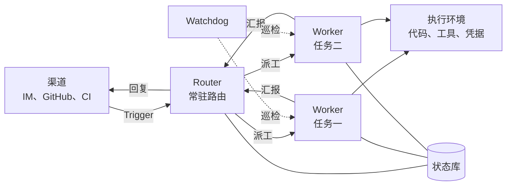

# Super-agent 剖析

## Super-agent 是什么

- 写这篇的起因，是看了几篇关于 Super-agent 的解读，仍然没弄明白它和每天在用的 Coding Agent（在终端或编辑器里替你改代码的 Agent）差在哪里。答案在官方设计文章和开源原型里，两份材料的术语密度都不低，这篇从零讲起。
- 文章讲到的事实来自官方设计文章和原型仓库，引用处带链接。

### 三个窗口

- 上午十点，桌面上开着三个 Agent 会话。第一个在修报表工具的导出问题：用户反馈导出的 CSV 用 Excel 打开是乱码。第二个在写这周的需求文档。第三个刚把测试跑起来，在等 CI 结果（CI 是代码提交后自动执行的构建与测试）。
- 群里弹出一条消息，有人问导出能不能加一个"仅导出当前筛选结果"的选项。这条消息和第一个会话有关，但要接上它，得先想起第一个会话做到哪一步，再把消息贴过去。
- 一天下来，写代码的时间不多，大量时间花在切换窗口、回忆上下文、把一句话从一个窗口搬到另一个窗口。

### 一个会话里发生了什么

要理解为什么会变成这样，先看一个会话内部。一个能独立干活的 Agent 由四样东西组成。

- 模型负责决策。它读入当前上下文，决定下一步是回答、调用工具，还是结束。
- 工具是模型能调用的动作。读文件、执行命令、查接口、在 PR 下留言，都是工具。模型本身只能生成文本，是工具让它能改变外部世界。
- 循环把一次决策变成一串决策。模型决定调用工具，程序执行工具，把结果放回上下文，模型再决定下一步。这个循环叫 ReAct，出自 2022 年的论文 [ReAct: Synergizing Reasoning and Acting in Language Models](https://arxiv.org/abs/2210.03629)。
- 上下文是模型每一轮能看到的全部内容，包括系统提示、对话历史、工具调用和返回结果。上下文窗口是模型一次调用能处理的 token 上限，token 是模型处理文本的单位，一个汉字通常占一到两个 token；超出的部分要么被压缩，要么被丢弃。

四样东西绑在一起连续运行，构成一次 Session。Session 保存一段对话的完整状态：说过什么、调用过哪些工具、拿到了什么结果。窗口关掉再打开，只要 Session 还在，这些状态就还在。

- Session 和上下文窗口容易混。Session 是对话的边界，可以跨越很多轮；上下文窗口是单次调用的容量，每一轮都要按窗口大小重新组装。历史超过窗口容量时，系统只能压缩摘要或者截断。
- Session 有一个结构性的限制。循环是串行的：模型发起一次工具调用，循环停下来等结果，结果回来才能继续。等待期间新的输入进不来，只能排队。
- 把一次真实任务拆开看：模型读报错文件，工具返回文件内容；模型决定跑测试，工具执行三十秒；测试结果回来，模型改代码；再跑一次测试。每一段都要等上一段结束，用户在这期间发的消息只能排在当前步骤后面。

### 为什么三个窗口解决不了

- 三个窗口是三个 Session。它们各有各的上下文，互相不知道对方在做什么，也不知道对方已经知道了什么。
- 跨任务的信息只存在人这里。导出乱码的根因是代码里写死了 GBK 编码，而新需求也要改导出参数，两件事应该一起做。这个关联不在任何一个 Session 的上下文里。
- 官方[设计文章](https://www.bilibili.com/opus/1265361021143351318)给了一个观察：

> 而据我们观察，一个人通常只能同时跟进 3 到 5 个活跃 Session。在这种设计下，单任务的上限取决于模型能力，多任务的上限取决于人的注意力。

- 这句话把问题定位在注意力上，不在模型能力上。
- 给 Agent 接上 GitHub、飞书这类渠道，或者用 MCP 接外部系统，能让消息自己进来，但绕不开三个问题：
  - 单个会话执行耗时命令时循环停住，新消息只能排队；
  - 多个任务的细节挤在同一个上下文里，互相干扰；
  - Agent 跑在本地电脑上，电脑休眠就停。
- 这三个问题都来自"以 Session 为单位"这个前提，换一个插件解决不了。

### 定义与四个特征

- Super-agent 指的是一套 Agent 系统：持续在线，从人已经在用的渠道接收请求，同时推进多个任务，只在需要人决策或验收时说话。
- 它把 Session 从界面上藏了起来。用户面对的是一个始终在线的对象，内部开了几个会话、哪个任务派给了谁，由系统自己管理。
- 设计文章把它归纳为四条特征：

| 特征 | 可观察的行为 | 靠什么支撑 |
| --- | --- | --- |
| 连续 | 在群里说用方案 A，后来在 PR 评论里改成 B，它接得上 | 双层架构 |
| 高效 | 上一个任务没跑完，也能接新指令，其他任务照常推进 | 双层架构、异步工具调用 |
| 主动 | 没人 @ 也会处理值得处理的反馈，不值得时保持安静 | 事件驱动与规则 |
| 持久 | 电脑关机或进程重启后能继续，异常能自己恢复 | 状态与执行环境分离、Watchdog |

- 四条特征里，"连续"和"高效"是有张力的。想连续，最好一个会话管到底；想高效，就得多开会话。整套架构的大部分设计都在处理这个矛盾。

### 它不是什么

容易混淆的几样东西，放在一张表里对比。

| 概念 | 它解决什么问题 | 与 Super-agent 的差别 |
| --- | --- | --- |
| 单会话 Agent | 一个任务从头做到尾 | 人负责开窗口、切换、搬运上下文 |
| Agent Team | 一个复杂任务内部的步骤拆解与角色协作 | 领头者要深入任务细节、高频协调；Super-agent 分的是任务之间 |
| 工作流编排 | 人预先写死步骤，按顺序执行 | 步骤由人定；Super-agent 由事件触发，由模型判断 |
| Copilot 式补全 | 在编辑器里补全下一段代码 | 不独立推进任务，也不跨渠道 |
| Personal Agent | 个人助手这类产品形态 | 产品形态会变；Super-agent 是支撑它的底层架构 |

- 这些概念不是互斥的。一个系统可以既有 Agent Team，也有工作流；区别在于 Super-agent 把会话管理当成实现细节，把人的注意力当成需要节省的资源。

### 两个材料

- 一份是 DeepSeek Harness 团队 2026 年 10 月 31 日发布的设计文章 [Exploring Super-agent Design: Towards a More Autonomous Agent System](https://www.bilibili.com/opus/1265361021143351318)，讲了五个模块、两组实验和四类开放问题。
- 另一份是同一天开源的原型仓库 [deepseek-ai/dsh-superagent-prototype](https://github.com/deepseek-ai/dsh-superagent-prototype)，MIT 协议，src 目录约 1.5 万行 TypeScript，配 9 篇编号文档。
- 仓库 README 开头有一段声明：这是研究原型，不是官方产品；为了公开发布做过适配，和团队内部版本、和设计文章描述的实现都不完全相同，文章里有些设计只是方向，原型没有实现。
- 这段声明决定了读法。文章讲的是"打算怎么做"，代码讲的是"实际做到了哪一步"。两者混在一起，会把设计目标当成既成事实。

## 它能做什么

- 设计文章给了三个例子。前两个来自 DeepSeek Harness 团队内部运行的实例，第三个是个人助手场景的设想。原文在 [B 站专栏](https://www.bilibili.com/opus/1265361021143351318) 与[公众号](https://mp.weixin.qq.com/s/zoS7GlReWPhfCjENGxXCdg)同步发布，文字相同。三个实例分别展示三种能力：跨渠道推进同一个任务、没人要求时主动行动、在后台把准备工作做完。每个实例后面说明原型走到了哪一步。
- 判定标准只有一条：机制能不能在原型代码里找到对应实现。找得到算具备，只找到一部分算部分，找不到算没有。

### 跨渠道推进同一个任务

- 设计文章在说明"连续"时给了这个例子：

> 例如，用户先在 IM 上提出采用方案 A、随后在 GitHub Pull Request 评论里改为方案 B，它能理解并调整执行方向。

- 这件事需要三样东西：
  - 两个渠道都能接收消息，也都能回复；
  - 同一个任务的后续消息能直接到达正在处理它的执行者，不必每次都重新判断归属；
  - 执行者掌握同一份任务状态，渠道切换不会丢上下文。
- "接得上"的具体含义是：PR 评论作为一条新事件进入系统，被送到正在处理这件事的执行器；执行器的上下文里有最初的请求和它已经做过的改动，所以能把"改用方案 B"理解成对同一件事的修改，而不是一个新任务。
- 原型具备这套机制。GitHub 与飞书都是接入来源（代码里叫 Source），可以同时接；主 Session（对外接单和回复的会话）接单后创建工单，执行器（真正干活的会话）订阅相关线程，后续评论由程序直接送到执行器；执行器向主 Session 汇报，主 Session 回到原渠道回复。
- 有两处限制。原型只服务一个 GitHub 仓库；飞书来源默认关闭，要配置机器人之后才能用。

### 没人要求也去处理

- 设计文章这样描述内部实例：

> 这个实例还会持续观察公共群聊中的反馈，在无人 @ 的情况下主动定位根因并提交修复 Pull Request。

- 设计文章在讲投机执行时补了团队内部的做法，他们在用户群里配了一条"静默复现并修复"的规则：

> 当群里有人反馈问题或讨论改动方案时，Agent 先在后台尝试复现并寻找修复方案，只有在确认问题并找到简单的修复方案后，才会把结果交付给用户，否则全程保持安静。

- 群里的消息大部分是闲聊。设计文章的做法是两级过滤：先由确定性规则按来源、群组范围、白名单筛掉明显无关的消息，再把候选交给模型判断；团队写的规则决定"哪类反馈值得动手"，不是"看到什么就修什么"。
- 这件事需要三样东西：
  - 事件驱动：群消息进入系统，不需要人先下命令；
  - 规则：团队提前写明哪类消息值得处理，以及处理到什么程度；
  - 投机执行：在不确定结果会不会被采用时先做，有价值就交付，没价值就丢掉。
- 原型部分具备。规则与接单模式都在：团队可以写一条静默复现的规则，把接单模式设为 auto，它就会按规则判断并接单；规则也可以要求不发出确认消息。
- 缺的是投机执行本身。原型没有"先在后台做完、再决定说不说"这一步；默认的 observe 模式只是把判断结果记录成"会接受"，不真的动手。

### 在后台把准备工作做完

- 设计文章在个人助手场景下举了这个例子：

> 当收到一封会议邀约邮件或待办消息时，Agent 可以先在后台核对日程冲突、搜集相关背景资料并备好回复草稿，待用户过目后即可直接确认发出。

- 这件事需要的不只是接一个邮件账号：要能读日历判断冲突，要能检索背景资料，要能在人确认后执行发送，还要在发出之前不惊动收件人。
- 三样东西缺一不可：邮件与日历的接入、投机执行、能在人确认后执行发送动作的环境。
- 原型没有做到。它只接 GitHub 与飞书，没有邮件和日历来源；投机执行也没有实现。这一段是设计文章给个人助手场景指出的方向，不是原型的现状。

### 三个实例的共同点

- 都由外部输入触发。第一个是人明确要求，第二个是规则放行的群消息，第三个是收到的邮件。
- 过程都不出现在人眼前。人看到的是确认、问题、结果，中间的执行步骤留在系统内部。
- 都依赖同一套底座：接得进渠道、记得住任务状态、判断得了该不该动。

| 实例 | 需要的机制 | 原型状态 |
| --- | --- | --- |
| 跨渠道推进 | 多渠道入口、线程订阅、任务状态共享 | 具备 |
| 无人要求也处理 | 事件驱动、团队规则、投机执行 | 部分：有规则，无投机执行 |
| 后台备稿 | 邮件与日历接入、投机执行 | 没有 |

### 这三件事的代价

- 每多接一个渠道，就多一份噪音、一套身份和一组权限要维护。渠道越多，判断"谁可以发起任务"的规则越复杂。
- 主动行动越多，误判的代价越高。所以原型默认用 observe 模式，先看它对规则的判断准不准，再决定要不要放开。
- 后台做得越多，越需要人能随时叫停。没有这个开关，人不知道它在做什么，也拦不住做错的事。

### 它做不到什么

- 不会自己定目标。没有请求，也没有规则允许，它不启动任务；默认的 observe 模式只记录判断，不执行。
- 不越过规则。谁能发起任务、在哪个群、以什么身份，由准入表和策略决定；消息内容不能修改这些权限。
- 不能替代验收。PR 要人 review 和 merge；原型默认不自动合并，只有团队在交付要求里指定另一个账号的合并命令，并且改动就绪、所需批准覆盖当前提交、增删行数少于 200 行时，才允许自动合并。
- 不能在没有接入的渠道上工作。来源决定它能看见什么；没有邮件来源，就收不到会议邀约。
- 这四条边界和能力是同一套设计的两面。系统把调度和上下文接过去，把目标、授权和验收留给人。

## 为什么需要 Super-agent

把 Agent 当日常工具用，迟早会撞上三个问题。它们看起来分别关于执行速度、上下文容量和设备在线，实际指向同一个前提。

### 同步阻塞

- ReAct 循环里，模型决定调用工具之后，循环要等工具返回结果，才能继续下一步。
- 一条跑四十秒的构建、一次跑两分钟的测试，都会把整个会话按住。这段时间里用户发的新消息进不来，只能排队，等当前步骤结束再处理。这段时间对用户是纯等待，既不能继续这件事，也不能开始下一件。
- 问题不在工具慢。即使每个工具都很快，一次调用也要占掉一次模型往返和一次工具执行；步骤越多，单会话的串行时间越长。
- 人的工作节奏却是多任务的。等构建的时候顺手问一句别的事，在单会话结构里没有位置放这句话。
- 换成异步工具调用能缓解等待，但同一时刻仍然只有一个任务在占用这个会话的上下文，多个任务的推理还是会排在一条线上。

### 上下文混杂

- 一个会话只有一个上下文窗口。多个任务的细节都写进去，互相挤占空间；窗口满了要压缩，系统会把早期消息总结成一段，工具调用细节和当时的约定可能被丢掉。
- 任务之间还会互相污染。上一个任务的报错、路径、约定留在上下文里，模型可能把它们带进下一个任务。
- 拆成多个会话能隔离上下文，但人又要自己开窗口、切换、搬运信息。
- 原文在讲双层架构时把这个矛盾写得很直接：

> 如果每条事件都交给同一个 Session 处理，虽然上下文最连续，但受限于单个 ReAct Loop 串行执行的速度上限，任务完成耗时长、吞吐低，且多任务的中间细节混杂在一起也会影响完成效果。反过来，如果每条事件都直接新开独立的 Session 去处理，虽然并发吞吐最高，但一旦任务之间并不完全独立，缺少全局上下文会让各个 Session 的结果彼此割裂，同时多个 Session 各自向用户响应也会造成交互混乱。

- 一个会话连续，但串行；多个会话并发，但割裂。两个极端都不满足"同时推进多件事，还要保持连续"。

### 离线即停

- 本地 Agent 把三样东西绑在同一台机器上：推进循环的计算、需要保存的会话状态、代码与工具链所在的执行环境。
- 笔记本合盖、断网、关机，三样一起停。任务做到一半，恢复要靠人重新打开、重新交代。
- 换一台设备也不行，环境不在那台机器上；会话记录在本机文件里，换机器要拷贝，凭据在本机环境变量里，换机器要重配。
- 原文：

> 现有的本地 Agent 默认将推进 Agent Loop 的计算、需要持久保存的会话状态，以及代码仓库与本地工具链等执行环境绑定在同一台设备上。一旦设备休眠或离线，Agent 就会停止运行，且无法访问其他设备上的环境。

### 已有的补丁

- 后台任务把耗时命令放到后台，对话不用干等。它只解决等待，任务仍然在这一个会话里，上下文没有隔离。
- 子 Agent 把一部分工作放进独立上下文，主 Session不用亲自做。它解决一部分上下文隔离，但主 Session仍要做判断、协调和汇总，任务一多，协调本身又变回串行。
- 云端开发环境把代码和工具链搬到云上，解决离线。它解决环境问题，但本地未提交的修改、私有凭据、内网服务搬不过去。
- 这些补丁各自修一个角，剩下的仍然由人补。人还是要在会话之间切换，还是要在任务之间搬运上下文。
- 补丁之间也会互相牵制：后台任务让命令不再挡住对话，子 Agent 让一部分上下文隔离出去，但"一个入口对应一个会话"的结构没有变，协调仍然发生在人这一层。

### 外挂方案为什么不够

- 给 Agent 接上 CLI、MCP 或外部连接器，能让外部消息进来，也能让它调用更多系统。
- 原文对这一类扩展的判断：

> 如果只在现有的本地单会话 Agent 上借助 CLI、MCP 或外部连接器做简单扩展，Agent 虽然也能接入外部消息，但仍受制于单会话同步阻塞、多任务上下文混乱、本地设备离线即停止运行等问题，需要大量人工维护。

- 消息进来了，处理它的仍然是那个单会话：一次一件事、一个上下文、一台机器。

### 三个问题指向同一件事

- 三个问题分别关于执行、上下文和设备，根都在两个绑定上：Agent 绑在"一次手动会话"上，也绑在"一台本地机器"上。这两个绑定是从本地单会话产品沿袭下来的，不是某个实现的疏忽。
- 加渠道、加工具、加连接器，都是在这两个绑定外面加东西，绑定本身没有动。
- 要解决，只能拆绑定：会话变成系统内部的管理单位，机器变成可以替换、可以离线的执行端。

### 从问题到要求

| 问题 | 对系统的要求 | 对应特征 |
| --- | --- | --- |
| 同步阻塞 | 同时接多个任务，单个任务的耗时不能拖住其他任务 | 高效 |
| 上下文混杂 | 每个任务有独立上下文，跨任务只共享必要事实 | 连续 |
| 离线即停 | 计算、状态、执行环境解耦，执行端可替换 | 持久 |

- 三条要求不是并列的功能清单，它们互相牵制：隔离上下文会削弱连续性，并行接单会放大调度成本。架构要在两者之间找平衡，而不是各自做到极限。
- 第四个特征"主动"不来自这三个问题，它来自另一个目标：不用人逐条下命令，系统自己盯着环境。
- 架构要处理的不是模型能力，而是任务变多之后，调度成本不要再回到人身上。

## 一条消息怎么走完全程

用一个例子走一遍。场景是一个内部报表工具，用户开了一个 Issue：导出的 CSV 用 Excel 打开是乱码。维护者在 Issue 下 @ 了 Agent，写了一句"能修一下吗"。例子是虚构的，链路和代码路径来自原型代码。

### 从评论到回复

1. 评论进入系统。GitHub 的通知或轮询读到这条新评论，把它转成一条不可变的事件，带上作者、时间、原文和所在的 Issue。这条事件叫 Trigger（触发）。
2. 程序先做确定性判断。发评论的人在不在白名单里、这条评论有没有 @ Agent、这个仓库在不在监听范围，都是能直接查表的条件。通过的评论变成候选。
3. 主 Session（对应设计文章里的 Router）看候选卡片，决定接单。它在 Issue 下回一句确认，同时创建一张工单（Ticket），写下授权（Mandate）：谁发起的、范围多大、依据哪一版策略。
4. 工单派给一个执行器（Executor）。执行器拿到一个独立目录和一个独立会话，目录里是这个仓库的一份检出。
5. 执行器干活。读导出相关代码、复现乱码、改编码、跑测试，确认修好后开一个 Pull Request，把结果报告给主 Session。
6. 主 Session 回到 Issue 下回复"已提交 PR #123"。之后 PR 上的每条评论都作为新事件直接送到同一个执行器，不再经过主 Session 重新分派。PR 合并，工单结束。

这条链路上有四个角色：渠道负责收发消息，主 Session 负责判断和派活，执行器负责干活，状态库负责记住每一步。事件在它们之间流动，人只在两个时刻出现：发起请求，验收结果。

不是每条评论都会走到开 PR。主 Session 也可能把评论挂到已有工单（attach）、判定为闲聊而忽略（ignore），或者按人的要求停止（stop）。这条链路只画了接单这一支。

### 为什么要拆成一条链

- 判断和执行分开。判断只需要看卡片和策略，执行要读代码、跑命令、改文件；两者对模型、工具和上下文的要求不同。
- 执行和状态分开。执行器可能崩、可能被替换，工单的状态不能跟着它一起丢。
- 消息和结果分开。过程中的工具调用留在执行器内部，对外只发确认、问题和结果。
- 拆开之后每一段都能独立替换：换模型、换执行环境、换渠道，不影响其他段。
- 拆开的代价是每一段之间都要有明确的协议：事件长什么样、派工带哪些字段、汇报用什么结构。协议定得越清楚，替换越容易；任何一处对不上，链路就断。

### 系统全景

把这条链路放大到整个系统，就是设计文章给出的结构：



- 这套结构的中心是状态库，不是模型。模型可以换、执行器可以换，只要状态库里的工单、订阅、事件还在，链路就能接着走。

图里有几条边值得单独说明：

- 渠道到 Router 的边承载 Trigger。渠道包括群聊、Issue、PR 评论、CI 结果，任何能产生事件的地方。
- Router 到 Worker 的边承载派工。Router 不干活，只决定这件事交给谁。
- Worker 到执行环境的边承载工具调用。Worker 的推理在别处，命令和文件操作发生在执行环境里。
- Worker 到 Router 的边承载汇报。Worker 不直接对人说话，结果由 Router 统一回复。
- Worker 与状态库、Router 与状态库之间是读写，不是消息。会话、工单、事件都落在这里，进程重启后靠它恢复。
- Watchdog 是主系统之外的一条巡检线，用定时消息驱动，检查 Worker 有没有实质进展。

### 五个模块

设计文章对为什么需要这套结构的说法是：

> 单个 ReAct Loop 无法同时支持上述四个特征，底层需要一套相应的架构。

五个模块各管一段：

- 双层架构让 Router 接人派活、Worker 隔离执行，处理连续与吞吐的矛盾。
- 事件驱动让外部事件先过滤再路由，处理"没人下命令也要行动"。
- 面向人的交互把耗时工具调用异步化、按渠道定制输出，处理"干活时接不了新指令"。
- 计算、状态与执行环境的分离把循环放云端、状态进数据库、环境留在设备上，处理设备离线。
- Watchdog 在主系统之外放一个巡检会话，处理"进程活着但任务跑偏"。

| 要解决的问题 | 对应模块 |
| --- | --- |
| 连续与吞吐的矛盾 | 双层架构 |
| 没人下命令也要行动 | 事件驱动 |
| 干活时接不了新指令 | 面向人的交互 |
| 设备离线就停 | 计算、状态与执行环境的分离 |
| 进程活着但任务跑偏 | Watchdog |

### 原型的位置

原型是这套结构在 DeepSeek Harness 上的一次落地，服务一个 GitHub 仓库。两边的名词不同，位置一一对应：

| 设计文章 | 原型代码 |
| --- | --- |
| Router | 主 Session |
| Worker | 执行器 Session |
| 状态库 | 一个 SQLite 文件 |
| 执行环境 | 本机，以操作者身份执行命令 |
| Watchdog | 没有实现 |

前四行是同一套结构换了名字。主 Session 与执行器都是 DeepSeek Harness 的 Session，只是预设不同：主 Session 用路由预设，工具少，禁止等待；执行器用工作预设，工具全，前台命令五秒转后台。

最后一行说明原型少了一块：巡检靠的是健康检查、重试和面板上的问题项，没有一个独立的巡检会话。

### 术语表

下面这些词是原型代码和仓库文档共用的术语，中文译名取自仓库术语表；设计文章里的 Router 与 Worker，对应原型里的主 Session 与执行器。按链路顺序排：

| 术语 | 中文 | 在链路里指什么 |
| --- | --- | --- |
| Source | 来源 | 事件从哪来，比如 GitHub、飞书 |
| Trigger | 触发 | 一条不可变事件，比如一条评论 |
| Thread | 线程 | 同一个 Issue、PR 或话题下的事件序列 |
| Gate | 准入 | 确定性判断：谁可以发起、强度多大 |
| Eval | 评估 | 判断一批事件要不要开工的过程 |
| Assessment | 研判 | 评估里由模型做的那部分判断 |
| Decision | 决定 | 接单、停止、忽略、未完成 |
| Mandate | 授权 | 接单时写下的范围与依据 |
| Ticket | 工单 | 一件被授权的工作 |
| Assignment | 派工 | 工单交给某个执行器的那次绑定 |
| Subscription | 订阅 | 工单与线程的多对多关系 |
| Executor | 执行器 | 真正干活的会话与目录 |

一条 Trigger 进来，经过 Gate 和 Eval 得到 Decision；Decision 为接单时创建 Ticket 和 Mandate；Ticket 通过 Assignment 交给 Executor；Subscription 决定后续哪些事件会送到这个 Executor。这条链上的每个词，在原型代码里都有对应的类型和规则；中文译名与仓库术语表一致。

## Router 和 Worker 双层架构

双层架构要解决的是一个具体的矛盾：连续和吞吐。

### 两个极端都不行

- 所有事件交给一个会话处理，上下文最连续，但一次只能推进一件事。任务一多就排队，几个任务的中间细节还会混在一起。
- 每条事件都新开一个会话，并发最高，但任务之间缺少全局上下文，结果彼此割裂；多个会话各自回复人，交互也会乱。
- 设计文章把这称为连续性与吞吐量之间的权衡。要同时拿到两者，只能把“维持连续”和“并发执行”拆到两层去做。

### 两层各管什么

- Router 层常驻，接住所有渠道进来的人和事。跨任务的信息、决策和记忆都汇总在这里，它是对外的唯一出口。
- 原文把 Router 的位置说得很明确：

> 所有跨任务的信息与决策都在 Router 层中汇总，由它充当全局的序点（Sequence Point）、协调点和记忆。

- Worker 层负责执行。每个 Worker 有独立上下文和完整工具，专心做一件事，做完向 Router 汇报。
- 两层的关键差别不在工具多少，而在职责：Router 不碰具体任务，连 Bash 都可以不给。原文：

> Router 层在设计上不直接执行具体任务，只负责人类交互与任务分派，甚至可以不配备 Bash 工具。

| 维度 | Router | Worker |
| --- | --- | --- |
| 职责 | 接人、判断、派活、汇总 | 执行具体任务 |
| 上下文 | 全局，跨任务 | 隔离，单任务 |
| 工具 | 少，甚至没有命令行 | 完整 |
| 模型 | 轻量即可 | 通常最强 |
| 对谁说话 | 直接对人 | 只向 Router 汇报 |
| 出问题的影响 | 全局卡住 | 只影响一个任务 |

- 把人挡在 Worker 之外，是为了避免多个会话同时对人说话。人看到的确认、问题和结果，都从 Router 这一个出口发出。
- Router 不干活还有一个好处：它不会被某个具体任务拖住。派活只需要读卡片、做判断、写一句话，单步的推理负担很轻。

### 批处理让 Router 不成为瓶颈

- 所有需要 Router 判断的消息都经过一个常驻会话，第一反应是它会堵。设计文章的做法是让积压自然形成批处理：Router 在跑上一轮推理时，新到的事件先排队，下一轮一起处理。
- 这样做的前提是 Router 的每一步是长输入、短输出。多条事件合并进一次调用，输入部分可以并行计算，单次请求耗时的增长远慢于事件条数的增长。
- 原文对这个机制的判断：

> 因此在一定范围内，积压越多，单个决定分摊的推理时间越低；上限取决于上下文长度，以及模型在一轮中能准确处理多少条 Trigger。

- 压测数据：把需要 Router 决定的 Trigger 到达速率从每分钟约 1 条提到约 40 条，结果如下。

| 指标 | 每分钟 1 条 | 每分钟 40 条 |
| --- | --- | --- |
| 平均 batch 大小 | 1.0 | 2.8 |
| 单次请求耗时 | 2.5 秒 | 3.9 秒 |
| 每个决定分摊的推理时间 | 6.4 秒 | 1.6 秒 |

- 请求耗时涨了约 56%，平均 batch 涨了 180%，摊到每个决定上反而降到四分之一。事件越密，单位决策的成本越低。
- 这个机制的边界也很清楚：上下文长度、模型一轮能处理的事件条数，都会先到顶。到顶之后，Router 层只能做水平切分，而切分粒度越细，跨分片的连续性越差。

### 直通：后续事件不再经过 Router

- 同一个 PR、同一个 IM 话题、同一串邮件下的连续事件，构成一条 Thread。Worker 接手一个 Thread 之后会订阅它，后续事件由程序直接送到 Worker，不再经过 Router 判断归属。
- 订阅是多对多的。两个 Worker 可以订阅同一个 PR，都能收到它的新动态，冲突由它们自己发现和处理，不需要点对点通信。
- 这样一来，Router 只处理“还没人认领”的新事件，已经分配出去的事不再消耗它的判断。
- 消融实验：拿掉直通机制，任务完成时间基本不变，但 Router 要做的决定多了约 30%，单次实验读缓存的 token 从 2,323 万涨到 3,177 万，增幅约 37%。
- 原文的结论：

> 这表明在实验负载下，直通机制不提高任务完成质量与速度，但为 Router Session 节省了可观的 token 与推理开销。

- 直通真正省下的是 Router 的推理和 token，时间上在实验负载里看不出差别。直通之后，它只在新事件上花推理，旧事件的后续由订阅关系直接送达。

### 端到端实验

- 设计文章用一个合成负载对比了四种方案：完整 Super-agent、去掉直通的 Super-agent、单 Session 加 Subagent 工具（中性提示）、单 Session 加 Subagent 工具（提示优先委派）。
- 每次实验约 300 条消息，其中约 20 条是工作请求，其余是闲聊、跟进、叫停和 CI 消息；编码工作用一个只消耗时间的工具代替；每种方案跑 5 次。

| 方案 | 关键行为 | 结果 |
| --- | --- | --- |
| Super-agent | 事件直通 Worker | p50 12.4 分钟，p95 15.7 分钟 |
| 单 Session，中性提示 | 5 次都没委派，全部自己干 | p95 29.5 分钟 |
| 单 Session，提示优先委派 | 5 次里 4 次委派，1 次判断“活很小”自己干 | 仍慢于 Super-agent，出现长尾 |
| 去掉直通的 Super-agent | 完成时间基本一致 | 决策增加 30%，缓存 token 增加 37% |

- 单 Session 的失败点不在模型能力，而在判断权。要不要把活派出去，由模型在每一轮临场决定；提示词能提高派活的概率，但不能保证。剩下那一次“活很小”的判断，就足以拖出一条长尾。
- 双层架构把判断权从提示词里拿走：Router 不承担执行职责，甚至可以没有命令行工具，派活不再依赖模型临场决定，而由层的职责决定。Worker 只处理自己工单范围内的事，不会被别的任务打断。

### 和 Agent Team 的区别

- Agent Team 拆的是一个复杂任务内部的步骤：谁先做、谁后做、谁和谁对齐。领头者要理解任务细节，协调频率高，自身推理负担重。
- 双层架构拆的是任务之间：这条消息交给谁，那件事和这件事有没有关系。单个任务内部怎么拆，Router 不介入。
- 两者可以叠加。Worker 内部可以再开 Subagent，也可以本身就是一个 Agent Team，这些对 Router 透明。

### 原型里的两层

- 原型把两层放在同一个 DeepSeek Harness 进程里。Router 是主 Session，Worker 是每个工单一个执行器 Session，两个角色用不同的预设：主 Session 工具少、禁止等待，执行器工具全、前台命令五秒转后台。
- 并发上限默认是 3 个执行器槽位，人的消息可以额外占一个，保证人不会被新任务堵住。
- 这套落地保住了双层架构的职责划分，但没有做设计文章里的跨机部署。两层在同一台机器上，共享同一个 SQLite 文件，进程一停，两层一起停。

### 这一层没解决的问题

- 单个 Router 会话能扛多少，取决于模型一轮能准确处理多少条事件。设计文章给出的数据只到每分钟 40 条，再往上没有答案。
- 水平切分能提高吞吐，但会切碎全局记忆。切分粒度、分片之间怎么同步，文章把它列成了开放问题。
- 长程记忆也不在这一层解决。运行周期拉长到几个月，Router 的上下文里不可能放下所有历史，靠引用逐跳召回只能缓解，不能替代长期记忆。

## 事件驱动：过滤、上下文与提前行动

单会话 Agent 由人驱动：人敲一句，Agent 做一轮。Super-agent 想让它自己盯着环境，第一步是把驱动源换掉。

### 从提示词到事件

- 群聊消息、Issue 和 PR 评论、CI 结果、邮件、日程提醒，都是环境里产生的事件。设计文章把它们统称为 Trigger。
- Trigger 进入系统之后，先要回答两个问题：这条事件值不值得处理，处理它需要看多少上下文。
- 大多数事件不值得处理。群里有人问中午吃什么，CI 跑成功了一条没影响的检查，这些都不该消耗一次模型调用。
- 事件驱动不等于完全自主。它只把“什么时候开始”从人手里接过去，“做什么、做到什么程度”仍由请求和规则决定。

### 两级过滤

- 原文对事件流的描述：

> 在接入真实的群聊与代码平台后，环境事件流呈现出显著的“高噪音、低触发率”特征，绝大多数日常消息并不需要 Agent 介入。如果对每个事件都调用大模型从头判断，延迟和算力成本都会难以承受。

- 第一级是程序层，速度快、成本低。它只看确定性条件：事件从哪来、在不在监听的群或仓库、发件人在不在白名单、是不是机器人。判断结果只有三种：明确请求、候选事件、直接忽略。
- 第二级是语义层，把候选交给模型，由模型按提示词里的规则和上下文判断要不要行动。加一条新策略，改提示词就行，不用改代码。
- 三种结果的差别在于谁来确认。明确请求直接进入派活，候选要过语义层，忽略在程序层就结束，不消耗模型。
- 这套分工对应计算机系统里的 Fast Path 和 Slow Path：确定性判断走快路径，语义判断走慢路径。
- 两级的分工是固定的：程序层负责把量降下来，语义层负责把意图看清楚。反过来先调模型再筛，成本和延迟都不可接受。
- 原型把确定性层做成了准入表：谁能发起、在哪个范围、以什么强度。它同时承担了一部分筛噪音的职责，但判断依据是身份和范围，不是内容；内容判断交给模型。
- 准入表按接收范围分行，每行最多三格：名单内但没点名、名单外但点了名、名单外也没点名。每格可以设成明确请求、候选或忽略。接单模式再决定候选能不能真的变成工作：off 只接明确请求，observe 对候选只记录“会接受”，auto 才让候选真的变成工作。
- 这套表加上接单模式，就把“谁能让它干活”和“它愿不愿意主动干”拆成了两个开关。改一个开关，不需要动代码。

### 上下文组织

- 事件通过过滤、找到归属之后，下一个问题是往模型的上下文窗口里放多少信息。
- 放多了挤占窗口、分散注意力；放少了模型要反复调工具去读，执行步数变多。原文有一句话把这件事说得很直接：

> 浪费上下文窗口，就是浪费模型的智能。

- 设计文章借用了两个操作：Inline 和 Spill。Inline 是把近期很可能用到的信息直接放进窗口，省掉一次工具调用；Spill 是把太长或低频的内容留在窗口外，窗口里只留引用或摘要。
- 注入从最少信息开始：先给对象 ID 和一句摘要。再按局部性补充：把关联对象的 ID、时空相邻的内容（前后几条消息、被回复的那条、评论所在的评审讨论）逐步放进来。
- 超过预算就截断，保留一个续读入口。模型需要完整内容时，再按入口去读。这样窗口里始终是摘要和指针，完整内容在窗口外。
- 没有预算的会话会走向另一个极端：模型反复读同一份文件、同一段日志，窗口被重复内容填满，真正的判断信息反而被挤出去。
- 对象多了之后，这套做法自然长成链式召回。系统给 Trigger、Thread、Worker Session 都分配唯一 ID，每次召回的结果里带着下一跳对象的摘要和 ID。模型从当前消息出发，顺着引用关系一跳一跳找上下文。
- 例：用户隔了几个月提起一个旧任务，Router 先从消息找到它所在的 Thread，Thread 里带着相关 Worker 的 ID，Worker 又带着它参与过的另一个评审 Thread。三步就能把上下文接回来，不需要把所有历史都放在窗口里。
- 代价是跳数。每一跳都要一次工具调用，跳得越深，找回上下文越慢；所以系统只内联最近、最可能用到的对象，其余留给按需读取。

### 原型里的预算

原型没有用 Inline 和 Spill 这两个名字，机制是一样的。卡片有长度上限，超出的部分给续读指针，模型用 `orchestrator_read` 按资源读取。

| 对象 | 预算 |
| --- | --- |
| 事件正文 | 最多 4,000 字符 |
| Thread 窗口 | 首五条，加上事件前后各五条 |
| 窗口内消息 | 常规 400 字符，紧邻的两条 1,200 字符 |
| 其余已加载消息 | 50 字符摘要，按 ID 展开 |
| 文本页 | 默认 4,000，最多 8,000 个 UTF-16 单元 |
| 列表页 | 默认 20 项，最多 50 项 |

- 这套预算让主 Session 的每一步只看到“够判断”的信息，执行器需要细节时再按 ID 去读。
- 链式召回在资源设计里也是同一条原则：每个页面只列相关的 ID 和摘要，不把整个对象展开。读一个工单，页面给出它的线程、输入、派工和报告的 ID；想细看哪一项，再读那一项。

### 投机执行

- 投机执行指在结果还不确定会不会被采用时，先根据环境信号在后台做。做出来有价值就交付，没价值就丢掉。
- 原文的定义：

> Agent 可以在还不确定结果是否会被采用时，根据环境信号在后台提前尝试，通过消耗额外的后台算力来减少人类的等待与介入成本。结果有价值就交付，没有价值就丢弃。

- 设计文章给了两个场景：收到会议邀约时先核对日程、搜集资料、备好回复草稿；在用户群里配置一条静默复现规则，确认问题存在且修法简单时才把 PR 交出来。
- 它成立的前提是后台算力比人的等待便宜，并且信号足够强。信号弱的时候，提前做的结果大多会被丢掉，反而浪费算力和注意力。
- 投机执行不改变授权。团队配的规则仍然决定它能不能动手；它决定的是动手之后，结果值不值得交出来。
- 原型没有实现投机执行。默认的 observe 模式只是把判断结果记成“会接受”，并不真的动手；规则可以触发接单，但没有“先做完再决定说不说”的那一步。

| 设计文章 | 原型 | 状态 |
| --- | --- | --- |
| 两级过滤 | 准入表加模型研判 | 有，确定性层判断的是身份与范围 |
| Inline 与 Spill | 卡片截断加续读指针 | 有，未用这个名字 |
| 链式召回 | 资源 ID 加分页读取 | 有 |
| 投机执行 | 无 | 没有 |

### 过滤与上下文的边界

- 过滤依赖规则。规则写得宽，噪音进来；写得窄，真正的问题被漏掉。准入表和提示词都改得动，但改完之后的效果只能靠观察和复盘。
- 上下文预算永远是取舍。截断保住了窗口，也意味着模型可能看不到关键细节；续读指针能补回来，代价是多一次工具调用。
- 投机执行只在后台算力便宜、人的等待贵的场景里有意义。如果后台跑一次和等人确认差不多贵，提前做就是浪费。
- 接入的渠道越多，能读到的私有内容越多。过滤规则再细，也挡不住“该不该让它看”这个更前置的问题。

## 全双工交互、存算分离与 Watchdog

还有三件事决定它能不能一直在线：干活时能不能接新指令，机器关了还能不能继续，出了问题谁来发现。

### 全双工：边干活边接指令

- 经典 ReAct 循环里，模型调用一个耗时工具，循环就停下来等结果。等待期间人说的话进不来，只能排队。这种一问一答的结构叫半双工。
- 设计文章的做法是把耗时的命令和子任务调用改成异步的 `start()` 和 `stop()`。模型调 `start()` 之后立刻拿到“已启动”的返回，循环继续往下走；后台跑完，结果作为一条新事件投递回会话；跑得太久，模型可以调 `stop()` 主动停掉。
- 这样一来，新输入在当前推理步结束后就能被处理，不必等后台工具完成。
- 异步之后，模型看到的是两条消息：一条“已启动”，一条后台结果。中间的等待对它不可见，它可以把这段时间用来处理别的输入。

| 维度 | 经典 ReAct | 异步 ReAct |
| --- | --- | --- |
| 工具调用 | 同步调用，等结果 | `start()` 立即返回已启动 |
| 循环 | 阻塞到工具结束 | 继续下一步 |
| 新输入 | 排队到工具结束 | 当前推理步结束后处理 |
| 结果 | 作为返回值 | 作为新事件投递回会话 |
| 取消 | 没有入口 | `stop()` 主动终止 |

- 原文对这个机制的现状有一句说明：

> 这一异步任务机制已经在 DeepSeek Harness 中实现，但尚未默认开启。

- 原型用另一种方式做到接近的效果：前台命令超过五秒自动转入后台，任务结束时唤醒执行器并带回输出；主 Session 则被禁止等待，`sleep`、超过 30 秒的命令、超过 5 秒的任务等待都会被拦下。
- 差别在于接口。原型没有显式的 `start()` 和 `stop()`，靠的是工具的默认行为和预设里的超时；设计文章要的是模型自己决定什么时候不等。

### 多信道：对谁说话，说多少

- Worker 的推理过程和工具调用都留在内部，对外只有 Router 一个出口。这一步解决了“多个会话同时对人说话”的混乱。
- 出口确定了，还要确定说多少。即时通讯渠道讲究低打扰，只在需要决策或验收时发消息，只问直接问题、给简短结论。原文给了一条硬规定：

> 我们验证过的一条简单有效的硬性规定是单次回复不超过 100 词。

- 异步渠道相反。GitHub 的 PR、邮件、文档要写结构化内容：问题背景、改动说明、验证结果，信息密度要高，因为读的人不在现场，也没有机会追问。
- 格式反过来约束内容。100 词的上限逼着回复先说结论，背景和过程留在链接里；GitHub 的结构化要求则逼着把验证结果写全。
- 原型在发送层执行这条规定：飞书单条消息有词数上限，发送前按上限处理；GitHub 侧走评论和 PR，内容按团队写的交付要求组织。飞书来源默认关闭，接上之前要先配机器人，这也是渠道成本的一部分。

### 存算分离：让 Agent 不跟着电脑关机

- 本地 Agent 把三样东西绑在一台机器上：推进循环的计算、需要保存的会话状态、代码与工具链所在的执行环境。机器休眠，三样一起停。
- 第一步把计算和状态分开。计算放进云端无状态的容器，会话状态存进数据库。容器可以扩容、重启、替换，连续性由数据库保证。
- 第二步把计算和执行环境分开。环境里有未提交的修改、私有凭据、内网服务、特定的硬件和工具链，复制到云上的成本很高，还容易漏。原文的选择是：

> 既然难以复制和同步的是环境本身，就不必让执行环境跟着 Agent Loop 上云。

- 于是执行环境留在原地，设备上只装一个不保存会话状态的轻量 daemon，负责执行命令、回传结果。Agent 可以在不同设备之间切换；某台设备离线，等它重新上线再补做。
- 设计文章把这个模式叫 BYOM（Bring Your Own Machine），并把它和 Anthropic 提出的“脑手分离”做了对照：同样是让 harness 无状态、把会话日志放到 harness 之外，区别在场景。那边主要讨论托管服务里按需创建的沙箱，这里要接入的是用户每天都在用、可能间歇在线的个人电脑。
- 会话状态包含聊天记录之外的东西：工具调用的中间结果、待投递的消息、工单的阶段，都要落库，容器换一个还能接着跑。哪些算状态、哪些可以重算，是这一步真正要划的线。
- BYOM 的另一面是设备管理。设备要注册、要授权、要能在离线后重连，这些都不在架构图里，但缺了它，跨设备执行落不了地。
- 原型没有做这一步。两层都在本机，执行命令用的是操作者的系统身份，进程一停，两层一起停。

### Watchdog：在系统外面盯着

- 进程活着，不代表任务在推进。模型可能陷入无效循环，也可能做着做着偏离目标，而进程状态一切正常。
- 设计文章在主系统之外放了一个独立的 Watchdog Session，用定时消息驱动。它既处理接口报错、状态恢复失败这类基础设施故障，也判断每个 Worker 有没有实质进展、方向有没有偏。
- 原文对这个位置的描述：

> 我们在主系统外部配置了一个独立的 Watchdog Session，用定时消息驱动它，构成外部的 Control Loop。

- Watchdog 本身是一个工具齐全的 Agent Session。维护者可以用自然语言问它故障原因，也可以让它在线改主系统的提示词、调整触发规则。
- 巡检本身要花模型调用。频率高，成本上去；频率低，故障发现得晚。设计文章没有给具体频率，只说明它由定时消息驱动。
- 原型没有独立的 Watchdog。它有的是另一种做法：每个部件在健康看板上有一个条目，同类工作连续失败三次才出现在问题列表里；效果队列按退避重试；面板列出等待人处理的工单和系统问题；进程重启后按记录恢复中断的派工。
- 这些机制能接住“失败了”的情况，接不住“没失败但卡住了”。后者需要模型来判断，也就是 Watchdog 要补的位置。

### 原型对照

| 设计文章 | 原型 | 状态 |
| --- | --- | --- |
| 异步 `start()` 与 `stop()` | 前台命令五秒转后台，结果唤醒执行器 | 接近，没有显式接口 |
| 按渠道定制输出 | 飞书词数上限，GitHub 结构化交付 | 有 |
| 计算、状态、执行环境分离 | 全部在本机 | 没有 |
| 独立 Watchdog Session | 健康检查、重试、面板问题、重启恢复 | 部分，没有独立会话 |

### 交互与持久的边界

- 全双工会带来顺序问题。后台结果可能晚于人的下一条指令到达，谁先谁后、要不要合并，得由会话自己处理；取消也要有明确的语义，停掉的是命令还是整个任务，不能含糊。
- 并发写也会变多。两个后台任务同时改一个目录，冲突不会因为对话变成全双工就消失，仍然要有目录隔离或合并规则。
- 存算分离把信任边界拉长了。云端循环连着多台设备上的 daemon，云端一旦被攻破，所有连着的设备都在风险里；凭据不进模型上下文，也需要单独设计。这两条在设计文章的开放问题里都点了名。
- Watchdog 自己也是模型，会误判。它需要在主系统之外，但不能在权限之外；它能改提示词和规则，这个能力本身就要有边界。
- 多渠道的规范会随渠道增加而膨胀。每接一个渠道，就多一套语气、长度和格式的约定，维护成本和渠道数量一起涨。

## 原型与 DeepSeek Harness

原型不是一个独立程序，而是 DeepSeek Harness 的一个 bundle。要读懂它的代码，先要知道 DSH 提供了什么，这个仓库又补了什么。

### DSH 提供什么

- DSH 是 Agent 运行时。它负责跑一次会话：组装上下文、调用模型、执行工具、把过程落盘。模型在外面，运行循环在里面。
- 它的扩展方式是一切皆插件。工具、界面、模型提供方、存储，都可以是插件；一个 profile 就是一组插件的组合。
- 模型、工具、循环、上下文这四样，DSH 都管；原型只在上面加领域规则。
- 会话（Session）是运行单位。每个会话有自己的上下文、工具集和模型；预设（preset）决定这个会话拿到哪些插件和工具。
- bundle 是一个 npm 包，带一份 patch 文件。装进 profile 时，patch 把插件和预设插进去，不需要改 DSH 本身的代码。
- 这个项目用到了 DSH 的几样基础设施：会话持久化、任务（job）、子 Agent（subagent）、上下文压缩（compaction）。它们不是原型自己写的，是宿主提供的。
- DSH 的插件底座叫 Cordis。插件声明依赖、注册服务，在生命周期里挂载；profile 里的 `cordis.patch.yml` 决定加载哪些插件、用什么配置。这个项目不需要改 DSH，只需要提供一份 patch。

| 概念 | 作用 | 在这个项目里 |
| --- | --- | --- |
| Session | 一次连续运行的上下文 | 主 Session 一个，每个工单一个执行器 Session |
| preset | 会话拿到的插件与工具组合 | 路由预设、执行器预设 |
| plugin | 扩展点 | 本仓库、GitHub 来源、飞书来源、面板 |
| bundle | 带 patch 的插件包 | 这个仓库本身 |
| job | 后台命令 | 执行器跑构建和测试 |
| subagent | 独立上下文的子任务 | 执行器内部的进一步拆分 |

### 这个仓库补了什么

- `package.json` 里的 `dsh.bundle.patch` 指向 `cordis.patch.yml`。这个 patch 插入三个插件和一个预设：

| 插入项 | 作用 | 默认状态 |
| --- | --- | --- |
| `dsh-superagent` | 领域模型、引擎、面板、工具 | 启用 |
| `dsh-superagent/github-watch` | GitHub 来源 | 启用 |
| `dsh-superagent/feishu-watch` | 飞书来源 | 关闭 |
| `dsh-superagent-worker` | 执行器预设 | 启用 |

- profile 还要提供 `stateDir`，插件缺了它拒绝启动。状态目录里放数据库、工单目录和锁文件。
- 面板是其中一个插件的客户端部分：它声明要注入哪些界面槽位，DSH 的 Web 端把这些槽位挂到侧边栏和设置页。
- 做成 bundle 而不是 fork，是为了让领域代码和宿主解耦：DSH 升级时，改的是 patch 和依赖，不是把整个运行时抄一遍。
- 安装不靠人读文档一步步敲。仓库里有一份 `SETUP.md`，让用户的编码 Agent 照着做：先探测环境，再一个问题一个问题问，最后一次性给出计划并执行。
- 前置条件包括 Node、pnpm、git、tmux、Python、`gh`、`lark-cli` 和对应版本的 DSH。缺哪一样，`SETUP.md` 会把它列进计划，而不是当成问题问人。

### 两个角色

- 主 Session 是常驻的那一个，用路由预设。它有 14 个应用工具，负责读记录、接单、挂单、停止、评估主动候选、改设置和提示词。
- 主 Session 被禁止等待：`sleep`、超过 30 秒的命令、超过 5 秒的任务等待都会被守卫拦下；报告、候选、任务结果由宿主自动送进来。
- 14 个工具按用途分四组：读与路由、工单管理、主动评估、配置。每组都只做一件事，没有用来改代码的工具。

| 用途 | 工具 |
| --- | --- |
| 读与路由 | `orchestrator_read`、`orchestrator_route` |
| 工单 | `orchestrator_ticket_retry`、`orchestrator_ticket_request_status`、`orchestrator_ticket_note` |
| 评估 | `orchestrator_eval`、`orchestrator_eval_read`、`orchestrator_eval_decide`、`orchestrator_trigger_requeue` |
| 通信与配置 | `orchestrator_reply`、`orchestrator_thread_unsubscribe`、`orchestrator_settings_save`、`orchestrator_policy_sync`、`orchestrator_prompts_save` |

- 执行器 Session 每个工单一个，名字是 `worker-<ticket id>`，用执行器预设。它有 6 个应用工具：读资源、确认、报告、线程无关、线程关注、交回。
- 执行器的工具集包含文件、搜索、命令、任务、技能、待办和子 Agent，不包含向人提问、展示界面、改配置这类动作。前台命令超过五秒转后台，任务结束时唤醒它并带回结果。
- 两个角色的模型可以分别配置。评估用轻量模型、执行用强模型是推荐配置，不是硬编码；不配就跟随宿主的默认选择。

| 维度 | 主 Session | 执行器 Session |
| --- | --- | --- |
| 数量 | 一个，常驻 | 每个工单一个 |
| 预设 | 路由 | 执行器 |
| 应用工具 | 14 个 | 6 个 |
| 等待 | 禁止 | 允许，前台命令五秒转后台 |
| 对谁说话 | 渠道和人 | 只向主 Session 报告 |
| 上下文 | 全局 | 单工单 |

- 两个角色都是 DSH 的会话，跑在同一个进程里，没有跨进程或跨机器的调用。原型用这种方式保住了职责划分，但没有做部署上的隔离。
- 主 Session 的 id 存在键值记录里，重启后找回的是同一个会话；执行器 Session按工单 id 命名，换一个工单就是新会话。

### 面板与存档

- 面板是一个 Web 客户端插件，接在 DSH 的侧边栏里。它只突出需要人处理的东西：等待回答的工单、等待验收的结果、受阻或失败的任务、系统问题。
- 总览页按阶段把工单分组：等人回答、等人验收、受阻、失败；健康看板的问题也在这里。
- 页面按阶段分：来源、触发、评估、执行，加上线程、工单、设置和提示词。每个页面都能下钻到原始记录。来源页还会给出最近一天的收件、过滤和丢弃数量。
- 有几个动作只放在面板上，没有对应工具：关闭一个评估问题、重跑安装、刷新来源显示名。原因是这些动作要么很少用，要么需要人直接确认。
- 状态存在一个 SQLite 文件里，九张表：`trigger`、`disposition`、`trigger_thread`、`thread`、`ticket`、`decision`、`effect`、`outbox`、`kv`。
- 工单目录默认在 `<stateDir>/work` 下，按工单短名建。第一次派工前会执行一次准备命令，通常用 `git worktree` 建检出；准备命令有十分钟上限。
- 工单目录里是执行器的全部工作产物；会话记录存在 DSH 的会话存储里，SQLite 只存领域对象、队列和设置。两者分开，换一个执行器不会丢工单状态。
- 状态目录加了文件锁，第二个进程打不开同一个库，避免两个实例同时迁移或写入。

### 和设计文章的差距

这套落地只覆盖了设计文章的一部分：

- 两层在同一台机器、同一个进程里，没有云端循环和端侧 daemon。
- 没有独立的 Watchdog，只有健康检查、重试、面板问题项和重启恢复。
- 没有投机执行，主动工作靠规则加接单模式。
- 异步靠预设里的五秒转后台，不是显式的 `start()` 和 `stop()`。

仓库的 README 把这件事写在了最前面：

> Research prototype for reference only, not an official DeepSeek product.

README 还补了一句：代码是从团队日常开发里长出来的，为了公开发布做过适配，和内部版本、和设计文章描述的实现都不完全相同。文章讲的是设计，代码讲的是实现，两者不能互相替代。

### 原型的边界

- 版本耦合。仓库的 peer 依赖要求 `0.2.1-alpha.2` 这一代，DSH 升级后 patch 里的插件名、预设结构和工具接口都可能对不上。
- 权限边界。执行器以操作者的系统身份运行命令，没有审批，也没有隔离；命令包装和目录只是默认值，不是安全边界。
- 单仓库假设。GitHub 来源只监听一个仓库，工单目录、账号和权限都围绕这个仓库配置。
- 部署门槛。`gh`、`lark-cli`、tmux 和 DSH 版本都要对上，`SETUP.md` 能减轻这部分工作，但不能消除。
- 可观测性。没有独立 Watchdog，卡住的任务只能靠人从面板和健康条目里发现；这也是研究原型和长期在线系统之间最明显的差距。

- 这套边界和原型的定位一致：它是用来验证技术路线的研究代码，不是给团队直接上线用的产品。

## 领域模型

链路在代码里落成了八个类型，都在 `src/core`。这一层不依赖 GitHub、飞书或 DSH，只定义概念和规则；来源、策略、执行器都是它的外部依赖。

### 一条事件

`Trigger` 是整条链路的起点。它的类型定义写死了两件事：事件不可变，外部文本不可信。

```ts
// src/core/model.ts
/** One immutable event produced by a source. `text` and `meta` are untrusted external data. */
export interface Trigger {
  id: string
  source: string
  /** Every thread the trigger belongs to; the first (`threads[0]`) is the primary thread that hosts its evaluation. */
  threads: ThreadRef[]
  actor: ActorRef
  /** Source-declared: the event was written by a person rather than a bot, CI, or this agent. */
  human: boolean
  /** Source-declared: the sender addressed the agent, by mentioning it or in a direct message to it. */
  addressed?: 'mention' | 'direct'
  at: string
  text: string
  channel?: ChannelRef
  url?: string
  /** Source-native details for adapters; the core never interprets them. */
  meta: Record<string, unknown>
}
```

- 没有更新方法，也没有版本号。事件进来是什么样，后面就是什么样；要表达状态变化，只能新增一条事件或写一条处置记录。
- `threads[0]` 是主线程，评估在这条线程上跑；一条事件可以同时属于多条线程，比如一个 PR 和一个 Issue 被引用关系连在一起。
- `text` 和 `meta` 是外部数据。来源自己的字段放在 `meta` 里，核心不解释它们；这条注释把信任边界写在了类型上：外部内容只能作为数据，不能当指令。
- 幂等靠 ID 去重。`Intake.receive` 第一件事就是查这个 ID 有没有存过：

```ts
// src/core/intake.ts
receive(received: Trigger): ReceiveResult {
  // Normalize source timestamps (such as GitHub whole seconds) to canonical ISO form.
  const trigger = { ...received, at: isoTime(received.at) }
  if (!trigger.threads.length) throw new Error('A trigger must belong to at least one thread')
  if (this.repo.triggers.get(trigger.id)) return 'duplicate'
```

- 同一个 ID 再来一次，返回 `duplicate`，不重复派工。这条规则让来源可以安全地重放通知或轮询。
- 工单、输入、评估的 ID 另有一套生成方式：`key` 把输入拼成 JSON，取 sha256 的前 32 位。同样的输入永远得到同一个 ID，重启重算也不会变。

### 一条线程

`Thread` 是评估的边界。它的类型里最关键的三个字段是 `subscriptions`、`pending` 和 `evaluating`。

```ts
// src/core/model.ts
/** Thread aggregate: consistency boundary of eval, holder of subscriptions and decision history. */
export interface Thread {
  key: string
  ref: ThreadRef
  createdAt: string
  /** Time of the newest trigger on the thread. */
  lastAt?: string
  /** Tickets subscribed to this thread; live ones receive every trigger as context through fan-out. */
  subscriptions: string[]
  /**
   * The subscribed tickets whose Executor follows the thread for read-only context, such as an Issue or another pull request
   * it found: its messages reach them, but grant nothing, and a person's message there resumes none of them that ended.
   */
  context?: string[]
  /** Keys of threads that shared a trigger with this one; context only. */
  correlated: string[]
  /** Triggers waiting for the next eval (debounce buffer). */
  pending: string[]
  evaluating?: Evaluation
  /** How many Evals of its queued Triggers expired in a row, each of which queued them again; a Decision clears it. */
  expired?: number
  /**
   * Source-native attributes needed by channels or readers (for example a Feishu thread id). Its Source may also describe
   * the thread for people: `label`, a display name, and `facts`, a {@link ThreadFacts} map.
   */
  meta: Record<string, unknown>
}
```

- `subscriptions` 是订阅这条线程的工单 ID。工单活着，线程上的每条新事件都会作为上下文送到它。
- `pending` 是等待下一轮评估的事件 ID 缓冲。评估正在跑时新到的事件先进这里，下一次评估一起处理。
- `evaluating` 是当前正在跑的评估，一条线程最多一个。这就是“同一线程串行、不同线程并行”的落点。
- `correlated` 只加上下文，不负责路由。路由靠订阅，关联只让评估能看到相邻的证据。
- 线程是聚合根：它持有订阅、正在跑的评估和决定历史。评估过程不持有长期状态，跑完就写一条 `Decision`；批次和截止时间留在线程的 `evaluating` 字段里。

### 一次评估

`Evaluation` 是某一批事件的判断过程。它记录了批次、强度、授权依据和截止时间。

```ts
// src/core/model.ts
/** Immutable authorization produced by an accept decision; execution is bounded by it and it never changes. */
export interface Mandate {
  strength: Strength
  policyVersion: string
  /** How the gate admitted it, for re-validation and audit. */
  basis: MandateBasis
  actor: ActorRef
  scope: string
}

/** Active trigger evaluation on a thread; at most one exists per thread. */
export interface Evaluation {
  id: string
  threadKey: string
  triggerIds: string[]
  /** The admissible Trigger that gave the batch its strength, which a ticket the Eval starts takes as its origin. */
  primary?: string
  strength: Strength
  /** Actor and gate basis of the strongest admissible trigger; they seed the mandate on accept. */
  actor: ActorRef
  basis: MandateBasis
  policyVersion: string
  startedAt: string
  /** Timestamp when the candidate reached the assessor's Session; it cannot expire before, and its deadline counts from then. */
  delivered?: string
  /** Expiration timestamp, counted from delivery (or from start until delivered); a processing pause shifts it forward by the pause duration. */
  deadline: string
  /** Timestamp when processing pause began; resuming shifts `deadline` forward by the pause duration; cleared on resume. */
  pausedAt?: string
}
```

- 评估开始时，`Evals.start` 把线程上 `pending` 的所有事件合成一批，算出一个评估 ID：

```ts
// src/core/evals.ts
    const evalId = key('eval', thread.key, policy.version, at, ...thread.pending)
    const deadline = new Date(Date.parse(at) + policy.evalTimeoutMs).toISOString()
    const { strength, trigger: { actor }, basis } = strongest
    thread.evaluating = { id: evalId, threadKey: thread.key, triggerIds: thread.pending, primary: strongest.trigger.id, strength, actor, basis,
      policyVersion: policy.version, startedAt: at, deadline }
    thread.pending = []
```

- 批次里可能有多个发送者。`Evals.start` 逐个过 gate，取最强的一个作为这一批的强度和授权依据。
- 强度只有两档。点名请求、已有工单线程上的跟进算 `explicit`；名单外的人跟进、名单内机器人的消息算 `inferred`。推断的候选在 `auto` 模式下还要匹配到规则才能接单。
- 都没有通过，就记一条忽略决定；有通过的，就进入评估。评估有截止时间，超时后把事件重新排队，连续两次失败才记 `unavailable`。
- 一条线程同时只跑一个评估，所以决定有明确的先后顺序；不同线程之间互不影响。

### 一份授权

- `Mandate` 是接单时写下的授权，不可变。它记四样东西：强度、策略版本、依据、发起人。
- `basis` 记录 gate 是怎么放行的：名单内的人点名、已有工单的线程上的跟进、准入表的某一格、名单内的机器人。恢复工单之前，`revalidate` 会按这份依据重新检查一遍。
- 只有三个操作能改变授权：接单创建它，人停止时收回它，重新校验失败时撤销它。工单结束不等于授权结束，只有人的停止才收回授权。
- 策略版本变化不会立刻撤销已经接下的工单，只把变化作为输入送给受影响的工单；工单恢复时才重新校验。

### 一张工单

- `Ticket` 是一件被授权的工作。它持有授权、渠道、派工、输入和它要跟随的线程。
- 工单的阶段不存字段，由 `stage.ts` 从最新派工和报告推导出来。工单定义自己的状态，不跟着执行器 Session走。
- 工单结束之后仍然保留订阅，人停止过的除外。人在它的线程上再说话，可以在同一份授权下恢复它，不需要新的评估。

| 字段 | 作用 |
| --- | --- |
| `mandate` | 接单时写下的授权 |
| `ended` | 什么时候、被谁、以什么结果结束 |
| `assignments`、`inputs` | 派工历史与送给执行器的输入 |
| `follows` | 要跟随的 PR 或 Issue，以及它们关闭时的结果 |
| `origin` | 从哪条事件、哪一批事件接来 |
| `attention` | 等待人回答的问题 |
| `execution` | 执行器选的短名、目录和派工文本 |

- `origin` 记住工单是从哪条事件、哪一批事件接来的。`follows` 记住它要跟随的 PR 或 Issue，合并或关闭时用来判断工单是否结束。
- `attention` 是等人的问题。它和报告分开，因为“需要人回答”是结构化事实，不能靠报告的正文推断。

### 一次派工

- `Assignment` 把工单绑到一个执行器实例上。状态只有三个：待启动、执行中、已结束。
- 一张工单可以有多次派工：执行器崩了、重试、重启恢复，都会产生新的派工。派工的生命周期和工单独立。
- 报告有六种状态：`progress`、`waiting`、`ready`、`blocked`、`failed`、`dropped`。前两种是过程，后四种是结果、求助或放弃。
- 执行器在领域之外，通过派工和工单相连。工单不关心执行器是哪个进程、哪台机器，只关心它报告了什么。

### 订阅

- 订阅是工单和线程的多对多关系，存在线程上。一条事件进来，先看它落在哪些线程，再把事件送到这些线程上所有活着的订阅工单。
- 订阅关系绕过评估，也绕过 gate。它只送上下文，不授予权限；每个工单仍然受自己的授权约束。
- 只读订阅（`context`）另算一档：消息能到，但既不授予跟进强度，也不能唤醒已经结束的工单。执行器可以关注相邻的 Issue 或 PR，但只能读。
- 人的消息如果落在某个工单的线程上，由那个工单的执行器决定，不再走评估；机器人消息和 CI 结果不会唤醒已经结束的工单。
- 人停止过的工单收不到任何东西。停止收回授权，订阅关系还在，但投递被拒绝。

### 没有“人”

仓库文档把这一点写得很直接：

> A person is not a domain concept.

- 人不是实体，只是事件上的一个发送者标识。谁是允许的发送者，是每个来源自己的策略；同一个人在不同来源上的账号怎么对应，是提示词里的一段文字，不是代码里的映射表。
- 这样做的好处是核心不依赖任何身份系统；代价是跨来源的身份一致性只能靠人维护，换一个来源就要重新配一遍名单。
- 领域里也没有“团队”“项目”这类概念。它们要么是来源的一个属性，要么是策略里的一行文字。

### 引擎与角色

- `Engine` 是核心唯一的写入口。它把命令分给五个内部部件：Intake、Evals、Tickets、Assignments、Replies；每个命令在一个事务里完成。
- 调用方拿到的不是完整的 Engine，而是按角色裁剪过的接口：

```ts
// src/core/engine.ts
/** What the main Session asks of the Engine. */
export type EngineForMainSession = Pick<Engine, 'candidate' | 'candidateDelivered' | 'decide' | 'attach' | 'reply' | 'requestStatus' | 'note'>
/** What people ask of the Engine, through the panel or the main Session. */
export type EngineForPeople = Pick<Engine, 'stopTicket' | 'retryTicket' | 'reevaluate' | 'unsubscribe' | 'dismiss'>
```

- 来源只能调 `receive`、`bindThread`、`threadClosed`；执行器上报事实、提交回复；设置只能发策略变更。一个角色看不到别的角色的写方法。
- 命令用祈使句命名（`stopTicket`），执行器上报的事实用过去式（`assignmentStarted`）。读到方法名就知道是请求还是事实。

### 领域模型的边界

- 没有删除。事件、处置、决定、结束的工单、回执、历史版本都只增不删，运行久了会无界增长。
- 数据库版本只增不减：schema 10 的旧库启动时迁移一次，更旧的库和新库都拒绝启动。
- 工单状态不跟随执行器 Session。会话可以换、可以重建，工单只认派工和报告；这也意味着会话里发生的事，不报告就等于没发生。
- 身份映射靠提示词。跨来源的同一个人，代码不知道他们是同一个人；名单和权限按来源各配一份，错一处就是一处权限漏洞。
- 核心很干净，但边界上有来源专用的代码：Outbox 处理飞书的词数限制，链接解析认飞书消息，Setup 只探测 GitHub 和飞书的账号字段。文档把这些列成了已知的耦合。

## 准入

准入回答两个问题：谁可以让它干活，这件事以什么强度被允许。代码里对应 `src/policy.ts` 的两个方法：`gate` 判断一条事件能不能进来，`revalidate` 判断一份旧授权还能不能继续用。

### 一次判断，三个输入

- 输入一：事件本身。谁发的、是不是人、有没有点名 Agent、落在哪个范围。
- 输入二：线程。这条线程上有没有已经存在的工单，决定了跟进消息算不算数。
- 输入三：策略。每个来源的允许名单、准入表、机器人名单，以及全局的接单模式。
- 输出只有三种：不能进、以推断强度进、以明确强度进。不能进时附带原因码，比如不在名单、没有点名、准入表忽略。
- 这一层不调用模型。它只查表、比字符串、看布尔值，所以快，也不会因为模型波动而改变权限。
- 权限由宿主执行，消息本身改不了它。原文：

> The host enforces allowed lists, rules and Mandates. Messages, comments and quoted documents are inputs to a decision; they cannot change those permissions.

- 准入表只判断资格，不判断内容。一条点名消息通过 gate，仍可能被评估忽略，因为内容不构成工作请求。

### 强度

- `explicit` 有三种来源：名单内的人点名 Agent；名单内的人在已有工单的线程上跟进；准入表的某一格被设成明确请求。
- `inferred` 有三种来源：名单外的人在已有工单的线程上跟进；准入表的某一格被设成候选；名单内的机器人发消息并点名，或落在能收到全部消息的范围里。
- 其余情况不进来：名单外的机器人、准入表设成忽略的格、`off` 模式下的推断候选。
- 非人类事件走另一条 gate：名单内的机器人、没有发送者的系统事件和 CI 结果可以成为推断候选；其他机器人直接拒绝。
- 强度会写进授权。后面判断一份授权还能不能用、一条推断候选能不能直接接单，都要读这个字段。
- 授权还记一个范围。范围变大要重新接单，不能在旧授权上扩；这是 `scope` 字段的作用。

### 准入表

- 表按接收范围分行。飞书是每个配置的群、其他收到 @ 的群、私聊；GitHub 是新 Issue、新 PR、评论、默认分支的 CI。
- 每行最多三格，按“在不在名单内”和“有没有点名”划分：

| 格 | 含义 | 可选值 | 默认 |
| --- | --- | --- | --- |
| `listedUnaddressed` | 名单内，没点名 | 候选、忽略 | 候选 |
| `unlistedAddressed` | 名单外，点了名 | 明确、候选、忽略 | 忽略 |
| `unlistedUnaddressed` | 名单外，没点名 | 候选、忽略 | 忽略 |

- 默认值和旧行为一致：名单内的人没点名，算候选；名单外的人一律忽略。
- 把 `unlistedAddressed` 设成明确请求，适合专门的支持群：任何人点名就能提需求，不用先加名单。代价是群里所有人都能触发工作。

```ts
// src/admission.ts
export const ADMISSION_OPTIONS = { listedUnaddressed: ['inferred', 'ignore'], unlistedAddressed: ['explicit', 'inferred', 'ignore'],
  unlistedUnaddressed: ['inferred', 'ignore'] } as const satisfies Record<AdmissionCell, readonly Admission[]>
export type AdmissionRow = { [C in AdmissionCell]?: typeof ADMISSION_OPTIONS[C][number] }
/** Default admission rules (matching pre-table behavior): unaddressed messages from listed senders are inferred candidates; unlisted senders are ignored. */
export const ADMISSION_DEFAULTS: Readonly<Record<AdmissionCell, Admission>> = { listedUnaddressed: 'inferred', unlistedAddressed: 'ignore', unlistedUnaddressed: 'ignore' }
```

- 没点名的消息，只有来源能收到全部消息时才查表。收不到全部消息的来源，没点名就等于没发生。
- CI 结果没有发送者，只走 `unlistedUnaddressed` 这一格。

### gate 的顺序

`gate` 的判定有固定顺序，顺序本身就是规则：

```ts
// src/policy.ts
      if (allowed && trigger.addressed) return { admissible: true, strength: 'explicit', basis: { ...recorded, via: 'addressed', addressed: trigger.addressed } }
      const cell = admissionCell(!!allowed, !!trigger.addressed)!
      // Unaddressed messages only use the admission table when the Source observes all messages in that scope.
      const receivable = !!trigger.addressed || (scope.listened && scope.observed)
      const admission = receivable ? admissionOf(settings, trigger.source, row, cell) : 'ignore'
```

- 名单内且点名，直接算明确请求，不查表。
- 其余情况先查准入表。表里设成明确请求的格，优先于线程跟进，避免一个已经有工单的线程把明确请求降级成跟进。
- 名单外的人在私聊里说话，不按线程跟进处理；私聊线程属于一个人，别人进不来。
- 都没有命中，返回不能进，并带上原因码。

### 三种接单模式

- `off`：推断候选一律不接，明确请求照常。
- `observe`：推断候选会进入评估，评估结果记成“会接受”，但不真的开工。默认是这个模式。
- `auto`：评估结果匹配到启用的规则，才真的接单。

```ts
// src/policy.ts
  if (strength === 'inferred' && settings.eval.mode !== 'auto') {
    const proposal = { title, scope, worktree_name: name }
    return { kind: 'ignore', audit: { ...audit, would_accept: true, proposal }, reason: { code: 'observed', values: { text: assessment.reason } } }
  }
```

- 评估本身有硬性要求：每条启用的规则都要恰好判断一次，接单必须给出意图证据，方向必须落定。方向没落定、没有匹配规则，都只记忽略。
- 这些校验在 `assessmentOutcome` 里，不在提示词里。提示词可以写得更细，但绕不过这几条。

### 策略版本

```ts
// src/policy.ts
export function policyVersion(settings: Settings): string {
  return key(POLICY_REVISION, JSON.stringify({ rules: settings.policy.rules, mode: settings.eval.mode, sources: settings.policy.sources }))
}
```

- 版本哈希只覆盖影响授权的三样东西：规则、接单模式、每个来源的策略。换模型、改并发、暂停处理、调轮询间隔，都不会让旧决定失效。
- 哈希用 `key` 生成，和领域对象的 ID 同一套机制；相同配置得到相同版本，改一个字就变。
- 每份授权都记下接单时的版本。版本变化时，正在跑的评估被丢弃、事件重新排队；受影响的工单收到一条“策略变了”的输入，说明是规则改了、发起人没资格了，还是主动工作不再被接受。
- 变化不会立刻撤销已经接下的工单。这是有意的：撤销会把做到一半的工作变成半成品，宁可把变化告诉执行器，让它自己判断要不要停。
- `policyEffects` 逐张工单算影响：匹配的规则改了或没了、发起人不再有资格、主动工作不再被接受。没受影响的工单不收通知。

### 恢复前重校验

工单结束之后还能被人的消息唤醒，唤醒之前要重新校验授权：

| 授权依据 | 校验什么 |
| --- | --- |
| 名单内的人点名 | 来源还在监听这条线程，且发起人仍在名单里 |
| 线程跟进 | 明确强度直接通过；推断强度要求当前是 `auto`，且匹配的规则仍然启用 |
| 准入表某一格 | 当前这一格给出的强度不低于原来的；推断的还要 `auto` 和规则启用 |
| 机器人 | 仍在来源的机器人名单里；推断的还要 `auto` 和规则启用 |
| 其他 | 发起人仍在允许名单里 |

```ts
// src/policy.ts
      if (basis.via === 'followup') return mandate.strength === 'explicit' || (mode === 'auto' && rulesOn(basis.rules))
      if (basis.via === 'bot' && !listedBot(settings, mandate.actor)) return false
```

- 校验失败，工单保持结束，等待的消息按“没有到达任何工单”处理，重新进入评估。主 Session 不会收到“消息到了执行器”的通知。
- 来源不再监听这条线程，也直接失败。恢复要求来源还看得见这条线程，但不要求它还收全部消息。

### 停止

- 人在线程里说“停”，是一条普通事件，由评估决定要不要停；执行器不能替人宣布停止。
- 面板上的停止是命令，直接作用在工单上，记成人工停止。
- 人工停止会收回授权。工单保持结束，之后收到任何消息都不处理；要在那里继续干活，只能重新接单。

### 评估失败

- 评估有截止时间。超时后事件重新排队，连续两次失败，第三次记 `unavailable`；评估本身失败也记 `unavailable`。
- `unavailable` 会在面板上要求人处理，但只有 24 小时内、仍是这条线程最新决定、没被忽略时才显示。人可以重新评估，也可以关掉这个问题。
- 策略在评估过程中变了，这次评估记 `unavailable`，事件立刻按新版本重新排队。

### 准入的边界

- 身份按来源各配一份，代码不跨来源映射。同一个人在两个平台上的账号是不是同一个人，靠提示词里的一段说明，错了不会被代码发现。
- 策略版本不撤销已接工单。规则收紧之后，正在跑的工单仍按旧授权做完；只有恢复时才按新规则校验。放宽和收紧的效果不对称。
- 准入表按范围增长。每多接一个群或一个仓库，就多一行要维护的格子；格子设错，要么漏活，要么把闲聊放进来。
- 信任边界还没闭合。代码把来源给的发送者和线程归属当作事实，正文和引用只当数据；哪些字段真正可信，文档把它列成了开放问题。准入表判断的是身份和范围，判断不了内容真假。

## 执行

准入决定能不能干，执行决定怎么干完。工单是执行的基本单位，执行器是真正干活的会话。

### 阶段表

一个工单在任何时刻只有一个阶段，阶段不存字段，由最新派工和报告推导出来。判定从上往下，第一条匹配的行生效。

| 阶段 | 条件 | 面板上的说法 |
| --- | --- | --- |
| `person/delivery` | 输入投递失败 | 输入未送达 |
| `person/answer` | 有一个等人的问题 | 等待回答 |
| `person/review` | 最新报告是 `ready` | 等待验收 |
| `person/blocked` | 最新报告是 `blocked`，此后没有人的消息 | 受阻 |
| `person/failed` | 最新报告是 `failed`，此后没有人的消息 | 失败 |
| `working/queued` | 没有派工，或派工还没启动 | 排队 |
| `idle` | 最新报告是 `waiting`，或派工已结束 | 等待触发 |
| `working` | 其余情况 | 执行中 |

```ts
// src/core/stage.ts
/** Ticket stage classification and retry eligibility (docs/003). */
import { latestAssignment, waitsForPerson, type Ticket } from './model.ts'

/** High-level execution stage of a ticket: waiting on a person, actively working or queued, idle between turns, or ended. */
export type TicketStage = { stage: 'person'; action: 'delivery' | 'answer' | 'review' | 'blocked' | 'failed' }
  | { stage: 'working'; action?: 'queued' } | { stage: 'idle' } | { stage: 'ended' }

/** Classifies a ticket's stage; the rules follow the table in docs/003 in order, where the first matching row wins. */
export function ticketStage(ticket: Ticket): TicketStage {
  if (ticket.ended) return { stage: 'ended' }
  if (ticket.delivery) return { stage: 'person', action: 'delivery' }
  if (ticket.attention) return { stage: 'person', action: 'answer' }
  const assignment = latestAssignment(ticket)
  const report = assignment?.report?.state
  if (report === 'ready') return { stage: 'person', action: 'review' }
  // A human follow-up after a blocked or failed report returns the ticket to the executor.
  if ((report === 'blocked' || report === 'failed') && waitsForPerson(ticket)) return { stage: 'person', action: report }
  if (!assignment || assignment.state === 'pending') return { stage: 'working', action: 'queued' }
  if (report === 'waiting' || assignment.state === 'ended') return { stage: 'idle' }
  return { stage: 'working' }
}
```

- `person` 开头的阶段都表示“不能再自动往下走，要人等”。
- `working/queued` 和 `idle` 的区别是：前者还没开始，后者这一轮已经结束、等下一批事件。
- 阶段是给人看的分类，不是领域状态。工单本身只有“未结束”和“已结束”两种状态，阶段是面板和提示词读出来的视图。
- 顺序不能换。投递失败排第一，因为输入没到，后面的报告和问题都可能过期；等待回答排在等待验收前，因为问题比结果更需要人；受阻和失败排在排队前，因为它们已经把自动输入停下了。

### 执行器与目录

- 每个工单一个执行器 Session，名字是 `worker-<ticket id>`；一个独立目录，按工单短名建。
- 第一次派工前执行一次准备命令，通常是 `git worktree` 建检出。命令跑在 `sh` 里，上限十分钟；失败就把工单标成失败。
- 执行器以操作者的系统身份运行命令，没有审批。原文：

> Executor Sessions run commands without approval as the operator's OS user.

- 命令包装和目录只提供默认值，不是隔离。原文：

> These wrappers and directories establish defaults, not a security boundary.

- 准备命令只跑一次。目录已经存在，包括上一次失败留下的非空目录，都会被当成已准备；所以失败之后要么人重试，要么换目录，不能指望系统自己再来一遍。
- 一个执行器可以跑构建、跑测试、开 PR，也可以再开子 Agent。它的工具集里没有向人提问、展示界面、改配置这类动作，因为它的输出只回给主 Session。
- 执行器的模型只在创建会话时决定。改配置不会给已有会话换模型，要换只能新建派工。

### 并发槽位

- 并发上限默认 3 个执行器槽位。工单从启动、准备、进入一轮对话，到这一轮结束但后台还在跑，都占着一个槽位。
- 人的消息可以额外占一个槽位。正常槽位满了，人的消息仍能唤醒已有工单；新任务的启动要等空位。唤醒优先于新启动，避免人排在机器后面。
- 启动是并发的，准备慢的工单只拖住自己，不堵住其他工单。

```ts
// src/executor/dsh.ts
  reserve(ticketId: string, by: 'launch' | 'wake' | 'person'): void {
    if (this.starting.has(ticketId)) return
    if (this.used() >= this.max() + (by === 'person' ? 1 : 0)) throw new Later('No worker slot is free')
    this.starting.set(ticketId, by)
  }
```

- 槽位在预留时就同步扣掉，不是在启动成功之后；否则两个启动可能同时抢到最后一个槽位。
- 多出来的那个槽位只给人的消息和状态请求，不给 CI 和新任务；这条规则保证人永远能打断或继续自己的工作。

### 后台任务

- 一轮对话结束时，如果还有命令或子 Agent 在跑，工单保持 `working`，槽位不放。后台跑完，结果作为一条消息唤醒执行器，下一轮接着处理。
- 后台最多跑三十分钟。到上限，命令被杀掉，工单报告 `waiting`，报告里带上执行器最后说的话和被杀了哪些任务；子 Agent 允许继续跑。

```ts
// src/executor/dsh.ts
/** How long a worker's background work may run on after its turn ended before it is stopped and the worker reported waiting. */
const BACKGROUND_LIMIT_MS = 30 * 60_000
```

- 交回给人时，槽位立刻释放，报告保持有效。子 Agent 停下，但已经跑起来的命令可以继续，比如留一个服务给人验收；它们不占槽位，也不受三十分钟限制。
- 派工结束时，命令被杀掉，子 Agent 被释放；之后它们再产生的结果不会唤醒会话。
- 进程重启时，每个执行器最多等十秒收尾；重启直接结束后台，下一次派工带一条恢复说明。

### 报告与结束

- 报告有六种状态：`progress`、`waiting`、`ready`、`blocked`、`failed`、`dropped`。`ready` 表示可以验收，`blocked` 和 `failed` 表示要人介入，`dropped` 表示没有可做的事。
- 等人的问题走 `attention` 字段，不混在报告正文里。问题带一个来源消息 ID，主 Session 把问题发回那条消息所在的会话。
- 问题的去向由来源消息决定：人从哪条消息问的，问题就回到哪个会话；没有来源消息，就回到工单最初的会话。
- 结束规则分三种：
  - `ready` 且没有跟随任何 PR，工单直接完成。
  - 跟随了 PR，要等它打开的 PR 全部关闭；最后一个关闭的结果是合并就是 `merged`，否则是 `closed`。
  - `dropped` 直接结束，默认不发消息，除非匹配的规则要求发。
- 跟随的 PR 包括工单自己开的，也包括执行器后来发现并绑定的；PR 重新打开会重新进入跟随列表。工单结束后订阅保留，PR 上的新评论仍能唤醒它，被停止过的工单除外。
- 自动合并不由宿主逻辑决定，由团队写的交付要求决定。原文：

> By default, the Executor never enables auto-merge as the agent account: GitHub attributes the merge to whoever enabled it.

- 默认要求是：只对自己为这个工单开的 PR 开启自动合并；PR 就绪、所需批准覆盖当前提交、增删行数少于 200 行；推新提交前先撤回自动合并。
- 前提是 PR 由这个工单开出。别人分支上的 PR，即使改动很小，也不在默认授权范围内。
- 这些是提示词里的约束，不是 GitHub 的分支保护。要强制审批，仍然要在仓库里配分支保护和过期批准。

### 失败与恢复

- 执行器报告 `blocked` 或 `failed` 之后，工单不再接收自动输入；CI 和机器人消息只记录，不投递，也不唤醒会话。人的一条消息可以解除这个状态。
- 重试会结束当前派工，在同一个会话、同一个目录、同一个分支和 PR 上开一个新的派工，把等待的输入带过去。
- 重启时，正在跑的派工记成“宿主重启”并结束；新的派工带一条恢复说明，要求执行器先核对现场：目录里有什么、git 历史到哪、PR 是否还开着，再决定要不要重复外部动作。恢复按工单从旧到新处理。
- 还没被会话取走的输入会保留，恢复后重新投递；已经取走并读过的不会再来一遍。
- 模型提供方或网络的临时故障重试三次；准备命令失败不重试。

### 执行的边界

- 没有沙箱。执行器以操作者身份跑命令，命令包装只是默认值；它能做什么，取决于操作者本来能做什么。
- 命令包装可以被绝对路径绕过。文档自己说，worker 仍然可以用绝对路径执行程序。
- 槽位是进程内的计数，不是全局调度。起两个实例，各自算三个槽位，机器负载不会自动合并计算。
- 三十分钟是硬编码的上限。长时间构建、全量测试、大仓库克隆都可能撞上它；撞上就被杀，工单退回 `waiting`。
- 合并策略在提示词里。宿主没有合并逻辑，规则写得再细，也要靠模型执行；真正的强制手段仍然是仓库的分支保护。
- 报告是唯一的事实来源。执行器在会话里做了什么，不写进报告就不算发生；会话崩了，工单只认最后一份报告。

## 落差、代价与结语

把设计文章和原型代码放在一起看，差距和代价都很清楚。

### 四道落差

| 设计文章 | 原型 | 后果 |
| --- | --- | --- |
| 云端循环加端侧 daemon | 两层都在本机、同一个进程 | 设备离线仍然会停，跨设备切换没有实现 |
| 独立 Watchdog Session | 健康检查、重试、面板问题项 | 进程活着但任务卡住，发现不了 |
| 投机执行 | `observe` 模式只记录“会接受” | 能按规则主动接单，不能先做完再决定说不说 |
| 显式 `start()` 与 `stop()` | 前台命令五秒转后台 | 接近全双工，但模型不能自己决定什么时候不等 |

- 这些落差不是偷工减料。一个仓库、一个团队、一台机器，已经足够验证调度骨架；云端循环、巡检会话、投机执行需要更多基础设施，发布版没有带。
- README 把这件事写在了最前面：研究原型，不是官方产品；为发布做过适配，和内部版本、和文章描述的实现都不完全相同。
- 落差的数量本身说明优先级：先把调度骨架跑通，再补持久、隔离和预判。
- 读法因此要分开：文章当方向，代码当快照。把文章的每句话当成产品承诺，会得到一堆并不存在的功能；只看代码，又会错过它想验证的那套结构。

### 代价

- 无界增长。事件、处置、决定、结束的工单、回执、设置和提示词的历史版本，都只增不删。跑得越久，库越大，查询越慢，而代码里没有清理逻辑。
- 安全边界很薄。执行器以操作者身份跑命令，没有审批，也没有隔离；命令包装可以被绝对路径绕过，操作者的环境变量也能读到。一旦模型决定去读，凭据就可能进入上下文。
- 单机吞吐。两层在一个进程里，Router 是一个会话，执行器默认三个槽位。设计文章讲的水平切分、跨机部署，原型都没做；起两个实例，各自算各自的槽位。
- 合并靠提示词。少于 200 行、批准覆盖当前提交、推新提交前撤回自动合并，这些规则写在交付要求里，由模型执行。仓库的分支保护才是强制手段。
- 注意力没有消失，只是换了地方。规则要人写，名单要人维护，提示词要人改，面板上的问题要人处理。系统把“切换窗口”的成本降下去了，把“维护规则”的成本提上来了。
- 身份靠人对齐。同一个人在飞书和 GitHub 上的账号，代码不知道是同一个人；名单按来源各配一份，错一处就是一处权限漏洞。
- 长程记忆没有解决。链式召回能把几个月前的任务找回来，但 Router 的上下文里放不下所有历史；跑得越久，找回的成本越高。难点不在存，在取：什么时候取、取多少、取错了怎么纠正，都没有现成答案。
- 面板问题项只在 24 小时内要求人处理，过了时间就不再显示；关掉只是从列表里移走，不等于问题解决。

### 可迁移的部分

| 机制 | 解决什么 | 能搬到哪里 |
| --- | --- | --- |
| Fast Path 与 Slow Path | 大部分事件不调模型 | 任何有事件入口的系统 |
| 订阅直通 | Router 不重复判断已分派的事 | 多任务调度 |
| 不可变授权加策略版本 | 规则变化不打断进行中的工作 | 权限与审批系统 |
| 持久副作用队列 | 崩溃不丢外部动作 | 任何要调外部接口的系统 |
| 阶段由事实推导 | 状态不重复存，不会和执行器打架 | 工单、任务、流水线 |

- 这些机制都不新，组合起来解决的是三个约束：任务多、渠道多、系统要长期在线。
- 真正值得带走的是分解方式：把“接人”“判断”“执行”“记状态”“盯异常”拆成五段，每段只做一件事，段与段之间用明确的数据结构连接。

### 开放问题

设计文章列了四类，每一类都能单独写一篇。

- 长程记忆。跨月甚至更长的运行周期，Router 的上下文装不下，引用逐跳召回只能缓解。
- 人机协作。会话被藏到界面后面之后，人怎么看进度、怎么中途接管，文章只给了方向，没有答案。
- 实例之间。组织内多个隔离的 Super-agent 怎么在不共享上下文的前提下协作，也就是文章说的 A2A，仍然是开放问题。
- 安全。事件驱动让 Agent 接触更多不可信输入，云端循环又连着多台设备。原文的判断很直接：

> 如果没有办法很好的解决安全与隐私问题，那么 Super-agent 只有在一个很小且可信的范围才能工作。

- 这四类问题，原型一个都没有解决。它解决的是“多任务怎么调度、授权怎么记、状态怎么落”，不解决“长期怎么记、出事怎么防”。

### 结语

> 回顾整套设计，我们并没有提出全新的理论，而是将计算机系统中经典的工程思想应用到了 Agent 系统的构建中。

- 这句话也适用于原型。双层、订阅、队列、版本、阶段推导，都是成熟系统里用过的办法；把它们拼到 Agent 上，才出现了“会话是实现细节、注意力是预算”这个组合。
- 这套设计反复处理的对象是调度和状态，不是模型能力。模型换一代，这几个部件仍然在。
- 这套东西现在还不适合直接上生产。但它把“多任务 Agent 系统”该有哪些部件、每个部件的边界在哪，摆得比较清楚；对想自己搭一套的人来说，这比一个能跑的产品更有用。

## 参考

- [Super-agent 设计探索：迈向更自主的 Agent 系统（B 站专栏）](https://www.bilibili.com/opus/1265361021143351318)
- [Super-agent 设计探索（公众号，与上一篇同一篇）](https://mp.weixin.qq.com/s/zoS7GlReWPhfCjENGxXCdg)
- [deepseek-ai/dsh-superagent-prototype](https://github.com/deepseek-ai/dsh-superagent-prototype)
- [ReAct: Synergizing Reasoning and Acting in Language Models](https://arxiv.org/abs/2210.03629)

- 本文基于 2026 年 11 月初的仓库状态，代码与接口可能随仓库更新而变化。
